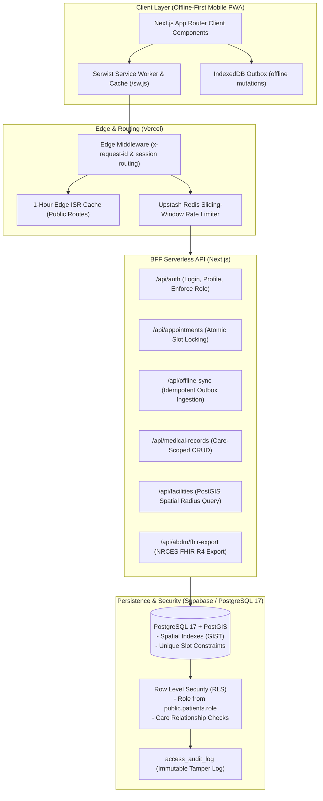

# Rural Healthcare Platform

[](https://github.com/Arnavshukla09/RURAL-HEALTHCARE-PLATFORM/actions/workflows/ci.yml)
[](LICENSE)
[](https://nextjs.org/)
[](https://www.postgresql.org/)

An offline-first, mobile Progressive Web Application (PWA) designed for rural and low-resource healthcare in India. Built with a serverless Backend-For-Frontend (BFF) architecture, the platform enables appointment scheduling, doctor consultations via WebRTC, pan-India geospatial health facility lookups, emergency visual first-aid triage, and ABDM/HL7 FHIR R4 clinical document export.

**Author & Lead Engineer:** Arnav Shukla ([@Arnavshukla09](https://github.com/Arnavshukla09))  
**Repository:** [github.com/Arnavshukla09/RURAL-HEALTHCARE-PLATFORM](https://github.com/Arnavshukla09/RURAL-HEALTHCARE-PLATFORM)  
**Security Inquiries & Disclosures:** [public/.well-known/security.txt](public/.well-known/security.txt)  

---

## 1. System Architecture



---

## 2. Core Capabilities

* **Strict Role-Based Access Control:** All authorization is derived solely from `public.patients.role`. Client-writable `user_metadata` is completely ignored across database triggers, RLS policies, and APIs (`SEC-2026-10-17-ROLE-TRUST`).
* **Care-Relationship Scoped Clinical Records:** Clinicians access records strictly for patients with active scheduled or completed appointments via `public.has_care_relationship()`. Administrators have zero direct `SELECT` or `UPDATE` access to clinical records.
* **Audited Right-to-Erasure:** Dedicated RPC `public.admin_erase_medical_record(record_id, reason)` allows verified admins to erase records with a mandatory reason, atomically appending audit records to `access_audit_log`.
* **Zero Double-Booking Guarantee:** Unique partial index `uq_provider_slot_scheduled` prevents concurrent appointment double-booking, mapping collisions to HTTP 409 Conflict.
* **Resilient Offline Outbox:** Offline appointments, health data logs, and profile edits are queued in IndexedDB with exponential backoff retry and server-side idempotency verification.
* **Geospatial Directory:** PostGIS radius queries locate verified PM-JAY hospitals, Community Health Centres (CHCs), and Primary Health Centres (PHCs).
* **ABDM HL7 FHIR R4 Conformance:** Generates standardized NRCES Document Bundles with LOINC and UCUM coded clinical payloads.

---

## 3. Honest Status & System Limitations

| Dimension | Current Status | Operating Limitations |
| :--- | :--- | :--- |
| **Content Security Policy** | Report-Only | `Content-Security-Policy-Report-Only` is active in `next.config.mjs` to monitor Jitsi WebRTC, OpenStreetMap tiles, and Google Translate assets without breaking connectivity. |
| **ABDM Integration** | Deterministic Local Engine | Fully validated against NRCES schema; defaults to local simulation mode when NHA sandbox credentials (`ABDM_CLIENT_ID`) are unconfigured. |
| **Free-Tier Boundaries** | 100% Free Tier ($0/mo) | Designed within Vercel Hobby, Supabase Free (500 MB DB / 200 conns), and Upstash Redis Free quotas. |
| **PostGIS Advisor Items** | Documented Invariant | System tables (`spatial_ref_sys`) and extension locations are preserved in `public` schema to avoid corrupting PostGIS geometry indexes. |

For detailed operational limitations, refer to [`docs/LIMITATIONS.md`](docs/LIMITATIONS.md).

---

## 4. Quick Start

### Prerequisites
* Node.js 22.x
* Supabase CLI (`npm install -g supabase` or local npx)
* Git

### Local Setup
```bash
# 1. Clone the repository
git clone https://github.com/Arnavshukla09/RURAL-HEALTHCARE-PLATFORM.git
cd RURAL-HEALTHCARE-PLATFORM

# 2. Install dependencies
npm ci

# 3. Configure environment variables
cp .env.example .env.local

# 4. Start local Supabase container (Docker required)
npx supabase start

# 5. Run database migrations and seed fixtures
npx supabase db reset

# 6. Start development server
npm run dev
```

Visit `http://localhost:3000` in your browser.

---

## 5. Security Model & Role Invariants

| Role | Permitted Actions | Prohibited Actions | Enforcement Mechanism |
| :--- | :--- | :--- | :--- |
| **Patient** | View/update own profile; view own appointments & records; book appointments. | Role elevation; accessing other patients' data; self-completing appointments. | Trigger `guard_patient_privileges()`; RLS `patients_read_own_records`. |
| **Doctor** | Access patient health data & records **only** where active care relationship exists. | Viewing records of unrelated patients; modifying system configurations. | Function `public.has_care_relationship()`; RLS `doctor_read_care_records`. |
| **Admin** | Manage users, view appointment metadata, manage health camps, execute audited erasures. | Direct `SELECT` or `UPDATE` on confidential clinical notes and records. | RLS policies reject admin SELECT on `medical_records`; RPC `admin_erase_medical_record`. |

---

## 6. Testing Strategy

The repository maintains zero-skip automated verification across all test tiers:

```bash
# Run unit & isolation tests (176 tests)
npm run test:unit

# Run live database integration & RLS contract tests (22 tests against local Supabase)
npm run test:integration

# Run pre-commit component validation & migration immutability gate
npm run check:components
npm run check:migrations

# Run Playwright end-to-end browser tests
npx playwright test
```

For complete test evidence, mutation proofs, and failure analysis, see [`docs/TESTING.md`](docs/TESTING.md).

---

## 7. Available Scripts

| Command | Description |
| :--- | :--- |
| `npm run dev` | Starts local Next.js development server at `localhost:3000`. |
| `npm run build` | Compiles production Next.js build with Serwist service worker. |
| `npm run lint` | Runs ESLint analysis across app and components. |
| `npm run test:unit` | Executes 176 unit tests via Vitest in ~1.3s. |
| `npm run test:integration` | Executes 22 live database contract tests via Vitest. |
| `npm run check:components` | Runs 6-stage automated pre-commit static and typecheck gate. |
| `npm run check:migrations` | Cryptographically validates baseline migrations against SHA-256 manifest. |
| `npm run report:dataset` | Outputs provenance statistics for facilities and provider datasets. |
| `npm run benchmark:integration` | Runs subsystem simulation benchmark across core modules. |

---

## 8. Documentation Index

The platform documentation is organized into focused, authoritative guides in [`docs/`](docs/):

* **[Architecture Guide](docs/ARCHITECTURE.md):** Complete system architecture, BFF design, and subsystem blueprints.
* **[Database Reference](docs/DATABASE.md):** Entity-relationship diagrams, schema catalog, and RLS policies.
* **[Testing & Mutation Proofs](docs/TESTING.md):** QA test matrix, integration contract proofs, and 7 behavioral mutation verifications.
* **[Security Notes & Policy](docs/SECURITY_NOTES.md):** Security audit changelog, attack mitigations, and accepted advisor items.
* **[Deployment Runbook](docs/DEPLOY.md):** Vercel environment setup, migration execution order, and post-deploy SQL checks.
* **[Credential Rotation Checklist](docs/CREDENTIAL_ROTATION_CHECKLIST.md):** Manual production key rotation and cleanup checklist.
* **[Dataset Provenance](docs/DATASETS.md):** Government registry sources, geospatial bounding boxes, and ETL pipelines.
* **[ABDM & FHIR Conformance](docs/ABDM_FHIR_INTEROPERABILITY.md):** HL7 FHIR R4 Document Bundle specifications.
* **[Clinical Safety Protocols](docs/CLINICAL_SAFETY.md):** Emergency triage decision tables and red-flag rules.
* **[System Limitations](docs/LIMITATIONS.md):** Documented architectural and operational boundaries.
* **[Changelog](docs/CHANGELOG.md):** Semantic version release history ([Archive](docs/history/CHANGELOG_ARCHIVE.md)).

---

## 9. License

This project is open-source software licensed under the [MIT License](LICENSE).  
Copyright (c) 2026 Arnav Shukla.
