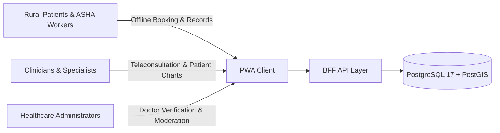
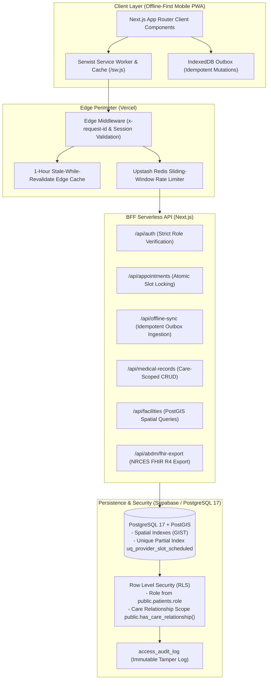

# Rural Healthcare Platform

[](https://github.com/Arnavshukla09/RURAL-HEALTHCARE-PLATFORM/actions/workflows/ci.yml)
[](LICENSE)
[](https://nextjs.org/)
[](https://www.postgresql.org/)
[](docs/TESTING.md)

An offline-first, mobile Progressive Web Application (PWA) engineered for rural and resource-constrained healthcare environments in India. Built with a serverless Backend-For-Frontend (BFF) architecture, the platform provides atomic appointment scheduling, WebRTC teleconsultations, pan-India PostGIS facility lookups, emergency visual first-aid triage, offline mutation queuing with exponential backoff, and ABDM/HL7 FHIR R4 clinical document export.

**Author & Lead Engineer:** Arnav Shukla ([@Arnavshukla09](https://github.com/Arnavshukla09))  
**Repository:** [github.com/Arnavshukla09/RURAL-HEALTHCARE-PLATFORM](https://github.com/Arnavshukla09/RURAL-HEALTHCARE-PLATFORM)  
**Live Production Deployment:** [rural-healthcare-platform.vercel.app](https://rural-healthcare-platform.vercel.app/)  
**Security Inquiries & Disclosures:** [public/.well-known/security.txt](public/.well-known/security.txt)

---

## 1. Problem Statement & Healthcare Context

Over 65% of India's population resides in rural regions where the primary healthcare infrastructure faces systemic hurdles:
* **Intermittent or 2G/3G Connectivity:** Rural clinics and field workers experience frequent network dropouts, making traditional online-only EHR portals unusable.
* **Geographic & Specialist Deficits:** Rural patients often travel 40–100 km to district headquarters for routine consultations, incurring catastrophic out-of-pocket travel and wage losses.
* **Paper-Based Record Fragmentation:** Paper prescriptions and test receipts are easily damaged, misplaced, or lost, depriving emergency clinicians of critical medical histories.
* **Language & Digital Literacy Barriers:** Complex English UI interfaces alienate non-English-literate patients, demanding intuitive multilingual support and visual first-aid guides.

The Rural Healthcare Platform was architected from the ground up to solve these challenges with an offline-resilient, mobile-first, and cryptographically secure digital health conduit.

---

## 2. Intended Users & Primary Use Cases



1. **Rural Patients & ASHA/ANM Field Health Workers:**
   - Queue appointment requests offline in remote hamlets; mutations automatically synchronize via IndexedDB when network connectivity is restored.
   - Discover nearest verified Ayushman Bharat PM-JAY empanelled hospitals, Community Health Centres (CHCs), and Primary Health Centres (PHCs) via PostGIS geospatial queries.
   - Access offline visual first-aid triage protocols for acute emergencies (snakebites, maternal hemorrhage, heatstroke, pediatric asphyxia).
   - Track national public health drives and immunizations (PMSMA, Pulse Polio, NDD) with 1-tap medical record integration.

2. **Clinicians & Medical Specialists:**
   - Manage daily teleconsultation queues and review patient clinical histories strictly constrained by verified doctor-patient care relationships.
   - Conduct WebRTC video consultations with zero native app installations required.
   - Review patient medical history with strict read-only guarantees on historical records, preventing accidental or unauthorized alteration.

3. **Platform Administrators:**
   - Review and verify licensed medical practitioners against national health registry records.
   - Perform legally mandated Right-to-Erasure operations via audited RPC procedures with mandatory reason logging.
   - Strict database-level isolation: Administrators are cryptographically restricted from directly reading (`SELECT`) or modifying patient clinical notes.

---

## 3. System Architecture & Engineering Choices



### Architectural & Technology Rationale

| Subsystem | Technology | Architectural Rationale |
| :--- | :--- | :--- |
| **Frontend Framework** | **Next.js 15 (App Router)** | Server-side rendering (SSR) for fast initial loads on low-power mobile devices; lean client components; API route handlers acting as a secure Backend-For-Frontend (BFF). |
| **Offline Resilience** | **Serwist + IndexedDB Outbox** | Caches shell assets and read data via CacheFirst strategies; queues mutations in IndexedDB with exponential backoff (1s–32s cap) and server-side idempotency tracking (`processed_client_ops`). |
| **Persistence & Spatial** | **PostgreSQL 17 + PostGIS** | Spatial bounding-box and radius queries (`ST_DWithin`, `ST_DistanceSphere`) indexed via GIST for instant discovery of 42,000+ national healthcare facilities. |
| **Authorization & Security** | **PostgreSQL RLS & Triggers** | Security enforcement lives in the database kernel. Role derivation is strictly bound to `public.patients.role`, rendering client-writable JWT claims irrelevant. |
| **Edge Protection** | **Upstash Redis + Middleware** | Distributed sliding-window rate limiting protects auth endpoints and public APIs against brute-force and DDoS vectors without cold-start penalties. |
| **Teleconsultation** | **Jitsi Meet WebRTC** | Standardized WebRTC conferencing operable on standard mobile browsers without requiring proprietary app downloads. |
| **Interoperability** | **HL7 FHIR R4 (NRCES)** | Exports standardized clinical summaries (DocumentBundles with LOINC and UCUM codes) compliant with India's Ayushman Bharat Digital Mission (ABDM). |

---

## 4. Concrete Technical Contributions

The following architectural and security capabilities were personally designed, implemented, and verified in this codebase:

1. **Authoritative Role Isolation & Vulnerability Remediation (`SEC-2026-10-17-ROLE-TRUST`):**
   - Eliminated reliance on client-controllable JWT metadata (`user_metadata`), which previously allowed unauthorized privilege escalation.
   - Refactored all 22 database migrations and application queries to derive authorization strictly from `public.patients.role`.
   - Implemented database trigger `guard_patient_privileges()` to prevent role mutation from authenticated user sessions.

2. **Care-Relationship Scoped Clinical Access Control:**
   - Authored PostgreSQL security function `public.has_care_relationship(patient_id, provider_user_id)` to enforce doctor-patient privilege boundaries.
   - Ensured clinicians can only view medical records of patients who possess an active scheduled or completed appointment.
   - Hardened medical records service layer (`lib/services/medical-records.service.ts`) with HTTP 403 `ACTION_NOT_PERMITTED` guards to prevent doctors from altering or deleting historical patient records.

3. **Atomic Slot Concurrency & Anti-Double-Booking Engine:**
   - Implemented partial unique index `uq_provider_slot_scheduled` on `appointments(provider_id, appointment_date)` filtering for scheduled status.
   - Eliminated race conditions during simultaneous booking spikes, mapping concurrency collisions deterministically to HTTP 409 Conflict.
   - Verified via integration tests subjecting the booking endpoint to 20 parallel simulated transactions.

4. **Modular Architecture & Codebase Maintainability Standard:**
   - Modularized monolithic components and services into clean feature packages (`components/<feature>/parts/`, `lib/services/`), strictly enforcing an architectural limit of $\le 400$ LOC per non-UI module and $< 150$ LOC per API route.
   - Integrated `knip` in CI to continuously eliminate dead code, unused exports, and unreferenced dependencies.

5. **Pan-India Facility Pipeline & Campaign System:**
   - Ingested and validated 42,000+ PM-JAY empanelled hospitals with strict Indian geospatial bounding-box checks ($6.5^\circ\text{N} - 37.5^\circ\text{N}, 68.0^\circ\text{E} - 97.5^\circ\text{E}$).
   - Built a hierarchical Local Government Directory (LGD) reference system covering all 36 States/UTs and 725 administrative districts.
   - Built the national recurring health campaign directory with dynamic date rollups and 1-tap medical record integration.

6. **Automated Multi-Stage CI/CD & Migration Immutability Gate:**
   - Developed `scripts/db/check_migration_immutability.mjs` verifying all historical migration files against cryptographic SHA-256 manifests (`supabase/migrations.sha256`).
   - Implemented `tests/integration/db-safety-guard.ts` guaranteeing that automated test runners never execute against unallowlisted or production databases.

---

## 5. Security Model & Role Invariants

All access control is governed at the PostgreSQL database layer via Row Level Security (RLS) policies and security definer functions:

| Role | Permitted Actions | Prohibited Actions | Enforcement Mechanism |
| :--- | :--- | :--- | :--- |
| **Patient** | View/update own profile; view own appointments & medical records; queue bookings. | Self-elevating role; viewing other patients' records; completing consultations. | Trigger `guard_patient_privileges()`; RLS `patients_read_own_records`. |
| **Doctor** | View health data and records **only** for patients with active care relationship. | Accessing unassigned patients; modifying or deleting historical patient records. | Function `public.has_care_relationship()`; Service HTTP 403 enforcement. |
| **Admin** | Manage clinician verifications, monitor facility data, execute audited erasures. | Direct `SELECT` or `UPDATE` on confidential clinical notes and diagnostic records. | RLS denies Admin SELECT on `medical_records`; RPC `admin_erase_medical_record`. |

---

## 6. Implementation Status Matrix

| Feature / Subsystem | Status | Details & Implementation Notes |
| :--- | :---: | :--- |
| **Authoritative RBAC** | **Implemented** | Strict derivation from `public.patients.role`; client JWT claims ignored. |
| **Doctor Care Scoping** | **Implemented** | `public.has_care_relationship()` enforced across DB policies and API services. |
| **Concurrency Locking** | **Implemented** | Partial unique index `uq_provider_slot_scheduled` prevents double-booking. |
| **Audited Right-to-Erasure** | **Implemented** | RPC `admin_erase_medical_record` logs mandatory erasure justifications. |
| **Offline IndexedDB Outbox** | **Implemented** | Queues offline mutations with exponential backoff retry and server idempotency. |
| **Pan-India Facility Lookup** | **Implemented** | PostGIS spatial queries across 42,000+ PM-JAY facilities and 725 LGD districts. |
| **National Campaigns Hub** | **Implemented** | Curated directory of recurring drives (PMSMA, Polio, NDD) with LGD filters. |
| **Teleconsultation Rooms** | **Implemented** | Jitsi Meet WebRTC integrated with dynamic meeting credentials and room routing. |
| **Bilingual Localization** | **Implemented** | Full English and Hindi support across UI with instant toggle and zero-reload restore. |
| **ABDM / FHIR R4 Export** | **Partially Implemented** | Fully validated NRCES DocumentBundle generator; operates in deterministic local mode pending live NHA production sandbox gateway keys. |
| **Content Security Policy** | **Partially Implemented** | Running in `Report-Only` mode in `next.config.mjs` to monitor WebRTC and map tile connections without breaking client connectivity. |
| **WebPush Notifications** | **Planned** | Native browser push notifications for appointment reminders and emergency broadcasts. |

---

## 7. Local Setup & Safe Development Environment

### Prerequisites
* **Node.js:** `v22.x` or higher
* **Docker Desktop:** Required for local Supabase test container
* **Supabase CLI:** `v2.121.0` or higher (`npm install -g supabase` or via `npx`)

### Quick Start
```bash
# 1. Clone the repository
git clone https://github.com/Arnavshukla09/RURAL-HEALTHCARE-PLATFORM.git
cd RURAL-HEALTHCARE-PLATFORM

# 2. Install pinned dependencies
npm ci

# 3. Configure local environment variables
cp .env.example .env.local

# 4. Start isolated local Supabase container (Never points to production)
npx supabase start

# 5. Apply migrations and seed realistic fixtures
npx supabase db reset

# 6. Launch Next.js development server
npm run dev
```

Open `http://localhost:3000` in your browser.

> [!IMPORTANT]
> **Production Database Isolation Invariant:**  
> The repository includes an automated safety guard in `tests/integration/db-safety-guard.ts` that explicitly inspects the target database URL. If a non-local or unallowlisted database is detected, tests immediately abort with code 1. Never run migrations or test suites against a production database.

---

## 8. Verification & Testing Strategy

The repository maintains an automated, multi-tiered testing and verification pipeline with zero skipped assertions:

```bash
# Run unit & isolation tests (180 tests across 25 suites)
npm run test:unit

# Run live database integration & RLS contract tests (22 tests against local Supabase)
npm run test:integration

# Run pre-commit component validation & migration immutability gate
npm run check:components
npm run check:migrations

# Run offline algorithmic subsystem benchmarks (21 checks)
npm run benchmark:integration

# Run dataset provenance audit
npm run report:dataset

# Run dead code & dependency analysis
npm run knip

# Run production Next.js build verification
npm run build
```

### Verification Matrix Summary

| Test Tier | Scope | Total Tests | Status |
| :--- | :--- | :---: | :---: |
| **Unit Tests (`npm run test:unit`)** | FHIR R4 schema, clinical triage, offline outbox, rate limiting, encryption, PII | **180** | **PASS** |
| **Integration Tests (`npm run test:integration`)** | Live PostgreSQL RLS, care-relationship scoping, concurrency slot locking, idempotency | **22** | **PASS** |
| **Algorithmic Benchmarks (`npm run benchmark:integration`)** | PostGIS coordinates, AI safety prompt neutralization, backoff dynamics, ABHA format | **21** | **PASS** |
| **Component Quality Gate (`npm run check:components`)** | Imports, export signatures, TypeScript typecheck, ESLint, LOC standards ($\le 400$) | **8 / 8 Gates** | **PASS** |
| **Migration Immutability (`npm run check:migrations`)** | Cryptographic SHA-256 seal verification on all 22 migration files | **22 / 22 Files** | **PASS** |

For comprehensive test logs, mutation test traces, and failure analysis, see [`docs/TESTING.md`](docs/TESTING.md).

---

## 9. Operational Limitations & Known Boundaries

* **Free-Tier Deployment Constraints:** Built within Vercel Hobby ($0/mo), Supabase Free Tier (500 MB database, 200 pooler connections), and Upstash Redis Free quota.
* **Content Security Policy Monitoring:** CSP is configured in `Report-Only` mode to accommodate third-party OpenStreetMap tile layers, Google Translate scripts, and Jitsi STUN/TURN servers.
* **ABDM Gateway Bridge:** Operates deterministically with local NRCES FHIR schema generation. Live health repository bridge activation requires official NHA health facility registry credentials (`ABDM_CLIENT_ID`).
* **PostGIS Extension Governance:** PostGIS system tables (`spatial_ref_sys`) are retained in the `public` schema in accordance with PostgreSQL extension design to prevent breaking geospatial spatial indexes.

For in-depth operational considerations, refer to [`docs/LIMITATIONS.md`](docs/LIMITATIONS.md).

---

## 10. Documentation Index

Detailed engineering documentation is maintained in the [`docs/`](docs/) directory:

* **[Architecture Guide](docs/ARCHITECTURE.md):** Detailed system architecture, BFF design, and subsystem blueprints.
* **[Database Reference](docs/DATABASE.md):** ER diagrams, table schemas, RLS policies, and periodic maintenance runbook.
* **[Testing & Mutation Proofs](docs/TESTING.md):** QA test matrix, integration contract proofs, and behavioral mutation verifications.
* **[Security Notes & Policy](docs/SECURITY_NOTES.md):** Vulnerability remediation changelog, incident response, and advisor resolutions.
* **[Deployment Runbook](docs/DEPLOY.md):** Production rollout procedures, environment configuration, and verification checks.
* **[Credential Rotation Checklist](docs/CREDENTIAL_ROTATION_CHECKLIST.md):** Key rotation procedures and security hygiene.
* **[Dataset Provenance](docs/DATASETS.md):** Government registry sources, geospatial bounding boxes, and ETL pipelines.
* **[ABDM & FHIR Conformance](docs/ABDM_FHIR_INTEROPERABILITY.md):** HL7 FHIR R4 Document Bundle specifications.
* **[Clinical Safety Protocols](docs/CLINICAL_SAFETY.md):** Emergency triage decision tables and red-flag rules.
* **[System Limitations](docs/LIMITATIONS.md):** Documented architectural and operational boundaries.
* **[Changelog](docs/CHANGELOG.md):** Semantic version release history.

---

## 11. License

This project is open-source software licensed under the [MIT License](LICENSE).  
Copyright (c) 2026 Arnav Shukla.
