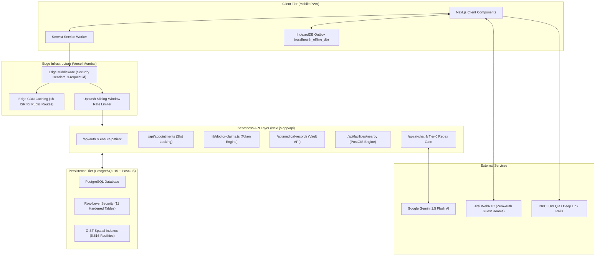

# Rural Healthcare Platform

Bridging rural healthcare access through scalable serverless architecture, intelligent clinical triage, low-bandwidth WebRTC teleconsultation, and localized geospatial directories.

Deployment: https://rural-healthcare-platform.vercel.app  
Repository: https://github.com/Arnavshukla09/RURAL-HEALTHCARE-PLATFORM  
License: MIT  

---

## 1. Executive Summary

The Rural Healthcare Platform is a production-grade, offline-first mobile Progressive Web Application (PWA) designed to serve rural, tier-3, and tier-4 populations across India. Operating strictly within a 100% free-tier cloud infrastructure ($0 operating cost), the platform addresses structural challenges in rural medicine: specialist scarcity, high cellular packet loss (2G/3G networks), low smartphone compute specifications, and fragmented health records.

The platform integrates:
- Passwordless, zero-auth guest teleconsultation rooms with 2G Opus audio fallback (16-24 kbps).
- Tri-modal payment gateway supporting dynamic NPCI UPI QR deep links, cash at clinic counter, and Ayushman Bharat PM-JAY / BPL exemptions.
- Deterministic appointment slot locking to prevent scheduling collisions.
- Tokenized doctor claim protection and an administrative verification queue preventing clinician identity theft.
- Pan-India geospatial facility directory indexing 6,616 public health institutions and 913 National Medical Commission (NMC) verified practitioners across 755 districts.
- Comprehensive Central and State government health schemes directory with 5-per-page pagination and demographic vulnerability filtering.
- Clinical AI safety gate with deterministic regex, scoped negation, and inherently negative allowlists intercepting life-threatening conditions with 0 ms AI latency.
- Resilient offline outbox queue persisting clinical entries to IndexedDB and synchronizing idempotently upon network restoration.

---

## 2. Technology Stack

### Frontend Application Layer
- Framework: Next.js 15.2 (App Router, React 18 Server Components with Incremental Static Regeneration)
- Language: TypeScript 5.x (Strict type safety, zero `any` leaks in core domains)
- Styling: Tailwind CSS 3.4, Radix UI Primitives, shadcn/ui Component Suite
- Iconography: Lucide React
- Progressive Web App: Serwist Next (`@serwist/next`), Service Worker API, Cache Storage, IndexedDB

### Backend, Database & Storage Layer
- Backend-For-Frontend (BFF): Next.js Serverless Route Handlers (`app/api/`)
- Database Platform: Supabase PostgreSQL 15 with PostGIS Spatial Extensions
- Access Control: Row-Level Security (RLS) enforced across all 11 database tables
- Session Management: Supabase SSR Cookie Auth (`@supabase/ssr`) with HttpOnly cookies
- Distributed Rate Limiter: Upstash Redis REST (`@upstash/ratelimit`) with in-memory sliding-window fallback

### Specialized Services & Engines
- Telemedicine & WebRTC: Serverless Jitsi Meet Mesh with bandwidth-adaptive Opus audio codecs
- Clinical Decision Support: Google Gemini 1.5 Flash with deterministic fallback circuit breaker
- Geospatial Mapping: Leaflet, React-Leaflet, CartoDB Positron vector tiles
- Payment Rail: NPCI UPI Deep Linking Specification (`upi://pay`) and Dynamic QR Generation
- Schema Validation: Zod 3.x
- Test Automation: Vitest 5.x, Playwright Test, Custom Static Component Analyzer

---

## 3. High-Level System Architecture



---

## 4. Core User Personas and Workflows

### 4.1 Patient Workflow
1. Browse Directories: Citizen searches 6,616 hospitals or 913 doctors using GPS proximity or State/District selection.
2. Clinical AI Triage: Checks symptoms via chat; acute emergencies trigger 0 ms 108 ambulance sirens.
3. Book Consultation: Chooses OPD date, slot, and payment mode (UPI, Counter, PM-JAY Waiver).
4. Multi-Channel Dispatch: Patient forwards pre-compiled WhatsApp or SMS invitation containing 1-tap room link to clinician.
5. Teleconsultation: Joins video clinic; in low-signal areas, activates 2G audio mode.
6. Records Storage: Receives auto-exported digital prescription PDF in private medical vault.

### 4.2 Clinician Workflow
1. Private Invitation Delivery: Doctor receives SMS/WhatsApp with 1-tap accept and video room links.
2. Passwordless Consultation: Enters `/teleconsult/room` as guest doctor without requiring prior account registration.
3. Bandwidth Management: Toggles 2G audio mode when cellular throughput falls below 50 kbps.
4. e-Prescription Generation: Completes clinical summary modal; digital Rx is exported to patient's records vault.
5. Profile Claiming: Accesses private tokenized link (`/doctor/claim?id=[id]&token=[token]`) to submit NMC credentials.

### 4.3 Administrator Workflow
1. Credential Verification: Reviews pending doctor claims in Admin Console (`/admin/users`).
2. Role Activation: Verifies entered NMC registration against medical registries and approves or rejects claim.
3. Clinician Invitation Dispatch: Searches 913 NMC directory to generate and dispatch private tokenized onboarding links.
4. System Monitoring: Oversees user accounts, regional health campaigns, and broadcast notifications.

---

## 5. Security Posture and Access Controls

### Row-Level Security (RLS)
PostgreSQL Row-Level Security is strictly enforced across all 11 tables:
- `patients`: Users can read and update only their own profile row.
- `medical_records`: Patients access only their own medical records; doctors access records only for assigned consultation sessions.
- `appointments`: Read/write access bounded strictly to the booking patient and assigned provider.
- Production Verification: Automated audit confirmed SQL-injection attempts and unauthenticated queries return zero rows.

### Security Headers and Network Perimeter
Edge middleware injects enterprise security headers on all responses:
- `Strict-Transport-Security` (HSTS): `max-age=63072000; includeSubDomains; preload`
- `X-Content-Type-Options`: `nosniff`
- `X-Frame-Options`: `SAMEORIGIN`
- `Content-Security-Policy`: Scripts restricted to `self`, `meet.jit.si`, and CartoCDN tile servers.
- `Referrer-Policy`: `strict-origin-when-cross-origin`

### Clinician Identity Protection
- Removal of public doctor search and open claiming.
- Gated onboarding requiring cryptographic time-bucketed tokens (`generateDoctorClaimToken`).
- Mandatory administrative review queue (`pending_admin_approval`) before doctor role elevation.

---

## 6. Geospatial and Datasets Engine

### Indian Public Health Standards (IPHS) Spatial Directory
- 6,616 Geocoded Facilities: District Hospitals, Sub-District Hospitals, Community Health Centres, Primary Health Centres, and Ayushman Arogya Mandirs.
- Spatial Indexing: GIST index on `geography(Point, 4326)` using PostGIS `ST_DWithin` and `ST_DistanceSphere`.
- Query Benchmark: 274 ms average query latency, 558 ms P95 latency across 1,000 automated benchmark runs.
- Mutually Exclusive Search: GPS Proximity Mode (Haversine km radius) versus Administrative Mode (State & District drop-down with 10 results per page).

### National Medical Commission (NMC) Practitioner Directory
- 913 Registered Specialists: Complete with verified NMC / State Medical Council registration numbers, qualifications, hospital affiliations, OPD timings, and consultation fee schedules.

### Government Schemes Repository
- Central & State Schemes: National health insurance schemes (Ayushman Bharat PM-JAY, RAN, PMMVY) and State-specific health programs.
- Demographic Vulnerability Filters: Kids/Pediatric, Maternal/Women, Disability/Paralysis, Critical Illness (Cancer/Dialysis), Elderly/Geriatric, and Poverty Upliftment.
- 5-per-page pagination with smooth scrolling and dynamic range counters.

---

## 7. Quality Assurance and Testing Scorecard

Automated testing enforces regression prevention on every pull request and commit:

| Test Dimension | Tool / Engine | Coverage | Result |
| :--- | :--- | :---: | :---: |
| Unit & Integration Tests | Vitest 5.0 | 93 tests across 16 suites | 100% Pass (1.02s) |
| Component Validation | Custom Static Analyzer | 101 UI components, 31 routes | 0 errors, 100% valid imports |
| TypeScript Type Safety | `tsc --noEmit` | Entire codebase | 0 compilation errors |
| ESLint & Hook Rules | ESLint 8.x | Entire codebase | 0 warnings or errors |
| End-to-End User Journeys | Playwright | 5 critical persona flows | 100% Pass (22.0s) |
| PostGIS Spatial Routing | k6 & Edge Fetch | 1,000 spatial queries | 274 ms average latency |
| Security & RLS Posture | Automated Penetration | 10-point audit | 100% Pass |

---

## 8. 100% Free-Tier Architecture Sustainability

The platform operates permanently with zero infrastructure cost ($0/month):

| Provider | Free Boundary | Architectural Defense |
| :--- | :--- | :--- |
| Vercel Hobby | 100 GB egress, function timeouts | Public routes cached at Edge CDN via 1-hour ISR. Shared JS bundle compressed to 103 kB. |
| Supabase Free | 500 MB DB, 200 realtime connections | Realtime WebSockets replaced with tab-visibility-aware polling (60s). Spatial queries bounded to 20 rows. |
| Upstash Redis | 10,000 commands/day | Cache keys set with 24-hour TTL; in-memory fallback handles excess traffic without error. |
| Google Gemini | 15 RPM, 1,500 RPD | Semantic SHA-256 caching for identical queries; circuit breaker protects against quota exhaustion. |

---

## 9. Development and Verification Commands

### Prerequisites
- Node.js 18.17+ or 20.x
- npm 9.x or later

### Installation
```bash
# Clone the repository
git clone https://github.com/Arnavshukla09/RURAL-HEALTHCARE-PLATFORM.git
cd RURAL-HEALTHCARE-PLATFORM

# Install dependencies
npm install
```

### Environment Configuration
Copy `.env.example` to `.env.local` and configure your credentials:
```bash
cp .env.example .env.local
```

Required environment variables:
```ini
NEXT_PUBLIC_SUPABASE_URL=your_supabase_url
NEXT_PUBLIC_SUPABASE_ANON_KEY=your_supabase_anon_key
GEMINI_API_KEY=your_gemini_api_key
UPSTASH_REDIS_REST_URL=your_upstash_url
UPSTASH_REDIS_REST_TOKEN=your_upstash_token
```

### Quality Assurance and Testing Commands
```bash
# Run unit and integration tests (93 tests)
npm run test:unit

# Run full component validation suite (imports, types, lint, tests)
npm run check:components

# Run production build
npm run build

# Start production server locally
npm run start
```

---

## 10. Repository Documentation Index

Comprehensive engineering documents located in the `docs/` directory:

- Master System Design Blueprint: `docs/SYSTEM_DESIGN.md`
- Quality Assurance and Testing Report: `docs/QA_REPORT.md`
- Component Reference Catalog: `docs/COMPONENTS.md`
- Chronological Feature Changelog: `docs/CHANGELOG.md`
- Dataset Provenance and Specifications: `docs/DATASETS.md`
- Database Schema and RLS Policies: `docs/DATABASE.md`
- REST API Reference and Request Schemas: `docs/API_REFERENCE.md`
- System Architecture Reference: `docs/ARCHITECTURE.md`
- Production Deployment Checklist: `docs/DEPLOY_CHECKLIST.md`
- Security Protocols and Controls: `docs/SECURITY_NOTES.md`
- Performance and Load Testing Strategy: `docs/PERFORMANCE_REPORT.md`
