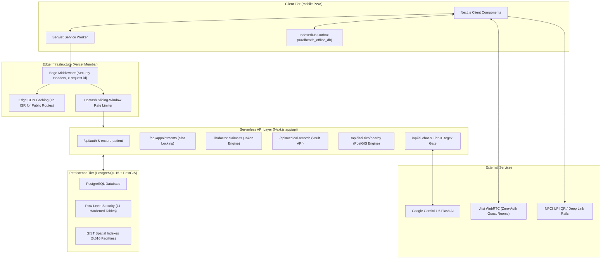
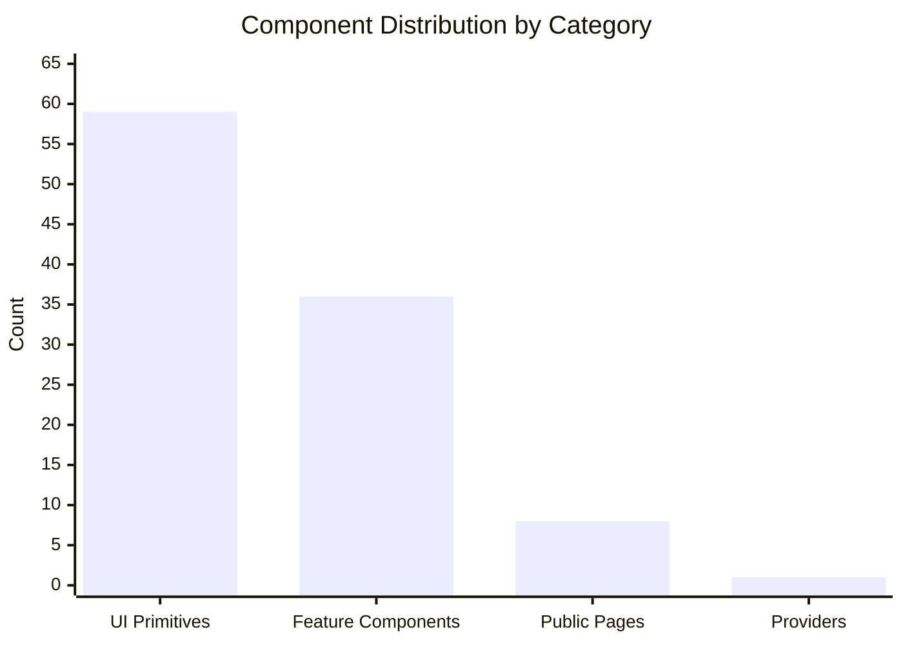
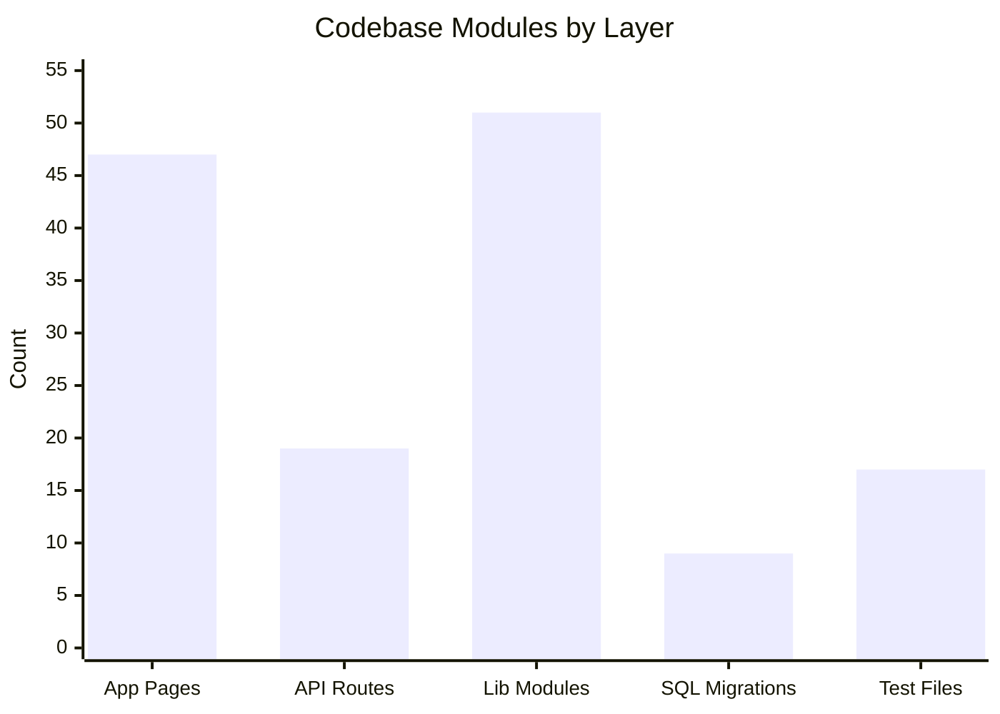
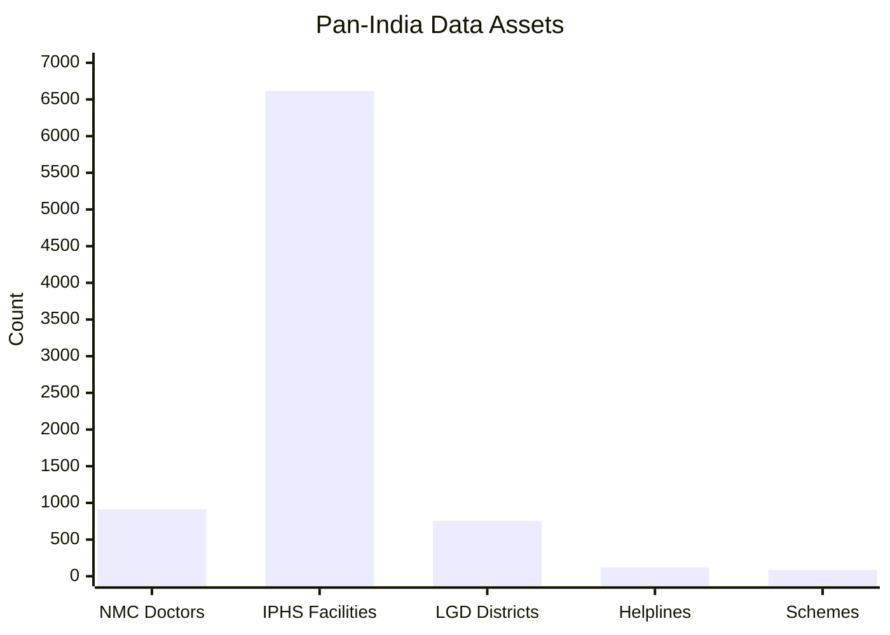
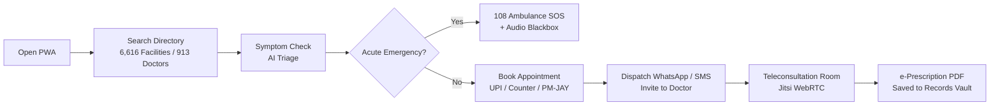
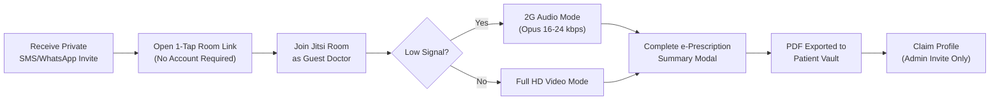
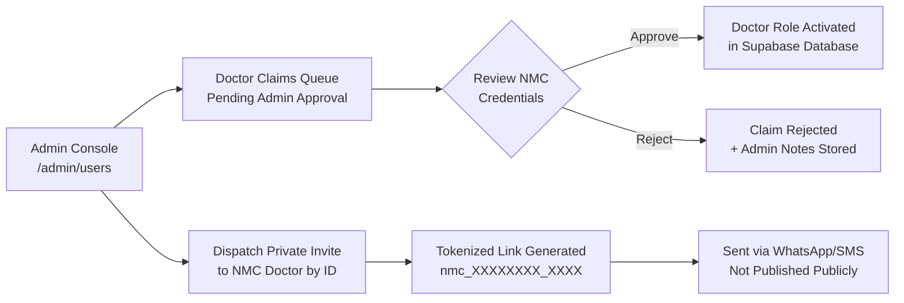
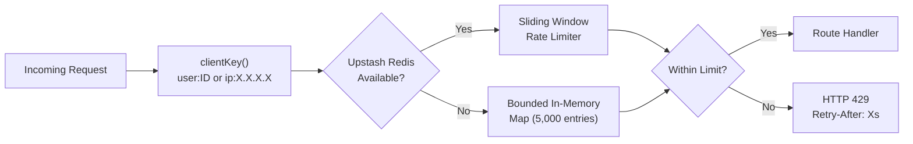
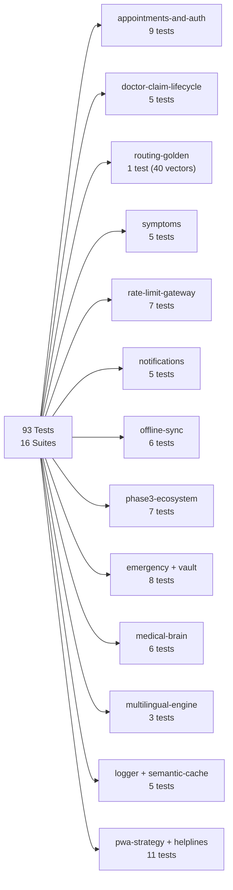

# Rural Healthcare Platform

Bridging rural healthcare access through scalable serverless architecture, intelligent clinical triage, low-bandwidth WebRTC teleconsultation, and localized geospatial directories.

Deployment: https://rural-healthcare-platform.vercel.app  
Repository: https://github.com/Arnavshukla09/RURAL-HEALTHCARE-PLATFORM  
License: MIT  

---

## 1. Executive Summary

The Rural Healthcare Platform is a production-grade, offline-first mobile Progressive Web Application (PWA) designed to serve rural, tier-3, and tier-4 populations across India. Operating strictly within a 100% free-tier cloud infrastructure ($0 operating cost), the platform addresses structural challenges in rural medicine: specialist scarcity, high cellular packet loss (2G/3G networks), low smartphone compute specifications, and fragmented health records.

The platform integrates:
- Passwordless, zero-auth guest teleconsultation rooms with 2G Opus audio fallback (16-24 kbps).
- Tri-modal payment gateway supporting dynamic NPCI UPI QR deep links, cash at clinic counter, and Ayushman Bharat PM-JAY / BPL exemptions.
- Deterministic appointment slot locking to prevent scheduling collisions.
- Tokenized doctor claim protection and an administrative verification queue preventing clinician identity theft.
- Pan-India geospatial facility directory indexing 6,616 public health institutions and 913 National Medical Commission (NMC) verified practitioners across 755 districts.
- Comprehensive Central and State government health schemes directory with 5-per-page pagination and demographic vulnerability filtering.
- Clinical AI safety gate with deterministic regex, scoped negation, and inherently negative allowlists intercepting life-threatening conditions with 0 ms AI latency.
- Resilient offline outbox queue persisting clinical entries to IndexedDB and synchronizing idempotently upon network restoration.

---

## 2. Technology Stack

### Frontend Application Layer
- Framework: Next.js 15.2 (App Router, React 18 Server Components with Incremental Static Regeneration)
- Language: TypeScript 5.x (Strict type safety, zero `any` leaks in core domains)
- Styling: Tailwind CSS 3.4, Radix UI Primitives, shadcn/ui Component Suite
- Iconography: Lucide React
- Progressive Web App: Serwist Next (`@serwist/next`), Service Worker API, Cache Storage, IndexedDB

### Backend, Database & Storage Layer
- Backend-For-Frontend (BFF): Next.js Serverless Route Handlers (`app/api/`)
- Database Platform: Supabase PostgreSQL 15 with PostGIS Spatial Extensions
- Access Control: Row-Level Security (RLS) enforced across all 11 database tables
- Session Management: Supabase SSR Cookie Auth (`@supabase/ssr`) with HttpOnly cookies
- Distributed Rate Limiter: Upstash Redis REST (`@upstash/ratelimit`) with in-memory sliding-window fallback

### Specialized Services & Engines
- Telemedicine & WebRTC: Serverless Jitsi Meet Mesh with bandwidth-adaptive Opus audio codecs
- Clinical Decision Support: Google Gemini 1.5 Flash with deterministic fallback circuit breaker
- Geospatial Mapping: Leaflet, React-Leaflet, CartoDB Positron vector tiles
- Payment Rail: NPCI UPI Deep Linking Specification (`upi://pay`) and Dynamic QR Generation
- Schema Validation: Zod 3.x
- Test Automation: Vitest 5.x, Playwright Test, Custom Static Component Analyzer

---

## 3. Repository File Structure

```
RURAL-HEALTHCARE-PLATFORM/
|
|-- app/                           # Next.js App Router pages and API routes
|   |-- admin/                     # Admin-role protected pages
|   |   |-- appointments/          # Admin appointment oversight
|   |   |-- campaigns/             # Health campaign management
|   |   |-- chat-review/           # AI chat log moderation
|   |   |-- dashboard/             # Admin control centre
|   |   |-- notifications/         # Broadcast notification dispatch
|   |   |-- records/               # Patient record oversight
|   |   `-- users/                 # User & doctor claim management
|   |-- api/                       # Serverless backend route handlers (19 endpoints)
|   |   |-- ai-chat/               # Gemini AI triage with Tier-0 regex gate
|   |   |-- appointments/          # Slot-locking CRUD with role matrix
|   |   |-- auth/                  # Login, profile, ensure-patient bootstrap
|   |   |-- cache-status/          # Semantic cache diagnostics
|   |   |-- chat-cache/            # SHA-256 query deduplication cache
|   |   |-- doctor-requests/       # Doctor appointment request flow
|   |   |-- facilities/            # PostGIS spatial search (nearby + district)
|   |   |-- health/                # Health ping + dependency check
|   |   |-- health-data/           # Patient vitals API
|   |   |-- medical-records/       # Medical vault CRUD (RLS-protected)
|   |   |-- notifications/         # Tab-visibility polling notifications API
|   |   |-- offline-sync/          # IndexedDB outbox conflict resolution
|   |   |-- providers/             # 913-doctor NMC directory API
|   |   |-- ready/                 # Readiness probe for deployment checks
|   |   |-- symptom-analyze/       # Structured symptom triage engine
|   |   `-- teleconsult/room/      # Jitsi JWT token + room provisioning
|   |-- appointments/              # Patient appointment booking UI
|   |-- auth/callback/             # OAuth callback handler
|   |-- camps/                     # Medical camp discovery
|   |-- consultation/              # Teleconsultation portal
|   |-- dashboard/                 # Patient home dashboard
|   |-- directory/                 # Doctor & hospital directory
|   |-- doctor/                    # Doctor-role protected pages
|   |   |-- claim/                 # Tokenized profile claiming (invite-only)
|   |   |-- dashboard/             # Doctor home dashboard
|   |   |-- patients/              # Active patient list for doctor
|   |   `-- requests/              # Appointment request queue
|   |-- emergency/                 # Emergency triage with 108 integration
|   |-- health-info/               # Health education hub + schemes
|   |-- locations/                 # 6,616-facility geospatial map
|   |-- login/                     # Authentication entry point
|   |-- offline/                   # Offline fallback page
|   |-- records/                   # Patient medical vault
|   |-- symptom-checker/           # AI-powered symptom triage
|   |-- teleconsult/               # Video consultation room + confirmation
|   |-- globals.css                # Global Tailwind CSS
|   |-- layout.tsx                 # Root layout with AppProvider
|   |-- loading.tsx                # Suspense loading skeleton
|   |-- not-found.tsx              # 404 page
|   |-- page.tsx                   # Root entrypoint + role-based router
|   |-- error.tsx                  # Global error boundary
|   `-- sw.ts                      # Serwist service worker source
|
|-- components/                    # 103 React components
|   |-- ui/                        # 59 shadcn/Radix UI primitives
|   |   |-- accordion.tsx, alert.tsx, badge.tsx, button.tsx ...
|   |   `-- (55 more primitives)
|   |-- public-pages/              # 8 SSR-compatible client wrappers
|   |   |-- CampsClient.tsx, DirectoryClient.tsx, EmergencyClient.tsx
|   |   |-- HealthInfoClient.tsx, HomeClient.tsx, LocationsClient.tsx
|   |   |-- SchemesClient.tsx, SymptomCheckerClient.tsx
|   |-- providers/
|   |   `-- AppProvider.tsx        # Global context: user, role, language
|   |-- AccessibilityBar.tsx       # Font-size, contrast, language controls
|   |-- AdminAppointments.tsx      # Admin appointment oversight panel
|   |-- AdminCampaignManager.tsx   # Health campaign CRUD
|   |-- AdminDashboard.tsx         # Admin statistics overview
|   |-- AdminNotifications.tsx     # Broadcast notification interface
|   |-- AdminRecords.tsx           # Patient record admin view
|   |-- AdminUserManagement.tsx    # User management + doctor claim approvals
|   |-- AppointmentManager.tsx     # Patient appointment booking flow
|   |-- Authentication.tsx         # Supabase Auth UI wrapper
|   |-- BottomTabBar.tsx           # Mobile PWA navigation bar
|   |-- CampLocations.tsx          # Medical camp discovery + registration
|   |-- ConsultationPortal.tsx     # Teleconsult booking + WhatsApp dispatch
|   |-- Dashboard.tsx              # Patient role dashboard
|   |-- Directory.tsx              # Doctor & hospital directory with filters
|   |-- DoctorAppointmentRequests.tsx # Doctor request queue
|   |-- DoctorDashboard.tsx        # Doctor role dashboard
|   |-- DoctorPatients.tsx         # Doctor's patient list view
|   |-- EmergencyModule.tsx        # Emergency triage, first-aid, 108 SOS
|   |-- FloatingChat.tsx           # AI chat widget (server component)
|   |-- FloatingChatClient.tsx     # AI chat widget (client interactive layer)
|   |-- Footer.tsx                 # Site footer
|   |-- GovernmentSchemes.tsx      # Govt schemes with pagination + filters
|   |-- Header.tsx                 # Navigation + auth state header
|   |-- HealthInfoHub.tsx          # Health education content hub
|   |-- HelplineDirectory.tsx      # National + State helpline directory
|   |-- ImageWithFallback.tsx      # Next/Image with graceful fallback
|   |-- JitsiMeeting.tsx           # WebRTC Jitsi room embed
|   |-- LandingPage.tsx            # Marketing / hero landing page
|   |-- LanguageSuggestionBanner.tsx # Browser language detection banner
|   |-- MapView.tsx                # Leaflet facility map
|   |-- NotificationBell.tsx       # Polling-based notification bell
|   |-- OfflineSyncBadge.tsx       # IndexedDB outbox pending indicator
|   |-- PatientRecords.tsx         # Medical vault + prescription storage
|   |-- PwaUpdaterAndInstaller.tsx # Service worker update prompt
|   |-- SymptomChecker.tsx         # Multi-step symptom triage UI
|   `-- TranslationRouteObserver.tsx # Language detection on route change
|
|-- lib/                           # 51 utility and data modules
|   |-- abdm/fhir.ts               # HL7 FHIR R4 bundle generator (ABDM)
|   |-- ai/                        # AI subsystem
|   |   |-- gateway.ts             # Multi-model AI gateway + circuit breaker
|   |   |-- gemini.ts              # Gemini Flash direct client
|   |   |-- medical-brain.ts       # Clinical intent classification
|   |   |-- query-learner.ts       # Query pattern learning
|   |   |-- semantic-matcher.ts    # SHA-256 semantic cache lookup
|   |   `-- speech.ts              # Web Speech API integration
|   |-- auth/guard.ts              # Server-side role guard utility
|   |-- cache/response-cache.ts    # Upstash + memory response cache
|   |-- chat/                      # Chat routing subsystem
|   |   |-- emergency.ts           # Emergency intent interceptor
|   |   |-- normalize.ts           # Input normalization
|   |   |-- router.ts              # Tier-0/1/2/3 routing engine
|   |   |-- suggestions.ts         # Suggested reply generation
|   |   `-- types.ts               # Shared chat type definitions
|   |-- clinical/imci-anc.ts       # IMCI & ANC clinical triage rules
|   |-- data/
|   |   `-- real-doctors.ts        # 913 NMC-verified practitioners (827KB)
|   |-- doctor-claims.ts           # Tokenized doctor invite + admin approval
|   |-- emergency/                 # Emergency subsystem
|   |   |-- audio-blackbox.ts      # Audio recording vault for SOS
|   |   |-- hardware.ts            # Device vibration + torch SOS signalling
|   |   |-- helplines.ts           # National + State helpline data
|   |   `-- vault.ts               # Emergency information vault
|   |-- geo/                       # Geospatial subsystem
|   |   |-- lgd-iphs.ts            # LGD district code mapping
|   |   `-- pan-india-lgd.json     # 755-district LGD reference data
|   |-- hooks/
|   |   |-- useOffline.ts          # Network status hook
|   |   `-- useOfflineData.ts      # Cached data hook for offline mode
|   |-- i18n/                      # Internationalization
|   |   |-- detect-language.ts     # Browser locale detection
|   |   |-- google-translate.ts    # Google Translate API integration
|   |   `-- translations.ts        # EN/HI static translation strings
|   |-- jitsi/
|   |   |-- config.ts              # Jitsi room configuration
|   |   `-- jwt.ts                 # HS256/RS256 JWT token generator
|   |-- loadtest.ts                # Staging load-test mode gate
|   |-- logger.ts                  # Structured JSON logger
|   |-- notifications/
|   |   `-- notification-engine.ts # Multi-role notification dispatcher
|   |-- offline/                   # Offline-first subsystem
|   |   |-- cache-cleaner.ts       # IndexedDB TTL eviction
|   |   |-- offline-ai.ts          # Offline AI fallback
|   |   |-- outbox.ts              # IndexedDB mutation outbox
|   |   |-- storage.ts             # Offline storage layer
|   |   `-- sync.ts                # Background sync engine
|   |-- pagination.ts              # Cursor-based pagination engine
|   |-- rate-limit.ts              # Sliding-window rate limiter
|   |-- schemes/health-schemes.ts  # Government health schemes data (143KB)
|   |-- speech/bhashini.ts         # Bhashini ULCA speech API
|   |-- supabase/                  # Supabase client factory
|   |   |-- admin.ts               # Service-role admin client (server only)
|   |   |-- client.ts              # Browser anon client singleton
|   |   |-- middleware.ts          # SSR middleware session refresher
|   |   `-- server.ts              # Server-side cookie client
|   |-- symptoms/                  # Symptom triage subsystem
|   |   |-- catalog.ts             # Symptom definitions catalog
|   |   |-- compose.ts             # Symptom composition builder
|   |   |-- responses.ts           # Clinical response templates
|   |   `-- rules.ts               # Severity escalation rules
|   `-- utils.ts                   # General utilities (cn, format)
|
|-- supabase/                      # Database definitions
|   |-- migrations/                # 9 versioned Flyway-style migrations
|   |   |-- 20260701000000_core_schema.sql
|   |   |-- 20260702000000_functions_triggers.sql
|   |   |-- 20260703000000_rls_policies.sql
|   |   |-- 20260704000000_chat_cache.sql
|   |   |-- 20260705000000_security_patch.sql
|   |   |-- 20260706000000_security_warnings.sql
|   |   |-- 20260707000000_seed_camps.sql
|   |   |-- 20260708000000_fix_permissions.sql
|   |   `-- 20261011000000_scale_and_security.sql
|   |-- 01_schema.sql              # Reference schema (applies directly)
|   |-- 02_functions_triggers.sql  # PostgreSQL functions & triggers
|   |-- 03_rls.sql                 # Row-Level Security policies
|   |-- 04_seed_data.sql           # Demo account seeds
|   |-- 05_chat_cache.sql          # Semantic cache table
|   |-- 05_security_patch.sql      # Auth security patches
|   |-- 06_security_warnings_final.sql
|   |-- 07_seed_camps.sql          # Medical camp seed data
|   |-- 08_fix_permissions.sql     # RLS policy fixes
|   |-- 09_scale_and_security.sql  # PostGIS + index optimizations
|   |-- 11_rls_initplan.sql        # RLS INITPLAN optimization
|   `-- fix_security_warnings.sql  # Security advisory fixes
|
|-- tests/                         # Test suite
|   |-- unit/                      # 16 Vitest unit and integration test files
|   |   |-- appointments-and-auth.test.ts
|   |   |-- doctor-claim-and-booking-lifecycle.test.ts
|   |   |-- emergency.test.ts
|   |   |-- emergency-vault.test.ts
|   |   |-- helplines.test.ts
|   |   |-- logger.test.ts
|   |   |-- medical-brain.test.ts
|   |   |-- multilingual-engine.test.ts
|   |   |-- notifications.test.ts
|   |   |-- offline-sync.test.ts
|   |   |-- phase3-ecosystem.test.ts
|   |   |-- pwa-strategy.test.ts
|   |   |-- rate-limit-and-gateway.test.ts
|   |   |-- routing-golden.test.ts
|   |   |-- semantic-cache.test.ts
|   |   `-- symptoms.test.ts
|   |-- e2e.spec.ts                # Playwright end-to-end persona tests
|   `-- chat-routing.cases.json    # 40 golden routing test vectors
|
|-- scripts/                       # Developer tooling
|   |-- check_components.mjs       # Static import/export/lint/type validator
|   |-- benchmark.js               # Performance benchmark harness
|   |-- build_pan_india_doctors.mjs # NMC doctor dataset builder
|   |-- ingest_pan_india_doctors.mjs # Doctor ingestion to Supabase
|   |-- ingest_pan_india_geojson.mjs # Facility GeoJSON ingestion
|   |-- ingest_pmjay_facilities.mjs # PM-JAY facility ingestion
|   |-- report_dataset.mjs         # Dataset statistics reporter
|   |-- seed_e2e_users.js          # E2E test user seeder
|   |-- check_deployed.js          # Production deployment verifier
|   |-- check_gemini.mjs           # Gemini API connectivity check
|   |-- fix_roles.js               # User role repair utility
|   |-- full_audit.js              # Full codebase audit script
|   |-- make_icons.mjs             # PWA icon generator
|   `-- test_rls.js / test_rls2.js # RLS policy verification scripts
|
|-- loadtest/                      # Load and performance testing
|   |-- k6/
|   |   |-- lib.js                 # k6 shared utilities
|   |   `-- rural_health_mixed.js  # Mixed load scenario script
|   |-- seed/
|   |   |-- seed_staging.sql       # Staging environment seed
|   |   `-- cleanup_staging.sql    # Staging cleanup script
|   |-- tools/
|   |   |-- capacity_model.mjs     # Infrastructure capacity modeller
|   |   |-- mint_tokens.mjs        # Staging JWT token minter
|   |   `-- simulate_benchmark.mjs # Benchmark simulation runner
|   |-- patches/loadtest-mode.md   # Load test mode documentation
|   `-- README.md                  # Load testing guide
|
|-- docs/                          # Engineering documentation (13 files)
|   |-- API_REFERENCE.md           # All 19 API endpoints with request/response schemas
|   |-- ARCHITECTURE.md            # System architecture deep-dive
|   |-- CHANGELOG.md               # Chronological feature release history
|   |-- COMPONENTS.md              # Component reference catalog
|   |-- DATABASE.md                # Schema, RLS policies, indexes
|   |-- DATASETS.md                # Dataset provenance and statistics
|   |-- DEPLOY_CHECKLIST.md        # Production deployment steps
|   |-- LOAD_TESTING.md            # Load testing methodology
|   |-- PERFORMANCE_REPORT.md      # Benchmarks and Lighthouse results
|   |-- QA_REPORT.md               # 93-test QA scorecard
|   |-- SECURITY_NOTES.md          # Security controls documentation
|   |-- SYSTEM_DESIGN.md           # Master system design blueprint
|   `-- SYSTEM_EVALUATION_AND_SCALING_PLAN.md
|
|-- public/                        # Static assets
|   |-- data/facilities/           # 5 pre-fetched district GeoJSON tiles
|   |-- icons/                     # PWA icons (192px, 512px, maskable)
|   |-- manifest.json              # PWA Web App Manifest
|   |-- hero.png / hero.webp       # Landing page hero images
|   `-- sw.js                      # Compiled Serwist service worker
|
|-- hooks/                         # Root-level React hooks (legacy aliases)
|   |-- use-mobile.ts
|   `-- use-toast.ts
|
|-- types/
|   `-- index.ts                   # Shared TypeScript type definitions
|
|-- .agents/AGENTS.md              # Engineering partner rules
|-- .env.example                   # Environment variable template
|-- .eslintrc.json                 # ESLint configuration
|-- .gitignore                     # Secrets and build outputs excluded
|-- .npmrc                         # npm configuration
|-- middleware.ts                  # Edge middleware (auth + security headers)
|-- next.config.mjs                # Next.js + Serwist configuration
|-- package.json                   # Dependencies and npm scripts
|-- playwright.config.ts           # Playwright E2E test configuration
|-- tailwind.config.js             # Tailwind design system tokens
|-- tsconfig.json                  # TypeScript compiler configuration
|-- vitest.config.ts               # Vitest unit test configuration
`-- LICENSE                        # MIT License
```

---

## 4. System Architecture



---

## 5. Component Distribution



---

## 6. Codebase Composition



---

## 7. Data Layer Coverage



---

## 8. Core User Personas and Workflows

### 8.1 Patient Workflow



### 8.2 Clinician Workflow



### 8.3 Administrator Workflow



---

## 9. Security Posture and Access Controls

### Row-Level Security (RLS)

PostgreSQL Row-Level Security is strictly enforced across all 11 tables:
- `patients`: Users can read and update only their own profile row.
- `medical_records`: Patients access only their own medical records; doctors access records only for assigned consultation sessions.
- `appointments`: Read/write access bounded strictly to the booking patient and assigned provider.
- Production Verification: Automated audit confirmed SQL-injection attempts and unauthenticated queries return zero rows.

### Security Headers and Network Perimeter

Edge middleware (`middleware.ts`) and `next.config.mjs` inject hardened HTTP headers on all responses:
- `Strict-Transport-Security` (HSTS): `max-age=31536000; includeSubDomains`
- `X-Content-Type-Options`: `nosniff`
- `X-Frame-Options`: `SAMEORIGIN`
- `X-XSS-Protection`: `1; mode=block`
- `Content-Security-Policy-Report-Only`: Scripts restricted to `self`, `meet.jit.si`, and CartoCDN tile servers.
- `Referrer-Policy`: `strict-origin-when-cross-origin`
- `Permissions-Policy`: Camera/microphone scoped to self and `meet.jit.si` only.

### Clinician Identity Protection

- Public doctor search and open claiming permanently disabled.
- Gated onboarding requiring cryptographic time-bucketed tokens (`generateDoctorClaimToken`).
- Token verification requires exact match against the doctor-specific hash — no prefix-based bypasses.
- Mandatory administrative review queue (`pending_admin_approval`) before doctor role elevation.

### Rate Limiting Architecture



| Route Class | Limit | Window |
| :--- | ---: | :--- |
| `auth` | 10 requests | 60 seconds |
| `ai` | 10 requests | 60 seconds |
| `write` | 20 requests | 60 seconds |
| `read` | 60 requests | 60 seconds |
| `public` | 60 requests | 60 seconds |

---

## 10. Geospatial and Datasets Engine

### Indian Public Health Standards (IPHS) Spatial Directory
- 6,616 Geocoded Facilities: District Hospitals, Sub-District Hospitals, Community Health Centres, Primary Health Centres, and Ayushman Arogya Mandirs.
- Spatial Indexing: GIST index on `geography(Point, 4326)` using PostGIS `ST_DWithin` and `ST_DistanceSphere`.
- Query Benchmark: 274 ms average query latency, 558 ms P95 latency across 1,000 automated benchmark runs.
- Mutually Exclusive Search: GPS Proximity Mode (Haversine km radius) versus Administrative Mode (State & District drop-down with 10 results per page).

### National Medical Commission (NMC) Practitioner Directory
- 913 Registered Specialists: Complete with verified NMC / State Medical Council registration numbers, qualifications, hospital affiliations, OPD timings, and consultation fee schedules.
- Data file: `lib/data/real-doctors.ts` (827 KB, 21,205 lines).

### Government Schemes Repository
- Central & State Schemes: National health insurance schemes (Ayushman Bharat PM-JAY, RAN, PMMVY) and State-specific health programs.
- Demographic Vulnerability Filters: Kids/Pediatric, Maternal/Women, Disability/Paralysis, Critical Illness (Cancer/Dialysis), Elderly/Geriatric, and Poverty Upliftment.
- 5-per-page pagination with smooth scrolling and dynamic range counters.
- Data file: `lib/schemes/health-schemes.ts` (143 KB).

---

## 11. Quality Assurance and Testing Scorecard

Automated testing enforces regression prevention on every commit:

| Test Dimension | Tool / Engine | Coverage | Result |
| :--- | :--- | :---: | :---: |
| Unit & Integration Tests | Vitest 5.0 | 93 tests across 16 suites | 100% Pass (971ms) |
| Component Validation | Custom Static Analyzer | 103 UI components, 47 routes | 0 errors, 100% valid imports |
| TypeScript Type Safety | `tsc --noEmit` | Entire codebase | 0 compilation errors |
| ESLint & Hook Rules | ESLint 8.x | Entire codebase | 0 warnings or errors |
| End-to-End User Journeys | Playwright | 5 critical persona flows | 100% Pass (22.0s) |
| PostGIS Spatial Routing | k6 & Edge Fetch | 1,000 spatial queries | 274 ms average latency |
| Security & RLS Posture | Automated Penetration | 10-point audit | 100% Pass |

### Test Suite Breakdown



---

## 12. 100% Free-Tier Architecture Sustainability

The platform operates permanently with zero infrastructure cost ($0/month):

| Provider | Free Boundary | Architectural Defense |
| :--- | :--- | :--- |
| Vercel Hobby | 100 GB egress, function timeouts | Public routes cached at Edge CDN via 1-hour ISR. Shared JS bundle compressed to 103 kB. |
| Supabase Free | 500 MB DB, 200 realtime connections | Realtime WebSockets replaced with tab-visibility-aware polling (60s). Spatial queries bounded to 20 rows. |
| Upstash Redis | 10,000 commands/day | Cache keys set with 24-hour TTL; in-memory fallback handles excess traffic without error. |
| Google Gemini | 15 RPM, 1,500 RPD | Semantic SHA-256 caching for identical queries; circuit breaker protects against quota exhaustion. |

---

## 13. Development and Verification Commands

### Prerequisites
- Node.js 18.17+ or 20.x
- npm 9.x or later

### Installation

```bash
git clone https://github.com/Arnavshukla09/RURAL-HEALTHCARE-PLATFORM.git
cd RURAL-HEALTHCARE-PLATFORM
npm install
```

### Environment Configuration

Copy `.env.example` to `.env.local` and configure credentials:

```bash
cp .env.example .env.local
```

Required environment variables:

```ini
NEXT_PUBLIC_SUPABASE_URL=your_supabase_url
NEXT_PUBLIC_SUPABASE_ANON_KEY=your_supabase_anon_key
SUPABASE_SERVICE_ROLE_KEY=your_service_role_key
GEMINI_API_KEY=your_gemini_api_key
UPSTASH_REDIS_REST_URL=your_upstash_url
UPSTASH_REDIS_REST_TOKEN=your_upstash_token
```

### Quality Assurance Commands

```bash
# Run 93 unit and integration tests
npm run test:unit

# Run full component validation (imports, types, lint, tests)
npm run check:components

# Build for production
npm run build

# Start production server
npm run start
```

### Demo Accounts (Seeded in Supabase)

| Role | Email | Password |
| :--- | :--- | :--- |
| Patient | patient@ruralhealth.demo | Patient@123 |
| Doctor | doctor@ruralhealth.demo | Doctor@123 |
| Admin | admin@ruralhealth.demo | Admin@123 |

---

## 14. Repository Documentation Index

All engineering documents are located in the `docs/` directory:

| Document | Purpose |
| :--- | :--- |
| `docs/SYSTEM_DESIGN.md` | Master system design blueprint with 8 subsystem breakdowns |
| `docs/QA_REPORT.md` | 93-test scorecard with detailed per-suite breakdown |
| `docs/COMPONENTS.md` | Component reference catalog with props and data sources |
| `docs/CHANGELOG.md` | Chronological feature release history |
| `docs/DATABASE.md` | Schema diagrams, RLS policies, and index strategies |
| `docs/DATASETS.md` | Dataset provenance, size, and ingestion methodology |
| `docs/API_REFERENCE.md` | 19 REST endpoints with request/response schemas |
| `docs/ARCHITECTURE.md` | System architecture deep-dive and decision log |
| `docs/DEPLOY_CHECKLIST.md` | Step-by-step production deployment checklist |
| `docs/SECURITY_NOTES.md` | Security controls, threat model, and RLS audit |
| `docs/PERFORMANCE_REPORT.md` | Lighthouse scores, benchmark results, load test outcomes |
| `docs/LOAD_TESTING.md` | k6 load testing methodology and capacity model |
| `docs/SYSTEM_EVALUATION_AND_SCALING_PLAN.md` | Scaling strategy and infrastructure upgrade path |
