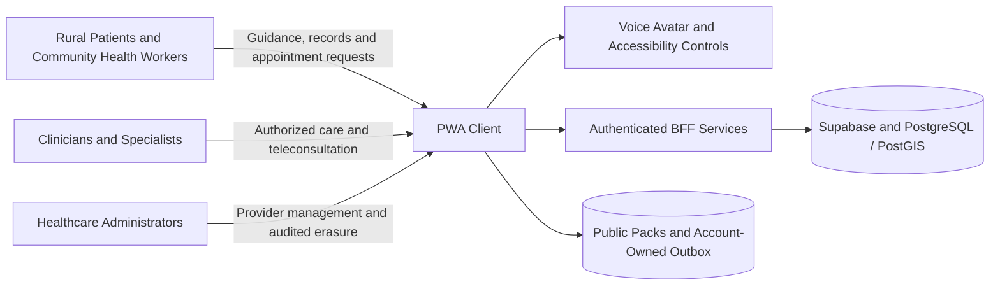
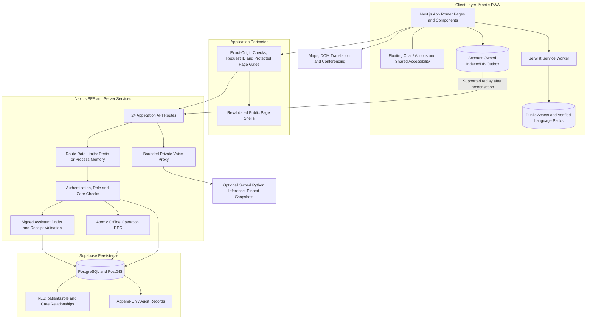
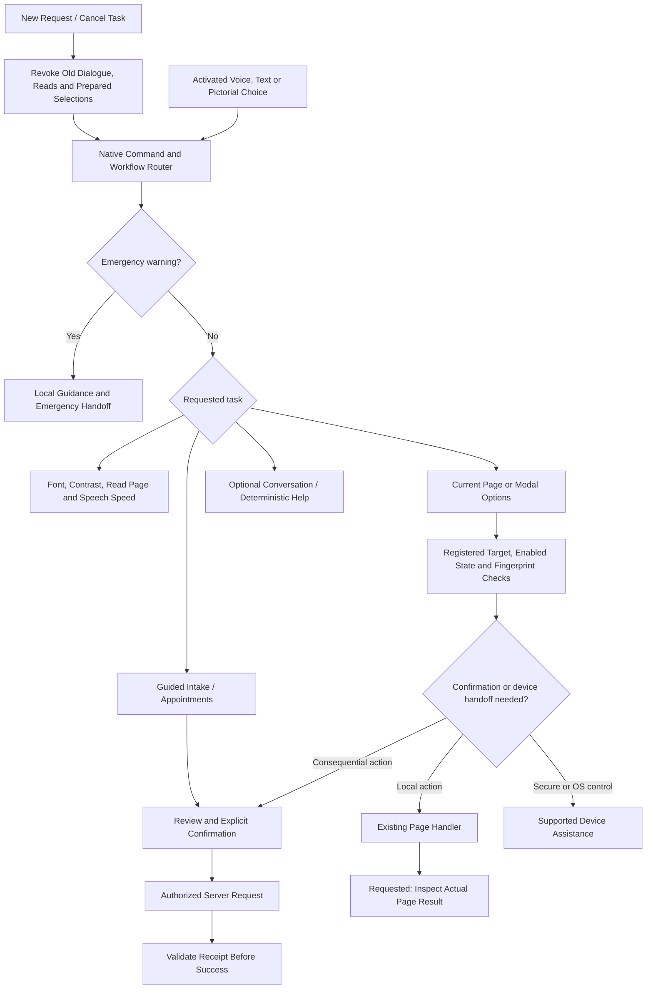
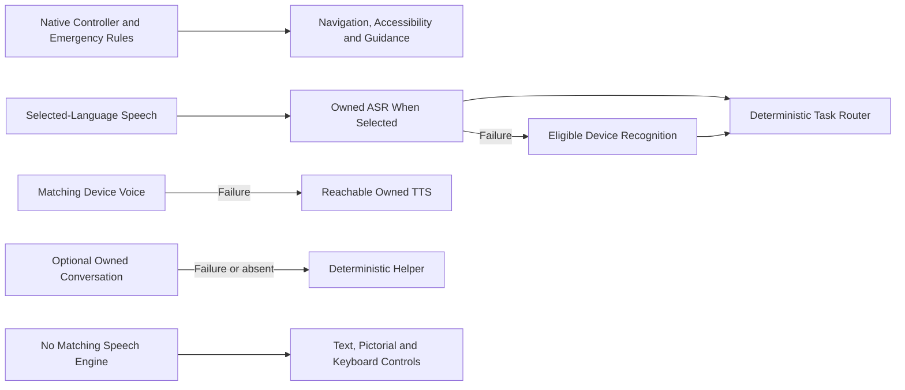
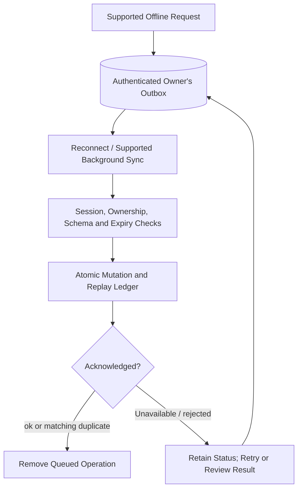

# Rural Healthcare Platform

[](https://github.com/Arnavshukla09/RURAL-HEALTHCARE-PLATFORM/actions/workflows/ci.yml)
[](LICENSE)
[](https://nextjs.org/)
[](https://www.postgresql.org/)
[](docs/VOICE_ASSISTANT_SETUP.md)

Updated **23 November 2026** against implementation commit `4c03bec` and verified evidence commit `d909403`. This README retains the original project overview, numbered sections and diagrams, with current behavior added throughout.

An offline-first, mobile Progressive Web Application (PWA) engineered for rural and resource-constrained healthcare environments in India. Built with a serverless Backend-For-Frontend (BFF) architecture, the platform provides atomic appointment scheduling, WebRTC teleconsultations, pan-India PostGIS facility lookups, emergency visual first-aid triage, offline mutation queuing with exponential backoff, and local HL7 FHIR R4 clinical document export modeled on ABDM/NRCES profiles. National gateway integration and identity verification remain separate work.

The persistent voice avatar now provides native guided workflows in all 13 selected languages, emergency-first local guidance, pictorial controls, and server-confirmed appointment actions. Speech depends on available device engines or the optional owned inference service. Model snapshots are pinned once; that service uses port **8765** and makes no runtime model downloads. See [one-time setup and verification limits](docs/VOICE_ASSISTANT_SETUP.md). Offline replay requires both new forward migrations described there; no unlimited hosted-service or background-microphone entitlement is implied.

The avatar now maps the website's current controls through “page options,” “more options,” numbered/name selection and field entry. Shared font/contrast/read controls and task replacement stay available during requests; supported native recognition also accepts wake-prefixed interruption during speech. [Implemented behavior, simple steps and outstanding audits](docs/HANDS_FREE_IMPLEMENTATION.md) distinguish source registration from real-device, all-language and clinical certification.

**Author & Lead Engineer:** Arnav Shukla ([@Arnavshukla09](https://github.com/Arnavshukla09))

**Repository:** [github.com/Arnavshukla09/RURAL-HEALTHCARE-PLATFORM](https://github.com/Arnavshukla09/RURAL-HEALTHCARE-PLATFORM)

**Published Website:** [rural-healthcare-platform.vercel.app](https://rural-healthcare-platform.vercel.app/)

**Security Inquiries & Disclosures:** [public/.well-known/security.txt](public/.well-known/security.txt)

---

## 1. Problem Statement & Healthcare Context

The platform addresses practical barriers faced by rural patients, clinics and community health workers:

* **Intermittent or 2G/3G Connectivity:** Network dropouts interrupt conventional record access and booking; cached public guidance and an owned outbox help retain supported work.
* **Geographic & Specialist Deficits:** Patients need useful nearby-facility information and access to remote clinicians without assuming directory listings prove current clinic availability.
* **Paper-Based Record Fragmentation:** Structured records and local document export help preserve consultation context across visits.
* **Language, Literacy & Accessibility Barriers:** Native assistant instructions, spoken interaction, pictorial choices, keyboard/switch access and shared font/contrast controls support people who find text interfaces difficult.

The project combines an offline-resilient PWA with server-authorized healthcare workflows. Clinical content, real-device speech and disability usability require review with the intended users; software tests alone cannot establish those outcomes.

---

## 2. Intended Users & Primary Use Cases



1. **Rural Patients & ASHA/ANM Field Health Workers:**
   - Queue supported appointment/health requests offline and check their server acknowledgment after reconnection.
   - Find PM-JAY and other directory facilities by region, service and distance; use contextual call/route handoffs.
   - Open saved emergency guidance and clinical screening tools. Emergency guidance does not dispatch an ambulance or replace assessment.
   - Browse annual campaigns/outreach and use existing record/registration actions where supported.
   - Discover current page controls by voice, dictate non-secret fields, adjust accessibility and switch tasks.

2. **Clinicians & Medical Specialists:**
   - Manage requests and authorized teleconsultations; review records within the implemented care relationship.
   - Use first-party meeting controls for microphone/camera/chat/leave, with device prompts and screen-sharing handoffs handled by the OS/provider.
   - Preserve read-only boundaries on historical records; create new clinical material through the authorized workflow.

3. **Platform Administrators:**
   - Manage stored provider/doctor-request workflows using trusted role checks. National medical-register verification is not automatically performed.
   - Request audited record erasure with a required reason; direct confidential clinical read access remains restricted.
   - Treat legacy browser-local doctor claims as demo references: they are disabled in production and cannot provision a trusted doctor role.

---

## 3. System Architecture & Engineering Choices



Local database configuration uses **PostgreSQL 15**; the deployed server version is not attested by this source review. Static public shells still contain components that make runtime API/data calls. Private route authorization remains in the API/services and RLS even when middleware uses a public fast path.

### Architectural & Technology Rationale

| Subsystem | Technology | Architectural Rationale |
| :--- | :--- | :--- |
| **Frontend Framework** | **Next.js 15 / React 18** | Public shell revalidation, interactive feature modules and lean BFF handlers share one project. |
| **Offline Resilience** | **Serwist + IndexedDB Outbox** | Cache bounded public assets/data; retain owner-scoped supported mutations until atomic server acknowledgment. Private HTTP APIs use NetworkOnly; private browser stores still exist. |
| **Persistence & Spatial** | **PostgreSQL + PostGIS** | Indexed region/radius queries support the public facility directory; row policies protect account/care data. |
| **Authorization & Security** | **RLS, Triggers and Server Services** | Role authority comes from public.patients.role; UI, user metadata and model text cannot assign permissions. |
| **Abuse Controls** | **Upstash Redis + Middleware** | Exact origins, route limits and bounded requests reduce abuse. Unconfigured Redis uses a process-local fallback. |
| **Teleconsultation** | **Jitsi WebRTC** | Authorized rooms and first-party SDK controls reuse browser conferencing; live provider/permission testing is required. |
| **Interoperability** | **Local HL7 FHIR R4 Builders** | Structured document bundles with modeled NRCES profiles, LOINC and UCUM; national certification/exchange is not implemented. |
| **Hands-Free Controller** | **Registered Controls and Native Catalogs** | Deterministic page/action routing remains available without a language model; scope, target and confirmation checks guard execution. |
| **Optional Speech/Dialogue** | **Owned Python Host + Device Engines** | Immutable snapshots, explicit installation and fallback avoid a required paid inference API or automatic model changes. |

### Assistant Routing, Accessibility & Task Switching



The floating UI separates **Chat** from **Actions**; language/offline settings collapse behind the settings icon. Font, contrast, read, replay, Stop, Cancel and emergency controls remain available. Current source coverage is **509 registered templates**, **499 reachable candidates**, **28 page entries** and **100 reachable files**. Wrappers, hidden/disabled states and explicit handoffs are included; these counts do not certify every live action.

Cancelling a dialogue cannot roll back an already submitted write. The assistant revokes old callbacks and confirmations while retaining the need to reconcile that transaction's authoritative receipt. See [HANDS_FREE_IMPLEMENTATION.md](docs/HANDS_FREE_IMPLEMENTATION.md) for full behavior.

---

## 4. Concrete Technical Contributions

The following architectural and security capabilities are implemented in the repository and supported by scoped tests. Current evidence and outstanding release gates are recorded in the [final audit](docs/FINAL_AUDIT.md):

1. **Authoritative Role Isolation & Vulnerability Remediation (`SEC-2026-10-17-ROLE-TRUST`):**
   - Eliminated reliance on client-controllable JWT metadata (`user_metadata`), which previously allowed unauthorized privilege escalation.
   - Role enforcement derives from `public.patients.role`; the **25 sealed migrations** are append-only and historical files remain immutable.
   - Implemented database trigger `guard_patient_privileges()` to prevent role mutation from authenticated user sessions.

2. **Care-Relationship Scoped Clinical Access Control:**
   - Implemented `public.has_care_relationship` checks in database policies and server services to enforce doctor-patient privilege boundaries.
   - Ensured clinicians can only view medical records of patients who possess an active scheduled or completed appointment.
   - Hardened medical records service layer (`lib/services/medical-records.service.ts`) with HTTP 403 `ACTION_NOT_PERMITTED` guards to prevent doctors from altering or deleting historical patient records.

3. **Atomic Slot Concurrency & Anti-Double-Booking Engine:**
   - Implemented partial unique index `uq_provider_slot_scheduled` on `appointments(provider_id, appointment_date)` filtering for scheduled status.
   - Eliminated race conditions during simultaneous booking spikes, mapping concurrency collisions deterministically to HTTP 409 Conflict.
   - Verified in disposable database CI with 20 parallel inserts for one scheduled provider slot: exactly one succeeds; the API maps unique conflicts to HTTP 409.

4. **Modular Architecture & Codebase Maintainability Standard:**
   - Modularized monolithic components and services into clean feature packages (`components/<feature>/parts/`, `lib/services/`), strictly enforcing an architectural limit of $\le 400$ LOC per non-UI module and $< 150$ LOC per API route.
   - Integrated `knip` in CI to continuously eliminate dead code, unused exports, and unreferenced dependencies.

5. **Pan-India Facility Pipeline & Campaign System:**
   - Validated **42,321 raw PM-JAY facility rows** in the local file audit with strict Indian geospatial bounding-box checks ($6.5^\circ\text{N} - 37.5^\circ\text{N}, 68.0^\circ\text{E} - 97.5^\circ\text{E}$).
   - Built a hierarchical Local Government Directory (LGD) reference system covering all 36 States/UTs and 725 administrative districts.
   - Built the national recurring health campaign directory with dynamic date rollups and 1-tap medical record integration.

6. **Automated Multi-Stage CI & Migration Immutability Gate:**
   - Developed `scripts/db/check_migration_immutability.mjs` verifying all historical migration files against cryptographic SHA-256 manifests (`supabase/migrations.sha256`).
   - Implemented `tests/integration/db-safety-guard.ts` guaranteeing that automated test runners never execute against unallowlisted or production databases.

7. **Hands-Free Access, Model Fallback & Publication Controls:**
   - Added native assistant catalogs in all 13 selected languages, first-party page control registration, shared accessibility and task replacement.
   - Kept model names/ports/protocol stable with explicit immutable installation, new digest inventories, independent missing-model handling and device/owned speech fallback.
   - Hardened origin checks, voice stream/type/redirect limits, public directory fields and logging; added client-boundary, publication and documentation gates plus five behavioral security mutations.

---

## 5. Security Model & Role Invariants

Server authentication/role/care checks and PostgreSQL RLS, triggers and scoped functions jointly enforce access control:

| Role | Permitted Actions | Prohibited Actions | Enforcement Mechanism |
| :--- | :--- | :--- | :--- |
| **Patient** | View/update own profile; view own appointments & medical records; queue supported requests. | Self-elevating role; viewing other patients' records; completing consultations. | Trigger `guard_patient_privileges()`; RLS `patients_read_own_records`. |
| **Doctor** | View health data and records **only** for patients with active care relationship. | Accessing unassigned patients; modifying or deleting historical patient records. | Care-relationship RLS and service HTTP 403 enforcement. |
| **Admin** | Manage clinician verifications, monitor facility data, execute audited erasures. | Direct `SELECT` or `UPDATE` on confidential clinical notes and diagnostic records. | RLS denies Admin SELECT on `medical_records`; RPC `admin_erase_medical_record`. |

Browser-visible API paths and publishable configuration are necessary application contracts. Internal voice origins, service-role/signing keys and installation tokens stay server/operator-only. Public provider responses select explicit directory fields and do not enrich patient-profile contacts. See [current HTTP surface](docs/CURRENT_ENDPOINTS.md) and [security evidence](docs/FINAL_AUDIT.md).

---

## 6. Implementation Status Matrix

| Feature / Subsystem | Status | Details & Implementation Notes |
| :--- | :---: | :--- |
| **Authoritative RBAC** | **Implemented** | Role from public.patients.role; client metadata cannot assign authority. |
| **Doctor Care Scoping** | **Implemented** | RLS/services restrict clinical access to the implemented care relationship. |
| **Concurrency Locking** | **Implemented** | Scheduled provider/time unique index; conflicting booking maps to 409. |
| **Audited Right-to-Erasure** | **Implemented** | Privileged reason-bound RPC; no general admin access to confidential notes. |
| **Offline IndexedDB Outbox** | **Implemented; rollout required** | Owner-scoped, individually atomic replay and expiry guards; requests stay queued until acknowledged. |
| **Pan-India Facility Lookup** | **Implemented** | Public region/service/radius search, map pan/zoom/recenter and contextual nearest results; live directory correctness needs owner review. |
| **National Campaigns Hub** | **Implemented** | Curated recurring programs, region filters and existing record actions. |
| **Teleconsultation Rooms** | **Implemented; provider/device-dependent** | Authorized meeting entry and first-party controls; live conferencing remains a device/network gate. |
| **13-Language Assistant Workflows** | **Implemented; speech device-dependent** | Native prompts/commands/packs in all selected languages; ASR/TTS availability and quality require testing. |
| **Website Control & Accessibility** | **Implemented; live-state audit required** | Page/modal options, selection, non-secret fields, font/contrast/read/rate; secure/device and unreviewed legacy writes use handoffs. |
| **Task Switching** | **Implemented** | New request/cancel revokes stale dialogue and selection; dispatched writes still require receipts. |
| **Owned Model Fallback** | **Implemented contracts; inference unverified** | Pinned optional snapshots, new SHA-256 inventories, independent absence and speech failover; weights not installed/tested by the audit. |
| **ABDM / FHIR R4 Export** | **Partially Implemented** | Local modeled document generation and ABHA syntax; no national identity verification, gateway or certification. |
| **Content Security Policy** | **Partially Implemented** | Report-only; blocking enforcement requires a separate staging review. |
| **WebPush Notifications** | **Planned** | Existing in-app polling is not OS push delivery or guaranteed background service. |
| **Fully Hands-Free Every Device / Page State** | **Release validation pending** | Source mapping does not replace all-role/live-modal, native-language, disability and OS handoff testing. |

### Simple Assistant Operating Steps

1. Open the website/PWA, choose a language and activate voice. Grant microphone permission through the device.
2. Say **page options**, then **select one** or **more options**. Open a menu/tab and ask again for its current options.
3. Select a non-secret field and dictate the value; use **next field**, **clear field** or **new question …**.
4. Use **increase font size**, **high contrast on**, **read page**, **speak slower**, **open chat**, **show actions** or **open settings**. Native equivalents ship in all 13 catalogs.
5. Say **cancel task** or **new request …**. Supported activated native recognition also accepts a wake-prefixed interruption during speech.
6. Review consequential actions before yes. **Requested** and **queued** are not completed; check the actual page/server receipt.
7. Prepare offline packs while connected and reactivate after suspension. Missing speech leaves text, pictorial, keyboard and switch-accessible controls available.

---

## 7. Local Setup & Safe Development Environment

### Prerequisites

* **Node.js:** `v22.x` used in CI
* **Docker Desktop:** Required only for disposable local Supabase/database tests
* **Supabase CLI:** CI uses `v2.121.0`; install through a supported official method or use `npx` locally.
* **Optional Inference:** Python 3.11/3.12 on an owned host; follow the isolated installation and compatibility gates below.

### Quick Start

```bash
# 1. Clone the repository
git clone https://github.com/Arnavshukla09/RURAL-HEALTHCARE-PLATFORM.git
cd RURAL-HEALTHCARE-PLATFORM

# 2. Install pinned dependencies
npm ci

# 3. Configure local environment variables
cp .env.example .env.local

# 4. Optional for database-backed work: start a disposable local stack
npx supabase start

# 5. Reset only this disposable local stack; never a remote project
npx supabase db reset

# 6. Launch Next.js development server
npm run dev
```

Open `http://localhost:3000` in your browser. Configure the local service values in the ignored environment file. Synthetic placeholders support build/source checks, not working authentication/data. The optional owned voice process is not started automatically by Next.js.

> [!IMPORTANT]
> **Production Database Isolation Invariant:**
> The repository includes an automated safety guard in `tests/integration/db-safety-guard.ts` that explicitly inspects the target database URL. If a non-local or unallowlisted database is detected, tests immediately abort with code 1. Never run migrations or test suites against a production database.

### Optional Owned Voice Service & Stable Defaults

| Purpose | Model / Contract |
|---|---|
| Website | Port **3000** |
| Owned inference | Port **8765**, fixed v1 protocol, server-only origin/token |
| Indian-language ASR | ai4bharat/indic-conformer-600m-multilingual; gated/custom-code review and actual locale validation required |
| English ASR | openai/whisper-tiny |
| Optional conversation | Qwen/Qwen3-0.6B; advisory text only, no action authority |
| Synthesis | Matching device voice or optional owned eSpeak NG |

Initial explicit installation records immutable revisions and licenses; new locks include per-file SHA-256. Runtime loads local snapshots only and does not resolve newer models. Missing optional snapshots preserve other capabilities; altered hashed bytes fail closed. Device/owned speech failover and deterministic help preserve the controller when an engine fails.



Hugging Face weights run on an owned Python host, not directly inside the browser. A deployed web server needs a reachable authenticated HTTPS inference origin; its localhost does not refer to a clinic PC. Use [VOICE_ASSISTANT_SETUP.md](docs/VOICE_ASSISTANT_SETUP.md) and [MODEL_FALLBACK_AND_OPERATIONS.md](docs/MODEL_FALLBACK_AND_OPERATIONS.md) for reviewed installation, fixed ports, repair and fallback. Real inference/custom-model compatibility remains a release gate.

Owner deployment requires the sealed atomic replay migration followed by the expired-booking guard. See [OFFLINE_SYNC_ROLLOUT.md](docs/OFFLINE_SYNC_ROLLOUT.md); production SQL/reset operations are not executed by repository tests.



---

## 8. Verification & Testing Strategy

The repository maintains an automated, multi-tiered verification pipeline. Live database and authenticated browser checks require a disposable local stack; skipped smoke-mode checks do not establish their behavior.

```bash
# Run unit & isolation tests (323 cases)
npm run test:unit

# Run database integration & RLS tests (29 cases; REQUIRE_DB=1 with local test keys)
npm run test:integration

# Run pre-commit component validation & migration immutability gate
npm run check:components
npm run check:migrations

# Run offline algorithmic subsystem benchmarks (21 checks)
npm run benchmark:integration

# Run dataset provenance audit
npm run report:dataset

# Run dead code & dependency analysis
npm run knip

# Run production Next.js build verification
npm run build

# Verify first-party controls and publication/documentation boundaries
node scripts/data/register_voice_controls.mjs
node scripts/ci/client_boundary_check.mjs
node scripts/ci/publication_safety.mjs
node scripts/ci/documentation_links.mjs

# Optional service contracts (standard library; no model download)
python -m unittest discover -s services/voice/tests -v

# Browser suite: seeded disposable accounts needed for all role journeys
npx playwright test
```

### Verification Matrix Summary

| Test Tier | Scope | Total Tests | Status |
| :--- | :--- | :---: | :---: |
| **Unit Tests (`npm run test:unit`)** | Existing subsystems plus assistant parsing/actions, audio races, account isolation, report gates and DOM lifecycle | **323** | **PASS locally and in CI** |
| **Integration Tests (`npm run test:integration`)** | Live PostgreSQL RLS, care-relationship scoping, slot locking and atomic replay | **29** | **PASS in GitHub's disposable local Supabase job** |
| **Full Browser Suite** | 18 assistant and 6 public/login journeys; audio mocked | **24** | **PASS in seeded CI; 21 local passes and 3 role skips** |
| **Optional Voice Contracts** | Install/repair, integrity, independent absence, declared languages and service access | **20** | **PASS; no model inference performed** |
| **Algorithmic Benchmarks (`npm run benchmark:integration`)** | PostGIS coordinates, AI safety prompt neutralization, backoff dynamics, ABHA format | **21** | **PASS** |
| **Component Quality Gate (`npm run check:components`)** | Imports, export signatures, TypeScript typecheck, ESLint, LOC standards ($\le 400$) | **8 / 8 Gates** | **PASS** |
| **Migration Immutability (`npm run check:migrations`)** | Cryptographic SHA-256 seal verification on all 25 migration files | **25 / 25 Files** | **PASS** |

The latest complete source/evidence CI for [d909403 passed](https://github.com/Arnavshukla09/RURAL-HEALTHCARE-PLATFORM/actions/runs/45144330920), including quality/build, all 29 database cases and all 24 seeded browser journeys. The five new source-security mutations failed as expected and passed after restoration. Secret/publication scans reported zero findings under documented exceptions.

This documentation restoration retains all 11 original README sections and verifies **16 Mermaid diagrams** across this README, the architecture guide and FHIR guide. See [documentation restoration evidence](docs/reports/DOCUMENTATION_RESTORATION.json).

For scoped logs, mutation evidence and limitations, see [TESTING.md](docs/TESTING.md), [FINAL_AUDIT.md](docs/FINAL_AUDIT.md) and [metadata reports](docs/reports/FINAL_VERIFICATION.json). Documentation-only changes do not establish new live device/production evidence.

---

## 9. Operational Limitations & Known Boundaries

* **Cost & Maintenance:** No required paid avatar/inference API was added. Hosted free quotas can change; owned hardware, electricity, bandwidth, hosting and review have costs. Pinning avoids surprise model updates but security maintenance remains necessary.
* **Dependency Advisories:** Five accepted high npm package exceptions expire **31 December 2026**. Explicit patched optional Python pins were reviewed through official metadata/OSV; full installed host/native-library and model compatibility still require validation.
* **PWA Lifetime:** The assistant is present across the open app, but browser/OS closure, battery restrictions and suspension prevent guaranteed background listening.
* **Language & Disability Validation:** All 13 assistant catalogs exist; matching engines, accents, native page labels, noise/echo and disability usability need actual users/devices. Online DOM translation does not provide complete native offline page text.
* **Private Browser Storage:** NetworkOnly prevents private HTTP caching, not all local storage. Account-owned queues/record/context stores require shared-device cleanup and recovery tests.
* **Permission & Legacy Handoffs:** Secure input, files, permissions, OAuth, diallers and device features need OS assistance. Mapped legacy writes retain separate server review; local demo claims are disabled in production.
* **Clinical & Conferencing:** Guidance is not diagnosis, dispatch or certification. Real Jitsi calls need connectivity/provider validation; automatic measured video-to-audio downgrade is not implemented.
* **CSP & Rate Limits:** CSP is report-only. Redis limits are shared when configured; memory fallback is process-local.
* **ABDM Gateway:** Local modeled FHIR export and syntax checks do not perform national identity/consent exchange. Configuring credentials cannot activate the stub.
* **Production Isolation:** Owner-controlled rollout/migrations, secrets, backup and monitoring remain separate deployment tasks. No real project SQL or patient-data testing was performed by the audit.

For detailed boundaries, use [LIMITATIONS.md](docs/LIMITATIONS.md), [DEPLOY.md](docs/DEPLOY.md) and the [assistant release checklist](docs/ASSISTANT_RELEASE_CHECKLIST.md).

---

## 10. Documentation Index

Detailed engineering documentation is maintained in the [`docs/`](docs/) directory:

* **[Project Structure](docs/PROJECT_STRUCTURE.md):** Current folder tree and assistant integration points.
* **[Assistant Setup & Release Checklist](docs/ASSISTANT_RELEASE_CHECKLIST.md):** Simple operation steps, deployment prerequisites and device/clinical/security audits.
* **[Architecture Guide](docs/ARCHITECTURE.md):** Detailed system architecture, BFF design, and subsystem blueprints.
* **[Database Reference](docs/DATABASE.md):** ER diagrams, table schemas, RLS policies, and periodic maintenance runbook.
* **[Testing & Mutation Proofs](docs/TESTING.md):** QA test matrix, integration contract proofs, and behavioral mutation verifications.
* **[Final Audit](docs/FINAL_AUDIT.md):** Current implementation/security findings, verified CI and remaining release gates.
* **[Model Fallback & Operations](docs/MODEL_FALLBACK_AND_OPERATIONS.md):** Immutable installation, independent models, speech fallback, backups and maintenance.
* **[Hands-Free Implementation](docs/HANDS_FREE_IMPLEMENTATION.md):** Page/action control semantics, accessibility, interruption and truthful result handling.
* **[Control Inventory](docs/HANDS_FREE_CONTROL_INVENTORY.md):** Source registrations across all 28 page entries, including handoffs.
* **[API Guide](docs/API_REFERENCE.md) / [Current HTTP Surface](docs/CURRENT_ENDPOINTS.md):** Handler contracts and generated public path/method inventory.
* **[Component Reference](docs/COMPONENTS.md):** Current feature modules and ownership.
* **[Security Notes & Policy](docs/SECURITY_NOTES.md):** Historical remediation and incident evidence; the final audit defines current status.
* **[Deployment Runbook](docs/DEPLOY.md):** Production rollout procedures, environment configuration, and verification checks.
* **[Credential Rotation Checklist](docs/CREDENTIAL_ROTATION_CHECKLIST.md):** Key rotation procedures and security hygiene.
* **[Dataset Provenance](docs/DATASETS.md):** Government registry sources, geospatial bounding boxes, and ETL pipelines.
* **[ABDM & FHIR Interoperability](docs/ABDM_FHIR_INTEROPERABILITY.md):** HL7 FHIR R4 Document Bundle specifications.
* **[Clinical Safety Protocols](docs/CLINICAL_SAFETY.md):** Emergency triage decision tables and red-flag rules.
* **[System Limitations](docs/LIMITATIONS.md):** Documented architectural and operational boundaries.
* **[Changelog](docs/CHANGELOG.md):** Project changes and preserved development history.

---

## 11. License

This project is open-source software licensed under the [MIT License](LICENSE).

Copyright (c) 2026 Arnav Shukla. External services, datasets, models and voices retain their own terms and attribution obligations.
