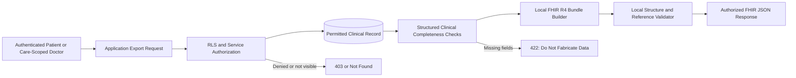
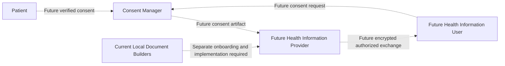
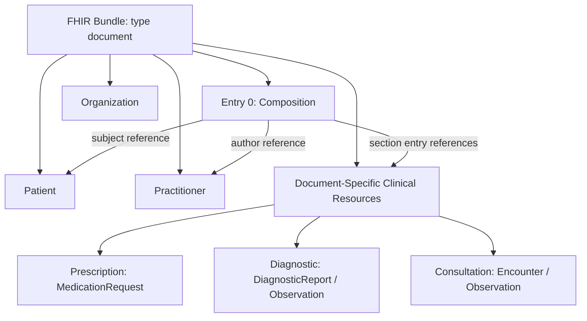
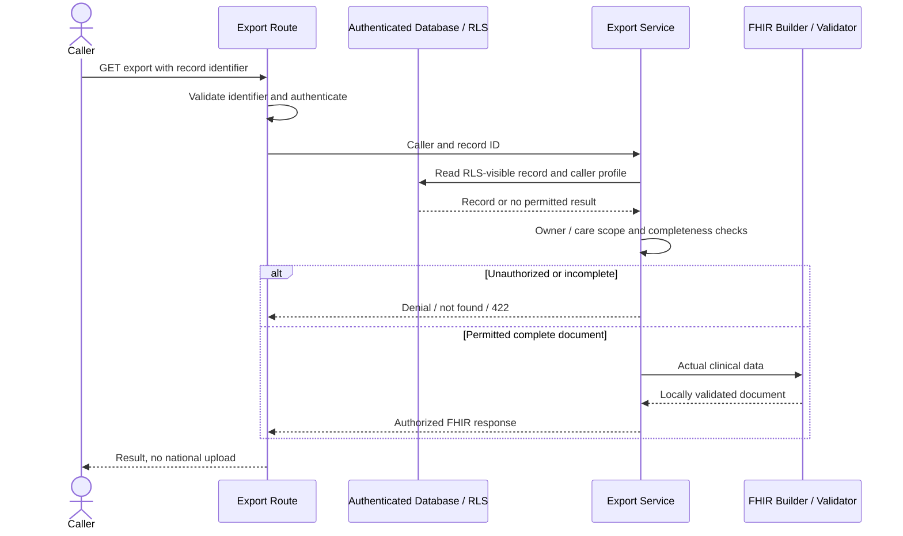

# ABDM & HL7 FHIR R4 Interoperability: Architectural Specification

Updated **23 November 2026** against the current source. The earlier guide's ecosystem, resource mapping, implementation and technical explanation sections are restored with accurate status labels. Local document formatting/validation is implemented; national identity verification, consent exchange and live gateway integration remain planned.

## 1. Executive Overview

The project uses structured FHIR R4 document builders so prescription, diagnostic and consultation data can be represented with explicit patient, practitioner, organization, observation and document references. These builders are modeled on NRCES profiles. Unit tests verify selected structural, coding and reference contracts; they do not establish national validator approval or clinical certification.

The current API exports an authorized local document. It does not upload it to a national repository, create an ABHA identity, discover/link records or implement HIP/HIU consent. Configuration cannot convert the format-only gateway stub into a live national integration.

## 2. ABDM Ecosystem Architecture & Federated Data Flow

### Current implemented flow



ABHA format checks are a separate local syntax utility. A syntactically valid identifier is not evidence that the caller owns an identity or has consent to exchange a document.

### Planned national integration — not an active network flow



Dashed connections describe future responsibilities, not implemented calls. National exchange requires official onboarding, authenticated consent/provenance, secure transport, expiry/revocation checks and independent interoperability review. The current project does not provide those from credentials alone.

## 3. ABDM Milestone & Implementation Status Matrix

| Capability | Current status | Evidence / boundary |
|---|---|---|
| ABHA number/address syntax | Implemented local checks | Format/normalization tests; identity and ownership unverified |
| Prescription documents | Implemented local builder | Required medications/clinician data must exist; no invented default doses |
| Diagnostic documents | Implemented local builder | Selected coding, observations and references; completeness required |
| Consultation/encounter documents | Implemented local builder | Structured document from permitted input |
| Local bundle validation | Implemented selected rules | Composition-first, references and selected fields; not a full national validator |
| Authenticated export | Implemented | Owner/care-scoped doctor; admin clinical export restricted |
| National ABHA verification / OTP | Planned | No live verification request in the stub |
| HIP/HIU onboarding | Planned | Official process and separate integration required |
| Discover/link / consent exchange | Planned | No national consent/artifact implementation |
| National health-information transfer | Planned | No upload/exchange through the export route |
| Official NRCES/ABDM certification | Not established | Independent official and clinical review required |

## 4. HL7 FHIR R4 Document Bundle Structure & NRCES Profiles

### 4.1 Document structure



Profile metadata and resource structures are declared by the builders. Composition gives the document its clinical context; references must resolve to the appropriate entries. This diagram illustrates categories, not a claim that every bundle contains all categories.

### 4.2 Resource mapping

| Application data | FHIR representation | Source responsibility |
|---|---|---|
| Demographics / optional ABHA fields | Patient | Actual recorded demographics; no national identity proof |
| Treating clinician | Practitioner | Available clinician metadata; avoid invented credentials |
| Facility | Organization | Required document source/facility context |
| Document date/sections | Composition | First entry and document references |
| Prescription items | MedicationRequest | Required medicine/dose/frequency/duration from the record |
| Lab reports / measurements | DiagnosticReport and Observation | Selected LOINC concepts and UCUM units |
| Consultation episode | Encounter and observations | Permitted metadata and actual observations |

LOINC describes supported measurement/report concepts; UCUM describes units such as mg/dL or mmHg. Codes do not prove a measurement is valid or the source is clinically complete.

## 5. Architectural Implementation Breakdown

### 5.1 Format checks and gateway stub

`lib/abdm/validation.ts` checks supported identifier formats and bundle contracts. `lib/abdm/client.ts` remains format-only: `isLive` is false and the mode is simulated even with credentials. Its messages distinguish format validity from identity verification.

No NHA token, OTP, consent-manager, HIP/HIU, discovery/link or national exchange request is implemented in that stub. A syntax result must not be presented as verified identity elsewhere in the product.

### 5.2 Deterministic builders

`lib/abdm/fhir.ts` exports the typed facade, validators, builders and stub. The builders are modularized in:

- `lib/abdm/prescription-builder.ts`
- `lib/abdm/diagnostic-builder.ts`
- `lib/abdm/encounter-builder.ts`

They format supported inputs deterministically. Completeness, clinician provenance and coding review remain separate obligations. Missing structured medication or clinician fields must reject rather than produce fabricated content.

### 5.3 Local conformance validator

`validateFhirBundle` checks the implemented structure, Composition-first ordering and selected references/fields. Tests include invalid inputs and dangling references. An official validator and clinical document review remain necessary before claiming national conformance.

### 5.4 Authenticated export endpoint



`GET /api/abdm/fhir-export` accepts the existing `record_id` query contract. The service uses authoritative profile role and scheduled/completed care relationships where implemented. Unrelated callers and admin non-owner clinical export are denied; RLS can return not found before explicit checks. Raw database/upstream details are not returned.

Prescription export requires structured medication items and clinician/facility details. Missing fields produce `INCOMPLETE_CLINICAL_RECORD`, status 422. A document is an export result, not consent, a national submission receipt or clinical certification.

## 6. Local Operation, Gateway Integration & Cost Boundaries

Local format checks/builders do not require a paid national API. Authentication/database/hosting still have costs and quotas. No permanent free hosted allowance is guaranteed.

Adding credentials cannot activate an unimplemented gateway. Future work needs official onboarding, secure server credentials, patient consent/expiry/revocation handling, provenance, transport and replay/audit controls. Do not publish credentials, patient examples or private origins in docs/traces.

Offline clinical requests use preassigned IDs and owner-scoped atomic replay to the application database. Builders can export complete acknowledged data. That queue does not synchronize into ABDM. See [OFFLINE_SYNC_ROLLOUT.md](OFFLINE_SYNC_ROLLOUT.md).

## 7. Technical Explanation & Review Questions

| Question | Current-project answer |
|---|---|
| Why FHIR instead of arbitrary JSON? | Shared document/resource representation; external interoperability needs separate checks. |
| ABHA number versus address? | Different identifier formats; syntax does not establish ownership or enrollment. |
| Is national patient consent implemented? | No. App authorization is not a national consent artifact. |
| Why Composition first? | It identifies context and references subject, author and sections. |
| How is IDOR restricted? | Authenticated RLS plus owner/doctor care checks and admin confidentiality. |
| Does offline replay upload to ABDM? | No. Application replay, document export and national exchange are separate. |
| Is local validation official approval? | No. It tests selected structure/reference rules, not full national conformance. |
| How do encounters map? | Source encounters/observations can inform builders; not every row is automatically interoperable. |
| What do LOINC/UCUM guarantee? | Supported concept/unit representation, not clinical correctness. |
| How is national consent expiry handled? | Not implemented; future exchange must verify expiry/revocation server-side. |

## 8. Verification & Test Evidence

Run the existing conformance suite:

```bash
npx vitest run tests/unit/abdm-fhir-conformance.test.ts
```

The implementation/evidence [CI run 45144330920](https://github.com/Arnavshukla09/RURAL-HEALTHCARE-PLATFORM/actions/runs/45144330920) passed 323 unit cases, 20 Python contracts, 29 required disposable database/safety cases and the seeded 24-journey browser job. Totals are project-wide, not 323 FHIR tests. No national gateway or real production patient data was used.

Required before broader claims: official profile validation, clinical coding/document review, authorized/denied export roles, incomplete sources, consent/privacy design and national onboarding. See [FINAL_AUDIT.md](FINAL_AUDIT.md), [CLINICAL_SAFETY.md](CLINICAL_SAFETY.md), [API_REFERENCE.md](API_REFERENCE.md) and [ARCHITECTURE.md](ARCHITECTURE.md).
