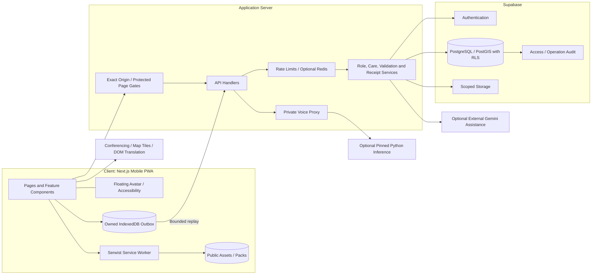
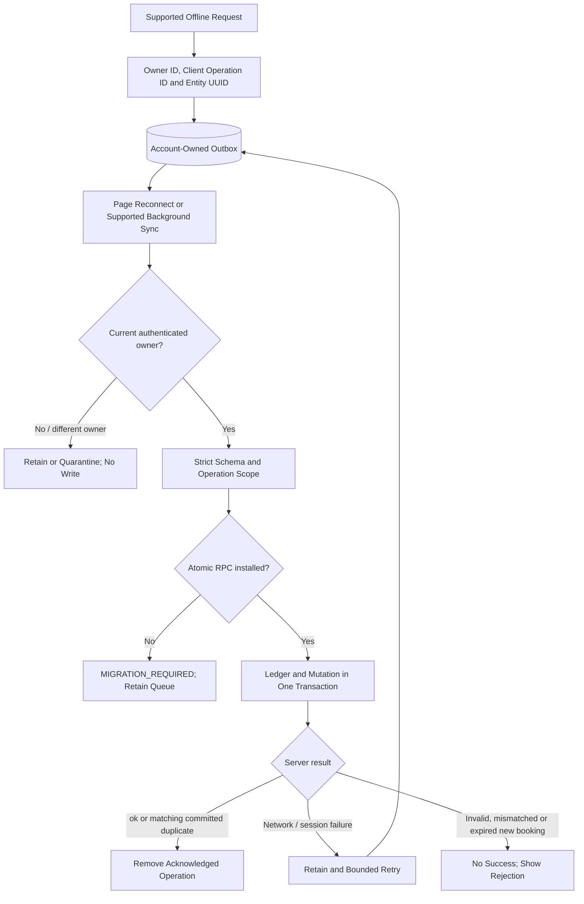
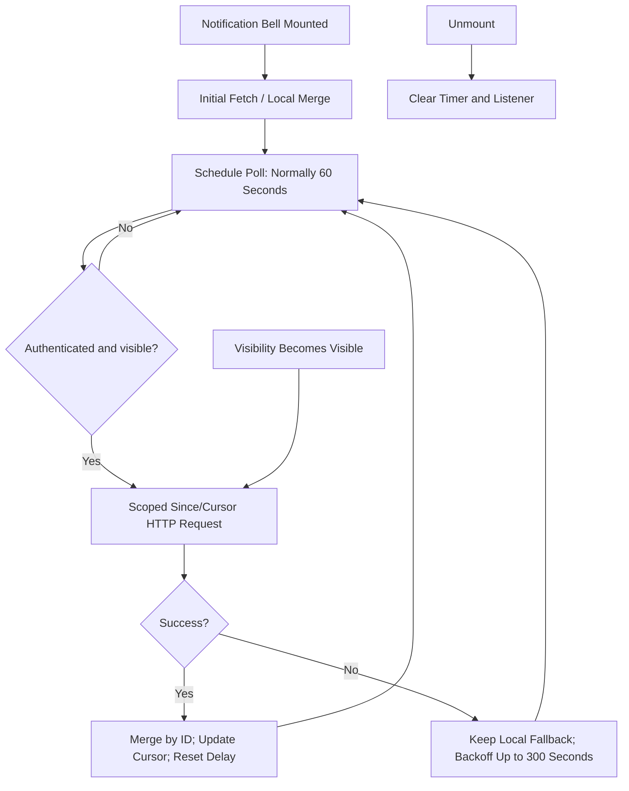
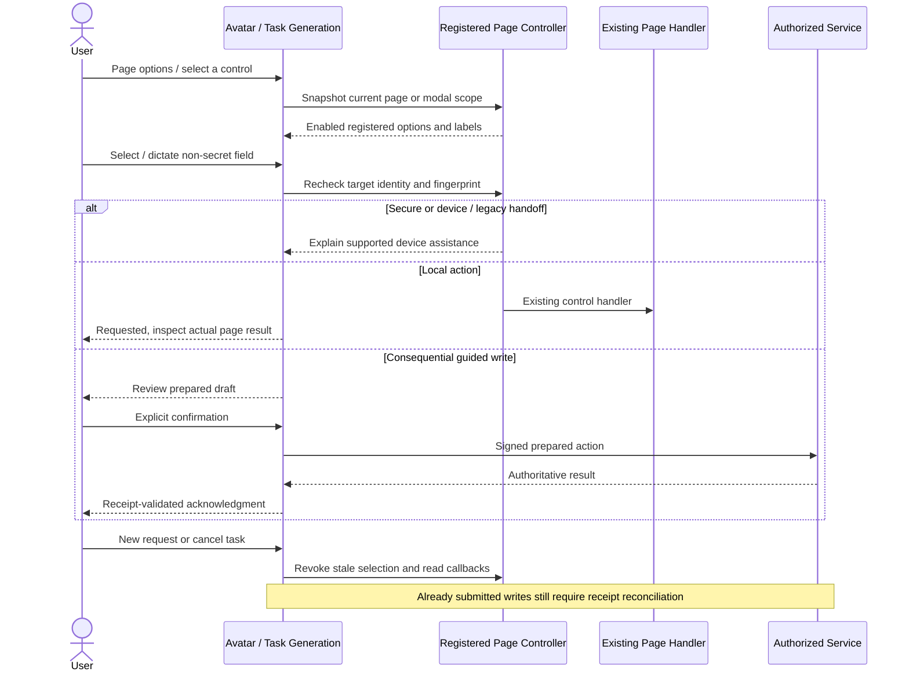
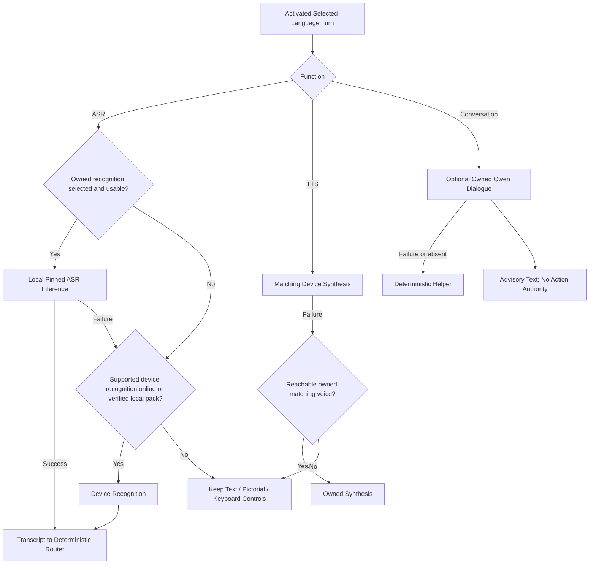
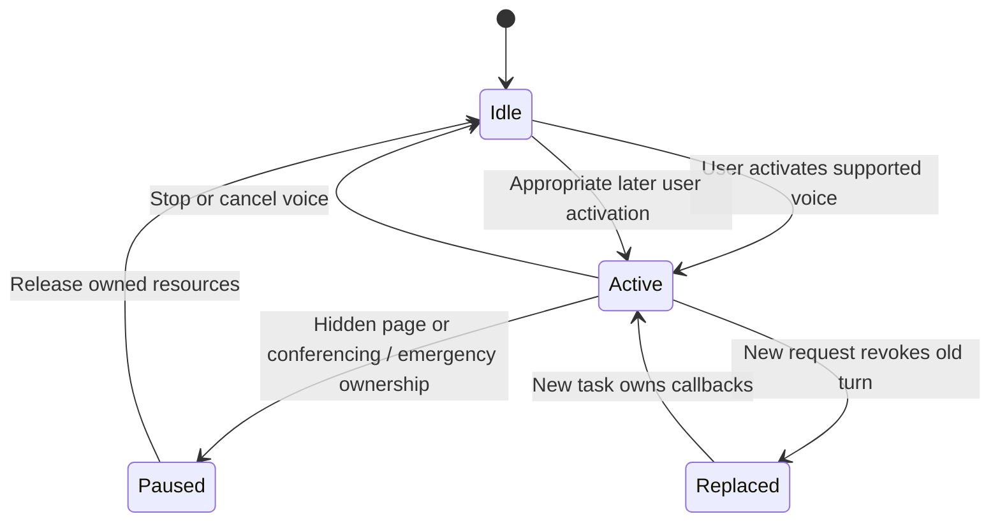
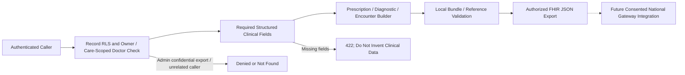

# Architecture Document: Rural Healthcare Platform

Updated **23 November 2026** against the current source and verified implementation/evidence commits. The original subsystem structure is retained and expanded with the assistant, model fallback and current security boundaries. This is a source architecture guide; it does not attest the live deployment, all devices or clinical certification.

---

## 1. High-Level System Architecture

The platform uses a Next.js Backend-For-Frontend for interactive healthcare workflows, public page revalidation and owner-scoped offline requests. Local configuration uses PostgreSQL 15/PostGIS; the deployed version is not established here. External services and an optional owned inference host have separate uptime/operating costs.

Public/API middleware fast paths avoid a blanket auth lookup. Protected API services still authenticate and apply role/care checks. Public directory responses select explicit fields; private patient profiles are not used to enrich public provider contacts. The [HTTP inventory](CURRENT_ENDPOINTS.md) lists **24 API routes**, while the [controller inventory](HANDS_FREE_CONTROL_INVENTORY.md) maps **28 page entries**.

---

## 2. Frontend & Rendering Architecture

### 2.1 Server Components & Incremental Static Regeneration

Public routes such as /, /campaigns, /camps, /directory, /emergency, /health-info, /health-info/schemes, /locations and /symptom-checker use revalidated shells where configured, commonly revalidate = 3600. Client feature components provide state, search, map and session interactions. Static rendering does not imply zero API or database traffic when those components load. Middleware and API role guards complement page-level navigation checks.

### 2.2 First-Load JavaScript & Feature Modules

Maps and the floating client use dynamic loading where configured so browser-only APIs do not execute during server rendering. The current production build's shared first-load JavaScript was about **105 kB**; individual page totals vary and this is a build measurement, not a network/hardware performance guarantee. The module checker enforces imports, exports, type/lint correctness, feature size limits and unused-dependency checks.

### 2.3 PWA Service Worker & Storage Classes

app/sw.ts uses Serwist with a cached /offline fallback. The first matching rule controls the response strategy:

| Request class | Implemented strategy | Boundary |
|---|---|---|
| Mutations and private/auth/assistant/ABDM APIs | NetworkOnly | Prevents private HTTP responses entering Cache Storage; private IndexedDB/localStorage still exists |
| District facility lookup | Network request, saved district pack on network failure | Only prepared public district coverage is available |
| Selected public API GETs | StaleWhileRevalidate; 50 entries, two-hour expiry | Can return older public data |
| Images | CacheFirst; 60 entries, 30-day expiry | Browser can evict storage |
| Fonts | CacheFirst; 20 entries, one-year expiry | External fonts need an initial fetch |
| JS/CSS/static assets | StaleWhileRevalidate; bounded one-day cache | Version/update lifecycle remains relevant |
| Permitted navigation | NetworkFirst with bounded page caching/fallback | Private route exclusions and account cleanup apply |

Native assistant packs contain text/commands/workflow data for all 13 selected languages with checksum verification. They do not install speech engines or provide every legacy page in native offline language. PWA install, storage and Background Sync support vary by device; none grants a permanent microphone or continuous worker.

### 2.4 Pan-India Campaigns, Directory & Map Interaction

lib/data/annual-campaigns.ts supplies recurring program entries and region filtering. Existing campaign/camp record actions reuse their page validation. Directory sources distinguish clinician entries from institutional contacts; the current local audit counts **456 curated records** (31 clinician / 425 facility contact) and **42,321 raw facility rows**, plus 36 State/UT and 725 district references. These are dataset measurements, not live licensing, phone correctness or clinic availability certification.

The facility UI orders location/search, service filters, then GPS/radius/Nearest. Nearest respects the selected service. Map zoom is upper-left, directional/recenter controls lower-right, and route details below. A single effect owns Leaflet creation/removal through the existing map-core provider. First-party controls call supported map APIs and carry facility context; they do not automate third-party DOM.

### 2.5 Persistent Avatar & Shared Accessibility

The root mounts FloatingChatClient and components/voice-assistant. Chat holds conversation; Actions holds current workflows/selections; settings collapse behind their icon. Shared accessibility state controls root font/contrast, bounded page reading, speech speed and reset. Read page asks consent before potentially audible private content. The lower-left toolbar stays synchronized with the avatar and avoids a competing English-only voice session.

Use [COMPONENTS.md](COMPONENTS.md) and [HANDS_FREE_IMPLEMENTATION.md](HANDS_FREE_IMPLEMENTATION.md) for source ownership and controls.

---

## 3. Data Ingress & Offline Outbox Architecture

### 3.1 Owner-Scoped Capture & Atomic Replay

The server derives patient identity from the authenticated profile. apply_offline_operation commits each mutation and replay claim together; failure rolls back the claim, successful duplicate replay acknowledges, and changed payload under a committed ID rejects. A batch is a collection of individually atomic operations, not one transaction for the entire clinical graph.

Both sealed replay/expiry migrations are required. An expired new booking rejects while a previously committed duplicate can still acknowledge. Missing RPC reports MIGRATION_REQUIRED with no direct-write fallback. [OFFLINE_SYNC_ROLLOUT.md](OFFLINE_SYNC_ROLLOUT.md) provides the owner rollout and mutation/recovery requirements.

### 3.2 Preassigned Relational UUIDs & Executor Lifetime

Parent entities can receive a UUID before capture; child observations refer to it and still require patient/encounter ownership. Replay preserves dependencies in order. The page and worker share lib/offline/executor.ts, with bounded batch count/time, server-verified worker session and account/cleanup epoch checks. Only acknowledged work leaves the queue. Retry timing and Background Sync are bounded best-effort scheduling; no closed-browser execution guarantee follows from that support.

Private browser stores include pending operations, clinical context and existing record/encounter storage. Logout/account changes request cleanup; unowned legacy operations are quarantined. Shared-device confidentiality, browser eviction and recovery remain release tests.

### 3.3 Clinical Media Compression Pipeline

lib/media/compressor.ts scales images while preserving aspect ratio, default maximum dimension **1280 px**, quality **0.72**, preferred WebP with JPEG fallback. The result records actual original/compressed bytes and dimensions. Canvas/bitmap support and image content affect reduction and visual quality; no fixed percentage or clinical diagnostic fidelity is guaranteed. Transfer-time estimation is a model, not a measured mobile connection. A clinician must assess whether compressed images are adequate for the intended use.

---

## 4. API Gateway, Rate Limiting & Abuse Prevention

### 4.1 Tiered Rate Limiting

lib/rate-limit.ts defines auth **10/min**, read **60/min**, write **20/min**, AI **10/min**, public **60/min** and voice **30/min**. Handlers choose their class; being a public route does not assign one universal budget. Redis provides shared windows when configured. The bounded memory fallback is per process and cannot enforce a fleet-wide limit. Standard rate responses provide Retry-After information.

### 4.2 AI Gateway & Circuit Breaker

lib/ai/gateway.ts applies a 30/day identity budget, five-failure circuit threshold, 60-second cooldown and a 25-second gateway envelope where used. The separate Gemini adapter bounds each candidate to 12 seconds and uses configured candidates/fallback. Optional hosted model retirement and quota changes remain possible. Responses are structured JSON; a streaming transport is not implemented. Deterministic navigation/clinical routing stays independent of optional dialogue output.

### 4.3 Private Voice Proxy & Resource Limits

The browser uses the same-origin /api/assistant/voice route. Only server services read the owned origin/token. Remote inference requires HTTPS and a nonblank matching token; loopback development has separate local authorization. Upstream redirects are rejected. The proxy bounds JSON/multipart reads, canonical language codes, input length, 20-second/2 MiB WAV recording, 16,000-byte upstream JSON and 4 MiB WAV output/signature/type. Capability probing has a two-second limit and inference requests are bounded to 30 seconds.

Health forwards only canonical protocol/availability/language/conversation fields, omitting internal revision/path metadata. Private/no-store/nosniff responses and static errors reduce disclosure; endpoint authorization and deployment restrictions remain necessary. See [API_REFERENCE.md](API_REFERENCE.md).

---

## 5. Realtime & Notification Architecture

### 5.1 In-App Polling Rather Than Unfiltered WebSockets

The notification bell uses authenticated HTTP cursor/since polling and local fallback rather than the previous unfiltered Realtime subscription. This limits connection demand but does not guarantee any hosted free allowance. In-app notification state is separate from OS WebPush, which remains planned.

### 5.2 Visibility-Aware Polling & Viewport Portal

components/notification-bell/index.tsx skips network polling while hidden; its scheduling timer can still exist. Visibility restoration requests a refresh. Results merge with local entries and pagination retains a next cursor. On desktop the panel anchors to the bell; mobile uses a body portal with overlay/card stacking to avoid header clipping. Delivery/read/write permissions remain in the existing notification service; UI presentation is not an authorization boundary.

---

## 6. Clinical Decision Support & Context Intelligence

### 6.1 Frontline Protocol Engine

lib/clinical/protocol-engine.ts contains offline NCD/ANC decision trees, structured urgency and LOINC observations with English/Hindi classifications/actions. lib/clinical/imci-anc.ts supplies additional screening rules. The assistant has its own native 13-language intake/catalog flow. Local emergency gates can route before optional model output; finite rules cannot detect every medical emergency or replace assessment.

### 6.2 Patient Clinical Context

lib/clinical/patient-context.ts builds a bounded clinical pretext from conditions/allergies/medications/vitals, with recognized email/phone/instruction redaction and local caching. This is still potentially sensitive health context, not proven anonymization. The existing symptom/chat path may send permitted pretext to optional external inference; the owned avatar path has separate contracts. Private page reading is bounded and is not sent to the optional conversation model. Context storage and account transition cleanup require shared-device checks.

### 6.3 Multilingual Page & Assistant Layers

| Layer | Implemented coverage |
|---|---|
| Language selector | en, hi, mr, bn, te, ta, gu, kn, pa, or, ml, as, ur |
| General translation dictionaries | Eight native dictionaries; remaining locales use fallback plus online DOM translation where supported |
| Google DOM translation | Online browser integration with crash/banner guards; no guaranteed full native/offline coverage |
| Native assistant packs/catalogs | All 13 selected locales, including command/confirmation/accessibility data and Urdu direction |
| Device recognition/synthesis | Actual engine/local pack and matching voice availability; locale tag alone is not proof of local processing |
| Owned models | Declared/reviewed ASR locales and detected eSpeak voices; health presence is not inference quality |

Place-name data remains predominantly bilingual. Native-speaker review, accents/numbers/dates, labels, Urdu layout and real-device speech remain release gates. Optional Qwen/Gemini prompts cannot certify unrestricted language comprehension or clinical quality.

### 6.4 Website Controller & Task Ownership

Only source-registered first-party controls are enumerated. Current modal scope, identity, enabled state, non-secret form fingerprint and confirmation are rechecked at execution. Model text cannot provide arbitrary scripts/selectors/table names/URLs. Secure input stops recognition and does not silently resume it. Generations protect against late read/dialogue callbacks; a new task cannot undo a committed mutation.

Accessibility commands work within the shared router and page reader; Stop/Cancel/emergency controls remain physical/keyboard alternatives. Native barge-in is restricted to activated visible supported sessions and cannot authorize a write. Echo/noise/false-confirmation performance remains unmeasured on actual hardware.

---

## 7. Observability & Security Perimeter

### 7.1 Structured JSON Logging

lib/logger.ts emits static diagnostic messages, bounded identifiers, route without query, status/duration and hashed user ID where supplied. lib/security/log-sanitizer.ts drops sensitive/nested fields and redacts recognized token, URL and email patterns. Errors expose a sanitized name rather than raw message/stack. These rules reduce common disclosure; arbitrary prose or future payloads are not guaranteed free of PII. Do not log audio, transcripts, page content or raw service exceptions.

### 7.2 Middleware & Server/Client Boundaries

middleware.ts checks unsupported methods and API origins. It accepts the exact request/configured origin, not every foreign provider preview. Cross-site mutations reject. Caller request IDs must fit the accepted UUID format or are replaced. Protected dashboard/admin/doctor/auth-related routes apply session/role checks; API services independently enforce permissions.

Client-import graph and publication gates reject recognized server secret references and accidental tokens/deployment identifiers in published source. Private inference configuration lives in server services. Public route names and publishable configuration remain browser-visible. Browser-local doctor claim references are disabled in production; trusted role issuance is a server/database responsibility.

### 7.3 Content Security Policy & Mutation Evidence

next.config.mjs sets CSP **Report-Only** while maps, translation and conferencing integrations remain under staging review. Report-only cannot block malicious script by itself. The finishing audit includes five deliberate source mutations covering origin, internal metadata, redirect following, public select-all and production demo claims; each failed its behavioral test and passed after source restoration. Database mutation records retain their own historical/disposable scope. See [FINAL_AUDIT.md](FINAL_AUDIT.md).

---

## 8. Hosting, Model Fallback & Quota Management

### 8.1 Operating Dependencies

| Service | Current operational role | Failure / cost boundary |
|---|---|---|
| Next.js hosting | Page/API/runtime and service worker assets | Hosting limits and platform retirement can change |
| Supabase | Auth, RLS database and scoped storage | Data/auth workflows need availability; owner controls rollout/backup |
| Optional Redis | Shared limiting and existing cache/gateway helpers | Process-memory fallback is not fleet-wide enforcement |
| Optional Gemini | Existing external chat/symptom enrichment | Configurable provider models/quota; deterministic fallbacks remain |
| Owned Python host | Optional ASR/TTS/conversation | Pinned snapshots; host hardware/power/license/uptime have costs |
| Device engines | Browser/OS speech | Matching language/pack, permission, processing location and OS lifetime vary |

No required paid avatar/inference API was added. Public free service terms are not a permanent cost or uptime promise. Five accepted high npm package exceptions expire 31 December 2026; CI rejects expired/new unaccepted risks. Patched optional Python pins have public advisory evidence but actual isolated host, native/CUDA libraries and model compatibility remain operator gates.

### 8.2 Owned Model & Device Fallback

Ports remain website **3000**, inference **8765**, v1 protocol. Model IDs remain IndicConformer, Whisper tiny and optional Qwen3 0.6B. The installer explicitly resolves immutable approved snapshots once and retains an existing lock. New locks record per-file digests; load/repair verifies them. Missing optional snapshots leave independent models available; untrusted manifest/corrupt bytes fail closed. Older locks without hashes remain compatible with weaker byte-integrity evidence.

Owned ASR failure selects eligible device recognition for the session. Device TTS failure can use reachable owned synthesis; no missing native voice is replaced with English. No host/model is required for core control enumeration/emergency rules. The Python process is separate from Next.js; deployed localhost is not a clinic PC. Runtime makes no model downloads, and the browser never receives the owned service token. [MODEL_FALLBACK_AND_OPERATIONS.md](MODEL_FALLBACK_AND_OPERATIONS.md) defines explicit repair and deployment checks.

### 8.3 Visibility, Conferencing & Emergency Audio Ownership

A service worker/PWA install cannot guarantee background listening after closure/suspension. Recorder, recognition, playback URL, timers and callback generations release or reject stale resources. Meeting speech coexistence is not silently enabled. Actual headset/echo/battery behavior requires device tests.

---

## 9. ABDM & HL7 FHIR R4 Interoperability Subsystem

### 9.1 Local Standards Alignment

TypeScript builders generate prescription, diagnostic and encounter document bundles modeled on NRCES FHIR R4. Composition is the first resource; Patient, Practitioner, Organization and clinical entries have intra-bundle references. LOINC and UCUM are used for selected observations/units. Structural unit validation is not official national/clinical certification.

### 9.2 Export Flow & Authority

GET /api/abdm/fhir-export validates the record identifier, authentication, RLS/service care scope and completeness. Admin non-owner clinical export is denied. Missing medication/dosage/clinician fields produce a structured incomplete-record response rather than fabricated values. See [ABDM_FHIR_INTEROPERABILITY.md](ABDM_FHIR_INTEROPERABILITY.md).

### 9.3 ABHA Format Stub & Future Integration

lib/abdm/client.ts always reports simulated/isLive false; adding credentials does not implement national requests. Number/address format validation is not verified identity/ownership. Token/OTP, HIP/HIU, consent, discover/link and national exchange remain planned. An exported bundle must not be sent to a national repository merely because its JSON structure passes local checks.

### 9.4 Encounters, Observations & Clinical Review

clinical_encounters and clinical_observations support structured visits and measurements under patient/care policies. Offline parent/child IDs aid capture/replay, not a certified national exchange. Local protocol engines supply urgency/actions and selected LOINC observations; these still require qualified review. Runtime models are advisory and cannot decide role or bypass consent/auth checks.

## 10. Verification & Release Evidence

The implementation/evidence CI [run 45144330920](https://github.com/Arnavshukla09/RURAL-HEALTHCARE-PLATFORM/actions/runs/45144330920) passed quality/build, **323 unit cases**, **20 Python contracts**, **29 required disposable database/safety cases** and the **24-journey seeded browser job**. Audio/model responses are mocked where indicated, and actual model inference is not installed/executed by these checks. See [FINAL_AUDIT.md](FINAL_AUDIT.md), [TESTING.md](TESTING.md) and [metadata reports](reports/FINAL_VERIFICATION.json).

All-role dynamic/modal controls, native languages/real speech, disability usability, clinical content, conferencing/device prompts, private-storage recovery and owner-controlled production rollout remain separate release gates.

---
