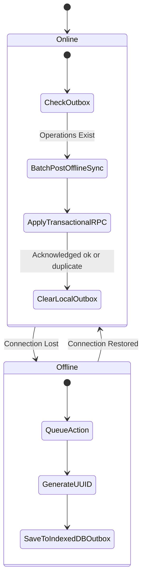

# Architecture Document: Rural Healthcare Platform

This document details the software architecture, design patterns, security controls, and infrastructure posture for the **Rural Healthcare Platform**. It is written to serve as an in-depth, authoritative architectural guide for any engineer working on the system.

---

## 1. High-Level System Architecture

The platform employs a **Backend-For-Frontend (BFF)** serverless architecture for low-bandwidth, intermittent connectivity. Existing hosted services have quota-limited free tiers whose terms may change. The guided avatar has no required paid inference or avatar API; owned model computation still needs hardware, electricity and maintenance.


---

## 2. Frontend & Rendering Architecture

### 2.1 Server Components & Incremental Static Regeneration (ISR)
All 9 public routes (`/`, `/campaigns`, `/camps`, `/directory`, `/emergency`, `/health-info`, `/health-info/schemes`, `/locations`, `/symptom-checker`) are **Server Components** configured with:
```typescript
export const revalidate = 3600 // Cached at Edge CDN for 1 hour
```
- **Zero Database Load on Navigation:** Page loads for public visitors do not invoke Supabase or execute serverless functions.
- **Client Interactive Islands:** Dynamic state (search filters, tab toggles, accordion expansion) is isolated in client components (`components/public-pages/`).
- **Elimination of SSR Redirect Hazards:** Protected dashboard routes use client-side `useEffect` wrappers for redirection, preventing server-side `location is not defined` errors during static generation.

### 2.2 First-Load JS Optimization & Code Splitting
- Heavy vendor libraries are dynamically imported with SSR disabled:
  * Leaflet maps: `next/dynamic(() => import("@/components/MapView"), { ssr: false })`
  * Floating AI assistant: `components/FloatingChatClient.tsx` dynamically imported in `app/layout.tsx`.
- First-load shared JavaScript payload was reduced from **607 kB uncompressed to 103 kB**, ensuring rapid first paint over 2G/3G rural networks.

### 2.3 PWA Architecture (Serwist Service Worker)
- **Engine:** Configured via `@serwist/next` with custom worker in `app/sw.ts`.
- **Runtime Caching Strategy:**
  * **Static Assets & Fonts:** CacheFirst with 30-day expiration.
  * **Public Cached APIs (`/api/facilities/nearby`, `/api/providers`):** StaleWhileRevalidate.
  * **Private Patient APIs (`/api/appointments`, `/api/medical-records`, `/api/notifications`, `/api/offline-sync`):** `NetworkOnly`. **Never cached** on disk, preventing medical data leakage on shared village smartphones.
- **Offline Fallback:** Standalone multilingual `/offline` page (English + 12 regional Indian languages) cached during service worker installation.

### 2.4 Pan-India Annual Health Campaigns & Outreach Hub
- **Curated Dataset (`lib/data/annual-campaigns.ts`):** Verified, authentic recurring public health programs under MoHFW, NHM, UIP, NTEP, NPCBVI, and Red Cross (PMSMA, AAM Wellness Day, Pulse Polio NID, NDD, Nikshay TB, Eye Screening, Poshan Maah, Blood Donation Month, and state-level outreach drives).
- **Hierarchical Geographic Filtering:** Matches Doctor Directory with pan-India LGD State & District selectors. National programs remain permanently visible to all citizens; state selections surface state-specific drives.
- **Scrollable Filter Row:** Reusable component (`components/ui/scrollable-filter-row.tsx`) providing explicit chevron arrow heads and smooth horizontal scrolling across category pills.
- **Patient Registration & Medical Records:** 1-tap registration stores camp schedule, venue, and helpline into patient medical records for offline tracking.

---

## 3. Data Ingress & Offline Outbox Architecture

To ensure uninterrupted operation when internet connectivity drops in remote villages:



### 3.1 Idempotent Outbox Mechanics
1. **Client Generation:** Offline requests receive a random `client_op_id`, optional preassigned entity UUID and authenticated owner ID, then enter IndexedDB (`rhcp_offline_db`). Unowned legacy requests are quarantined.
2. **Server Verification:** `POST /api/offline-sync` validates ownership and strict table/column schemas, then calls the authenticated `apply_offline_operation` RPC. Patient identity comes from the server profile.
3. **At-Most-Once Execution:** Each operation's claim, mutation and audit commit in one database transaction. Committed replay returns `"duplicate"`; a failed mutation rolls back its claim. A different payload under a committed key is rejected. A batch contains individually atomic operations, not one transaction covering the entire batch.
4. **Replay/Expiry:** Both new sealed migrations are required. New expired bookings are rejected; successful duplicates remain acknowledged after their appointment time passes. The page and worker use bounded retries, and only acknowledged requests leave the queue. See `docs/OFFLINE_SYNC_ROLLOUT.md` for deployment and unexecuted local-database gates.

### 3.2 Edge-Preassigned Relational UUIDs (Intelehealth Edge Architecture)
To eliminate foreign key dependency deadlocks during offline data capture:
- **Client-Preassigned Primary Keys:** The edge client generates an RFC4122 v4 UUID (`createClientEntityId()`) for parent entities (e.g., `clinical_encounters`, `appointments`).
- **Relational Graph Preserved Offline:** Child records created while offline (e.g., vital sign observations, e-prescriptions) reference the parent's pre-assigned `entity_id` directly in their local payload.
- **Atomic Replay:** Each operation commits through the RPC; child observations must reference an encounter owned by the patient. Dependent operations are replayed in order. The entire parent/child batch is not one database transaction.

### 3.3 Client-Side Clinical Media Compression Pipeline (`lib/media/compressor.ts`)
To overcome 2G/3G mobile uplink bottlenecks when uploading clinical photographs (dermatology rashes, wounds, eye exams):
- **Hardware-Accelerated In-Browser Compression:** Employs `createImageBitmap` and `HTMLCanvasElement` (with `OffscreenCanvas` support) to downscale 12MP smartphone photos to a maximum dimension of 1280px while preserving clinical diagnostic fidelity.
- **Bandwidth Optimization:** Encodes images into progressive WebP (with JPEG fallback) at 70% quality, reducing file sizes from ~4MB–8MB down to 100KB–250KB (an **85%–95% payload reduction**).
- **Cellular Transfer Estimation:** Includes `estimateTransferTimeSecs()` modeling uplink durations across rural Indian cellular standards (2G GPRS: ~30s, 2G EDGE: ~10s, 3G: ~1s).

---

## 4. API Gateway, Rate Limiting & Abuse Prevention

### 4.1 Tiered Rate Limiting
Implemented via `@upstash/ratelimit` with Redis and an in-memory sliding-window fallback:
- **Public Read (60 req/min):** Spatial directory and provider endpoints.
- **Auth Read (120 req/min):** Patient records and appointments.
- **Mutations (30 req/min):** Booking, medical record creation, outbox sync.
- **AI & Heavy Compute (10 req/min, 30/day per client key):** Existing Gemini symptom/chat enrichment. The new assistant's local workflows and owned voice service are separate.
- **Notifications Polling (120 req/min):** Periodic notification updates.

### 4.2 AI Circuit Breaker (`lib/rate-limit.ts`)
Protects against upstream Gemini API outages and token exhaustion:
- Tracks consecutive downstream failures.
- **Tripping Threshold:** 5 consecutive failures trips the breaker into `OPEN` state.
- **Cooldown Window:** 60 seconds where incoming requests are immediately served localized fallback triage data without waiting for network timeouts.
- **Half-Open Probe:** After 60s, a single request probes the Gemini API to verify health before closing the breaker.

---

## 5. Realtime & Notification Architecture

### 5.1 Elimination of Realtime WebSockets
Supabase Free tier enforces a hard limit of **200 concurrent Realtime connections**. The previous unfiltered `postgres_changes` subscription on the notification bell exhausted this connection pool under minimal concurrent traffic.

### 5.2 Visibility-Aware Polling Engine & Viewport Portal (`components/notification-bell/`)
- Replaced websockets with HTTP polling against `GET /api/notifications?since=<timestamp>`.
- **Interval:** Polls every 60 seconds **only** while `document.visibilityState === 'visible'`.
- **Background Suspension:** Completely halts polling when the browser tab is hidden or minimized.
- **Immediate Refresh:** Fires immediately upon tab focus (`window.addEventListener('focus')`).
- **Backoff:** Implements exponential backoff on server errors.
- **Dual Presentation & Stacking Isolation (`NotificationPanel.tsx`):** On desktop, renders as an inline positioned popover anchored below the bell icon. On mobile/PWA viewports, renders via React Portal (`createPortal`) directly into `document.body` with a `z-[90]` backdrop overlay and `z-[100]` card, preventing clipping from `<header>` stacking contexts and floating accessibility controls.

---

## 6. Clinical Decision Support & Context Intelligence

### 6.1 Frontline Protocol Engine (`lib/clinical/protocol-engine.ts`)
- Offline-executable clinical decision trees (Ayu-inspired CDSS) for NCD cardiovascular/diabetes staging and high-risk ANC screening.
- Maps frontline observations to standardized LOINC concepts and provides multilingual clinical triage guidelines (13 Indian languages).

### 6.2 Patient Clinical Pretext Subsystem (`lib/clinical/patient-context.ts`)
- **Baseline Extraction:** Synthesizes structured clinical parameters (chronic conditions, known allergies, current medications, baseline blood pressure/sugar) from patient profiles and clinical intake history.
- **Edge Caching:** Caches sanitized clinical baselines locally in `localStorage` (`rhcp_patient_clinical_pretext`) to enable instant prefilling across assessment sessions without duplicate entry.
- **PII Scrubbing & Prompt Injection Mitigation:** Automatically redacts phone numbers, emails, and prompt-injection keywords (`ignore previous instructions`, `system prompt`) before compiling prompt blocks.
- **Downstream Triage Augmentation:** Formats a concise ($\le 600$ char) clinical preamble injected into Gemini AI Chat (`/api/ai-chat`) during Step 4 of the Symptom Checker, providing personalized clinical awareness for home care recommendations.

### 6.3 13-Language Pan-India Multilingual Engine

The platform provides full client-side UI translation across **13 Indian languages** at zero cost using a DOM-mutation engine powered by Google Translate's free client-side API — not a static translation dictionary.

**Supported Languages:** English (`en`), Hindi (`hi`), Marathi (`mr`), Bengali (`bn`), Telugu (`te`), Tamil (`ta`), Gujarati (`gu`), Kannada (`kn`), Punjabi (`pa`), Odia (`or`), Malayalam (`ml`), Assamese (`as`), Urdu (`ur`)

| Module | Responsibility |
|:---|:---|
| `lib/i18n/detect-language.ts` | `SUPPORTED_LANGUAGES` array (13 entries), `getLanguageFromCoordinates()` GPS → LGD State → Regional Language mapping, full dialect metadata for all 36 States & UTs (Bhojpuri, Maithili, Marwari, Chhattisgarhi, Ahirani, Sambalpuri, etc.) |
| `lib/i18n/google-translate.ts` | Zero-cost client-side DOM translation engine, `installTranslateCrashGuard()` (React crash guard), `hideGoogleTranslateBanner()`, `triggerGoogleTranslate(lang, forceReload)` |
| `lib/i18n/translations.ts` | Eight native dictionaries (en, hi, te, mr, bn, ta, gu, kn); the other five fall back to English. Google DOM translation supplements the wider UI online. Assistant/offline-page prompts have their own native all-13 catalogs. |
| `lib/services/ai-chat.service.ts` | `buildMultilingualSystemPrompt(lang, dialect?, clinicalPretext?)` — parameterized Gemini system prompt dynamically assembled for the user's active language and optional dialect |
| `components/providers/AppProvider.tsx` | Language state persistence to `localStorage` (`rhcp_language`), auto-trigger of Google Translate on page load/hydration |
| `components/header/parts/UserMenu.tsx` | Desktop 13-language selector dropdown rendering `SUPPORTED_LANGUAGES` from `detect-language.ts` |
| `components/header/parts/MobileMenu.tsx` | Mobile 13-language selector with full script-rendered language names (native script: ਪੰਜਾਬੀ, ওড়িয়া, മലയാളം, অসমীয়া, اردو) |

> [!NOTE]
> Place-name datasets (`lib/data/real-doctors.ts`, `lib/geo/pan-india-lgd.json`) store geographic names bilingually (English + Hindi). All other UI text renders in the user's chosen language through the Google Translate DOM engine.

---

## 7. Observability & Security Perimeter

### 7.1 Structured JSON Logging (`lib/logger.ts`)
- Standardized log levels (`logInfo`, `logWarn`, `logError`).
- Formats logs as JSON containing `timestamp`, `level`, `message`, `requestId`, `path`, `method`, and `status`.
- **PII Protection:** Patient user IDs are never logged in plain text. All user identifiers are hashed using SHA-256 and truncated to 12 hex characters (`hashUserId()`).

### 7.2 Edge Middleware Hardening (`middleware.ts`)
- Path matcher ignores all static assets (`/_next`, `/icons/`, `/manifest.webmanifest`, `/favicon.ico`, `/images/`).
- Stretches and attaches `x-request-id` header for end-to-end request tracing.
- Only protected role paths (`/dashboard`, `/doctor`, `/admin`) invoke Supabase Auth session refresh.

### 7.3 Content Security Policy (CSP)
Configured via `next.config.mjs` with `Content-Security-Policy-Report-Only`:
- Restricts script and iframe execution to `self`, Jitsi (`meet.jit.si`), CartoCDN tiles, and Google Fonts.
- Prevents XSS and malicious script injection while allowing observability during initial deployment.

---

## 8. 100% Free-Tier Posture & Quota Management

The hosted deployment uses quota-limited free tiers whose terms and limits may change; permanent zero operating cost is not guaranteed. The new assistant's guided core has no required paid inference/avatar API. Owned model computation still requires hardware, electricity and connectivity. See `docs/VOICE_ASSISTANT_SETUP.md` for the stable service protocol, pinned snapshots and deployment requirements:

| Service | Free Tier Boundary | Architectural Defense |
|---|---|---|
| **Vercel Hobby** | 100 GB bandwidth, serverless invocations | Public routes use ISR (1-hour edge cache). JS bundle compressed to 103 kB. Static assets bypassed in middleware. |
| **Supabase Free** | 500 MB database, 5 GB egress, 200 realtime conns | Unfiltered websockets removed; cursor pagination limits row returns; coordinate rounding maximizes CDN cache; bounded query tables. |
| **Upstash Redis** | 10,000 commands/day | Cache keys TTL 24h; memory cache fallback when Redis is unconfigured or quota reached. |
| **Google Gemini** | 15 RPM, 1,500 RPD (Free tier) | Multi-model fallback cascade; SHA-256 response cache for identical queries; circuit breaker and IP daily quotas. |

---

## 9. ABDM & HL7 FHIR R4 Interoperability Subsystem

The platform implements an autonomous, zero-cost, pure TypeScript adapter for the **Ayushman Bharat Digital Mission (ABDM)** and **HL7 FHIR R4** standards:

### 8.1 National Standards Alignment
- **Profile Specification:** NRCES FHIR R4 Document Bundle (`https://nrces.in/ndhm/fhir/r4/StructureDefinition/DocumentBundle`).
- **Resource Composition:** Encapsulates clinical documents into structured bundles containing `Composition` (mandatory entry 0), `Patient`, `Practitioner`, `Organization`, and clinical payloads (`MedicationRequest`, `DiagnosticReport`, `Observation`, `Encounter`).
- **Standardized Coding Systems:**
  - LOINC for laboratory and clinical investigations (`11502-2` Lab report, `1558-6` Fasting blood glucose, `8480-6` Systolic BP).
  - UCUM (`http://unitsofmeasure.org`) for standardized units of measure (`mg/dL`, `mmHg`).
  - NDHM document types (`PRE` for Prescriptions, `DIAG` for Diagnostics, `ENC` for Encounters).

### 8.2 Architectural Seam & Zero-Cost Posture
- **Local Simulated Validation:** When sandbox credentials are not present in `.env`, the adapter executes local validation and bundle generation with $0 API expense and zero network egress.
- **Pluggable Live Gateway Seam:** Ready to connect directly to the NHA Sandbox Gateway (`https://dev.abdm.gov.in/gateway/v0.5`) upon provisioning `ABDM_CLIENT_ID` and `ABDM_CLIENT_SECRET`.
- **Integrity Verification:** Internal referential integrity is validated deterministically (`validateFhirBundle()`) to guarantee zero dangling URN references.
- **REST Export Endpoint:** `GET /api/abdm/fhir-export?record_id=<UUID>` enforces cross-tenant data isolation and emits `application/fhir+json` responses.

### 8.3 Standardized Clinical Encounter & Observation Hierarchy
To transition from monolithic record blobs to granular FHIR-native healthcare data:
- **`public.clinical_encounters`:** Represents clinical visit episodes (`screening`, `triage`, `teleconsult`, `followup`) with chief complaints, clinical notes, and media attachments.
- **`public.clinical_observations`:** Normalized atomic measurements mapped directly to LOINC concepts (e.g., `8480-6` Systolic BP, `8462-4` Diastolic BP, `2339-0` Glucose, `11884-4` Gestational age), numeric values, units, and qualitative interpretations.
- **Database-Enforced Security:** Both tables are protected by PostgreSQL RLS requiring `public.has_care_relationship(auth.uid(), patient_id)` for clinician access.

### 8.4 Frontline Decision Support Engine (Ayu-inspired CDSS)
Implements offline-executable clinical protocol decision trees in `lib/clinical/protocol-engine.ts`:
- **NCD Protocol:** Stages hypertension (Normal, Stage 1, Stage 2, Hypertensive Emergency) and detects hypoglycemia ($<70\text{ mg/dL}$) as a Tier 0 red-flag emergency.
- **High-Risk ANC Protocol:** Evaluates third-trimester risks, detecting pre-eclampsia danger signs (systolic $\ge 140$ with blurred vision/headache) and antepartum hemorrhage.
- **Multilingual Guidance:** Emits clinical instructions in the user's detected regional language (13 Indian languages — English, Hindi, Marathi, Bengali, Telugu, Tamil, Gujarati, Kannada, Punjabi, Odia, Malayalam, Assamese, Urdu), dialect-aware for ASHA and ANM grassroots community workers.

For detailed sequence diagrams, milestone breakdowns, and technical standards compliance, refer to [`docs/ABDM_FHIR_INTEROPERABILITY.md`](ABDM_FHIR_INTEROPERABILITY.md).


