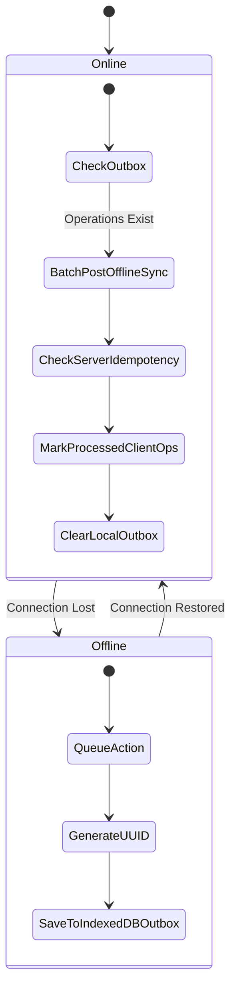

# Architecture Document: Rural Healthcare Platform

This document details the software architecture, design patterns, security controls, and infrastructure posture for the **Rural Healthcare Platform**. It is written to serve as an in-depth, authoritative architectural guide for any engineer working on the system.

---

## 1. High-Level System Architecture

The platform employs a **Backend-For-Frontend (BFF)** Serverless architecture designed specifically for low-bandwidth, spotty-connectivity rural environments while operating strictly within **100% Free-Tier quotas ($0 spend)** across all infrastructure providers.


---

## 2. Frontend & Rendering Architecture

### 2.1 Server Components & Incremental Static Regeneration (ISR)
All 8 public routes (`/`, `/camps`, `/directory`, `/emergency`, `/health-info`, `/health-info/schemes`, `/locations`, `/symptom-checker`) are **Server Components** configured with:
```typescript
export const revalidate = 3600 // Cached at Edge CDN for 1 hour
```
- **Zero Database Load on Navigation:** Page loads for public visitors do not invoke Supabase or execute serverless functions.
- **Client Interactive Islands:** Dynamic state (search filters, tab toggles, accordion expansion) is isolated in client components (`components/public-pages/`).
- **Elimination of SSR Redirect Hazards:** Protected dashboard routes use client-side `useEffect` wrappers for redirection, preventing server-side `location is not defined` errors during static generation.

### 2.2 First-Load JS Optimization & Code Splitting
- Heavy vendor libraries are dynamically imported with SSR disabled:
  * Leaflet maps: `next/dynamic(() => import("@/components/MapView"), { ssr: false })`
  * Floating AI assistant: `components/FloatingChatClient.tsx` dynamically imported in `app/layout.tsx`.
- First-load shared JavaScript payload was reduced from **607 kB uncompressed to 103 kB**, ensuring rapid first paint over 2G/3G rural networks.

### 2.3 PWA Architecture (Serwist Service Worker)
- **Engine:** Configured via `@serwist/next` with custom worker in `app/sw.ts`.
- **Runtime Caching Strategy:**
  * **Static Assets & Fonts:** CacheFirst with 30-day expiration.
  * **Public Cached APIs (`/api/facilities/nearby`, `/api/providers`):** StaleWhileRevalidate.
  * **Private Patient APIs (`/api/appointments`, `/api/medical-records`, `/api/notifications`, `/api/offline-sync`):** `NetworkOnly`. **Never cached** on disk, preventing medical data leakage on shared village smartphones.
- **Offline Fallback:** Standalone bilingual `/offline` page cached during service worker installation.

---

## 3. Data Ingress & Offline Outbox Architecture

To ensure uninterrupted operation when internet connectivity drops in remote villages:



### 3.1 Idempotent Outbox Mechanics
1. **Client Generation:** Operations created offline (prescriptions, camp registrations, vitals) are assigned a cryptographically random UUID (`client_op_id`) and persisted to IndexedDB (`ruralhealth_offline_db`).
2. **Server Verification:** `POST /api/offline-sync` checks the incoming batch against table `processed_client_ops`.
3. **At-Most-Once Execution:** If an operation was already recorded, the server returns status `"already_processed"` with HTTP 200 without executing duplicate insertions.
4. **Column Sanitization:** Client payloads are filtered against strict whitelists, discarding client-assigned IDs or privileged fields.

---

## 4. API Gateway, Rate Limiting & Abuse Prevention

### 4.1 Tiered Rate Limiting
Implemented via `@upstash/ratelimit` with Redis and an in-memory sliding-window fallback:
- **Public Read (60 req/min):** Spatial directory and provider endpoints.
- **Auth Read (120 req/min):** Patient records and appointments.
- **Mutations (30 req/min):** Booking, medical record creation, outbox sync.
- **AI & Heavy Compute (15 req/min, 200 daily quota):** Symptom checker and chat triage.
- **Notifications Polling (120 req/min):** Periodic notification updates.

### 4.2 AI Circuit Breaker (`lib/rate-limit.ts`)
Protects against upstream Gemini API outages and token exhaustion:
- Tracks consecutive downstream failures.
- **Tripping Threshold:** 5 consecutive failures trips the breaker into `OPEN` state.
- **Cooldown Window:** 60 seconds where incoming requests are immediately served localized fallback triage data without waiting for network timeouts.
- **Half-Open Probe:** After 60s, a single request probes the Gemini API to verify health before closing the breaker.

---

## 5. Realtime & Notification Architecture

### 5.1 Elimination of Realtime WebSockets
Supabase Free tier enforces a hard limit of **200 concurrent Realtime connections**. The previous unfiltered `postgres_changes` subscription on the notification bell exhausted this connection pool under minimal concurrent traffic.

### 5.2 Visibility-Aware Polling Engine (`components/NotificationBell.tsx`)
- Replaced websockets with HTTP polling against `GET /api/notifications?since=<timestamp>`.
- **Interval:** Polls every 60 seconds **only** while `document.visibilityState === 'visible'`.
- **Background Suspension:** Completely halts polling when the browser tab is hidden or minimized.
- **Immediate Refresh:** Fires immediately upon tab focus (`window.addEventListener('focus')`).
- **Backoff:** Implements exponential backoff on server errors.

---

## 6. Observability & Security Perimeter

### 6.1 Structured JSON Logging (`lib/logger.ts`)
- Standardized log levels (`logInfo`, `logWarn`, `logError`).
- Formats logs as JSON containing `timestamp`, `level`, `message`, `requestId`, `path`, `method`, and `status`.
- **PII Protection:** Patient user IDs are never logged in plain text. All user identifiers are hashed using SHA-256 and truncated to 12 hex characters (`hashUserId()`).

### 6.2 Edge Middleware Hardening (`middleware.ts`)
- Path matcher ignores all static assets (`/_next`, `/icons/`, `/manifest.webmanifest`, `/favicon.ico`, `/images/`).
- Stretches and attaches `x-request-id` header for end-to-end request tracing.
- Only protected role paths (`/dashboard`, `/doctor`, `/admin`) invoke Supabase Auth session refresh.

### 6.3 Content Security Policy (CSP)
Configured via `next.config.mjs` with `Content-Security-Policy-Report-Only`:
- Restricts script and iframe execution to `self`, Jitsi (`meet.jit.si`), CartoCDN tiles, and Google Fonts.
- Prevents XSS and malicious script injection while allowing observability during initial deployment.

---

## 7. 100% Free-Tier Posture & Quota Management

The entire architecture is designed to remain permanently within free tiers ($0 operating cost):

| Service | Free Tier Boundary | Architectural Defense |
|---|---|---|
| **Vercel Hobby** | 100 GB bandwidth, serverless invocations | Public routes use ISR (1-hour edge cache). JS bundle compressed to 103 kB. Static assets bypassed in middleware. |
| **Supabase Free** | 500 MB database, 5 GB egress, 200 realtime conns | Unfiltered websockets removed; cursor pagination limits row returns; coordinate rounding maximizes CDN cache; bounded query tables. |
| **Upstash Redis** | 10,000 commands/day | Cache keys TTL 24h; memory cache fallback when Redis is unconfigured or quota reached. |
| **Google Gemini** | 15 RPM, 1,500 RPD (Free tier) | Multi-model fallback cascade; SHA-256 response cache for identical queries; circuit breaker and IP daily quotas. |

---

## 8. ABDM & HL7 FHIR R4 Interoperability Subsystem

The platform implements an autonomous, zero-cost, pure TypeScript adapter for the **Ayushman Bharat Digital Mission (ABDM)** and **HL7 FHIR R4** standards:

### 8.1 National Standards Alignment
- **Profile Specification:** NRCES FHIR R4 Document Bundle (`https://nrces.in/ndhm/fhir/r4/StructureDefinition/DocumentBundle`).
- **Resource Composition:** Encapsulates clinical documents into structured bundles containing `Composition` (mandatory entry 0), `Patient`, `Practitioner`, `Organization`, and clinical payloads (`MedicationRequest`, `DiagnosticReport`, `Observation`, `Encounter`).
- **Standardized Coding Systems:**
  - LOINC for laboratory and clinical investigations (`11502-2` Lab report, `1558-6` Fasting blood glucose, `8480-6` Systolic BP).
  - UCUM (`http://unitsofmeasure.org`) for standardized units of measure (`mg/dL`, `mmHg`).
  - NDHM document types (`PRE` for Prescriptions, `DIAG` for Diagnostics, `ENC` for Encounters).

### 8.2 Architectural Seam & Zero-Cost Posture
- **Local Simulated Validation:** When sandbox credentials are not present in `.env`, the adapter executes local validation and bundle generation with $0 API expense and zero network egress.
- **Pluggable Live Gateway Seam:** Ready to connect directly to the NHA Sandbox Gateway (`https://dev.abdm.gov.in/gateway/v0.5`) upon provisioning `ABDM_CLIENT_ID` and `ABDM_CLIENT_SECRET`.
- **Integrity Verification:** Internal referential integrity is validated deterministically (`validateFhirBundle()`) to guarantee zero dangling URN references.
- **REST Export Endpoint:** `GET /api/abdm/fhir-export?record_id=<UUID>` enforces cross-tenant data isolation and emits `application/fhir+json` responses.

For detailed sequence diagrams, milestone breakdowns, and technical defense Q&A for placements, refer to [`docs/ABDM_FHIR_INTEROPERABILITY.md`](file:///c:/Users/aarrn/Desktop/rural%20health/RURAL-HEALTHCARE-PLATFORM-main/docs/ABDM_FHIR_INTEROPERABILITY.md).

