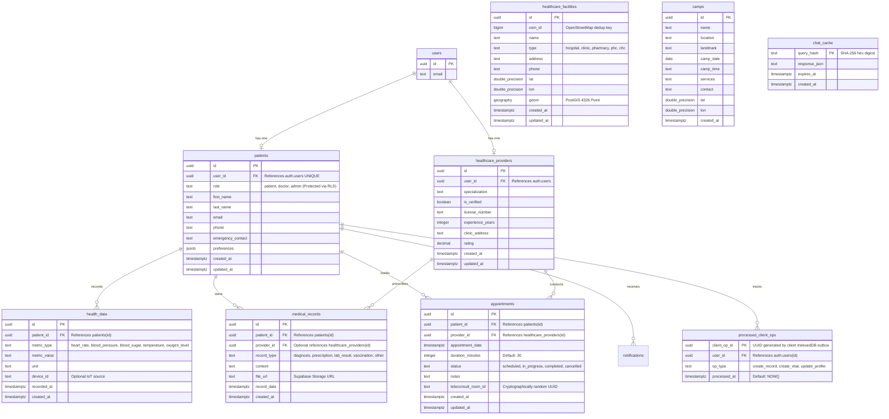

# Database Reference: Rural Healthcare Platform

This document describes the schema, structure, relationships, indexes, and Row Level Security (RLS) policies powering the Rural Healthcare Platform via **Supabase (PostgreSQL 15+ with PostGIS extensions)**.

---

## 1. Entity-Relationship (ER) Diagram



---

## 2. Table Definitions & Constraints

### 2.1 `patients`
Core patient and profile ledger.
- `id` (UUID, Primary Key, `default gen_random_uuid()`)
- `user_id` (UUID, Foreign Key `auth.users(id) ON DELETE CASCADE`, `UNIQUE`)
- `role` (TEXT, `CHECK (role IN ('patient', 'doctor', 'admin'))`, `DEFAULT 'patient'`)
- `first_name`, `last_name`, `email`, `phone`, `emergency_contact` (TEXT)
- `preferences` (JSONB, default `'{}'::jsonb`)
- `created_at`, `updated_at` (TIMESTAMPTZ)

**Security Hardening (Migration `09_scale_and_security.sql`):**
Users are strictly prevented from escalating their own privileges. The RLS update policy allows users to update only profile information, and an SQL trigger `prevent_patient_role_escalation` cancels any attempt by non-admins to change `role` or `user_id`.

### 2.2 `appointments`
Teleconsultation and clinic booking registry.
- `id` (UUID, Primary Key, `default gen_random_uuid()`)
- `patient_id` (UUID, References `patients(id) ON DELETE CASCADE`)
- `provider_id` (UUID, References `healthcare_providers(id) ON DELETE RESTRICT`)
- `appointment_date` (TIMESTAMPTZ, NOT NULL)
- `duration_minutes` (INTEGER, DEFAULT 30)
- `status` (TEXT, `CHECK (status IN ('scheduled', 'in_progress', 'completed', 'cancelled'))`, DEFAULT `'scheduled'`)
- `notes` (TEXT)
- `teleconsult_room_id` (TEXT, NOT NULL, Cryptographic UUID for Jitsi rooms)

**Double-Booking Prevention Constraint:**
A unique partial index guarantees that two scheduled appointments cannot exist for the same provider at the exact same time slot:
```sql
CREATE UNIQUE INDEX idx_appointments_provider_slot_active
ON appointments (provider_id, appointment_date)
WHERE status = 'scheduled';
```
When violated, Postgres throws error code `23505`, which API route `/api/appointments` maps directly to HTTP `409 Conflict` (`code: "SLOT_TAKEN"`).

### 2.3 `processed_client_ops`
Idempotency table for offline sync queue replay.
- `client_op_id` (UUID, Primary Key)
- `user_id` (UUID, References `auth.users(id) ON DELETE CASCADE`, NOT NULL)
- `op_type` (TEXT, NOT NULL)
- `processed_at` (TIMESTAMPTZ, DEFAULT NOW())

When the client flushes its IndexedDB offline outbox, each operation sends its client-generated UUID. If the server already contains that `client_op_id`, the operation is skipped without error, guaranteeing atomic at-most-once execution across network retries.

---

## 3. Indexes & Performance Optimization

All queries executed by API routes utilize dedicated indexes to ensure sub-millisecond execution times and zero sequential table scans:

| Table | Index Name | Index Definition | Purpose |
|---|---|---|---|
| `healthcare_facilities` | `idx_facilities_geom` | `USING GIST (geom)` | PostGIS bounding-box & spherical distance queries |
| `appointments` | `idx_appointments_provider_slot_active` | `UNIQUE (provider_id, appointment_date) WHERE status = 'scheduled'` | Double-booking prevention |
| `appointments` | `idx_appointments_patient_date` | `(patient_id, appointment_date DESC)` | Patient appointment list & cursor pagination |
| `appointments` | `idx_appointments_provider_date` | `(provider_id, appointment_date DESC)` | Doctor appointment queue & cursor pagination |
| `medical_records` | `idx_records_patient_date` | `(patient_id, record_date DESC)` | Patient records timeline & cursor pagination |
| `notifications` | `idx_notifications_recipient_created` | `(recipient_id, created_at DESC)` | Notification history |
| `notifications` | `idx_notifications_unread` | `(recipient_id, is_read, created_at DESC)` | Unread notification badge query |
| `health_data` | `idx_health_data_patient_recorded` | `(patient_id, recorded_at DESC)` | Vitals historical charts |
| `processed_client_ops` | `idx_processed_ops_user` | `(user_id, client_op_id)` | Fast batch idempotency check |

---

## 4. Row Level Security (RLS) Policy Matrix

| Table | Patient Access | Doctor Access | Admin Access |
|---|---|---|---|
| `patients` | Own row (SELECT, UPDATE profile only) | All rows (SELECT) | All rows (all ops) |
| `healthcare_providers` | Public verified (SELECT) | Own profile (all ops) | All rows (all ops) |
| `appointments` | Own appointments (SELECT, INSERT, cancel) | Assigned appointments (SELECT, complete) | All appointments (all ops) |
| `medical_records` | Own records (SELECT) | Assigned patients (SELECT, INSERT) | All records (all ops) |
| `health_data` | Own vitals (SELECT, INSERT, UPDATE) | Assigned patients (SELECT) | All vitals (SELECT) |
| `processed_client_ops` | Own ops (SELECT, INSERT) | Own ops (SELECT, INSERT) | All ops (all ops) |
| `notifications` | Own notifications (SELECT, UPDATE is_read) | Own notifications (SELECT, UPDATE is_read) | All notifications (all ops) |
| `healthcare_facilities`| Public (SELECT) | Public (SELECT) | All facilities (all ops) |
| `camps` | Public (SELECT) | Public (SELECT) | All camps (all ops) |
| `chat_cache` | Service role only (bypasses RLS) | Service role only | Service role only |

---

## 5. PostGIS Spatial RPC Functions

### `nearby_facilities` Function
Calculates spherical distance using PostGIS geography types:
```sql
CREATE OR REPLACE FUNCTION nearby_facilities(
    p_lat double precision,
    p_lon double precision,
    p_radius_km double precision DEFAULT 50,
    p_type text DEFAULT 'all',
    p_limit integer DEFAULT 50
)
RETURNS TABLE (
    id uuid,
    name text,
    type text,
    address text,
    phone text,
    lat double precision,
    lon double precision,
    distance_km double precision
)
LANGUAGE sql STABLE
AS $$
    SELECT
        f.id,
        f.name,
        f.type,
        f.address,
        f.phone,
        f.lat,
        f.lon,
        round((ST_Distance(f.geom, ST_SetSRID(ST_MakePoint(p_lon, p_lat), 4326)::geography) / 1000)::numeric, 1)::double precision AS distance_km
    FROM healthcare_facilities f
    WHERE
        ST_DWithin(f.geom, ST_SetSRID(ST_MakePoint(p_lon, p_lat), 4326)::geography, p_radius_km * 1000)
        AND (p_type = 'all' OR f.type = p_type)
    ORDER BY f.geom <-> ST_SetSRID(ST_MakePoint(p_lon, p_lat), 4326)::geography
    LIMIT LEAST(p_limit, 100);
$$;
```
