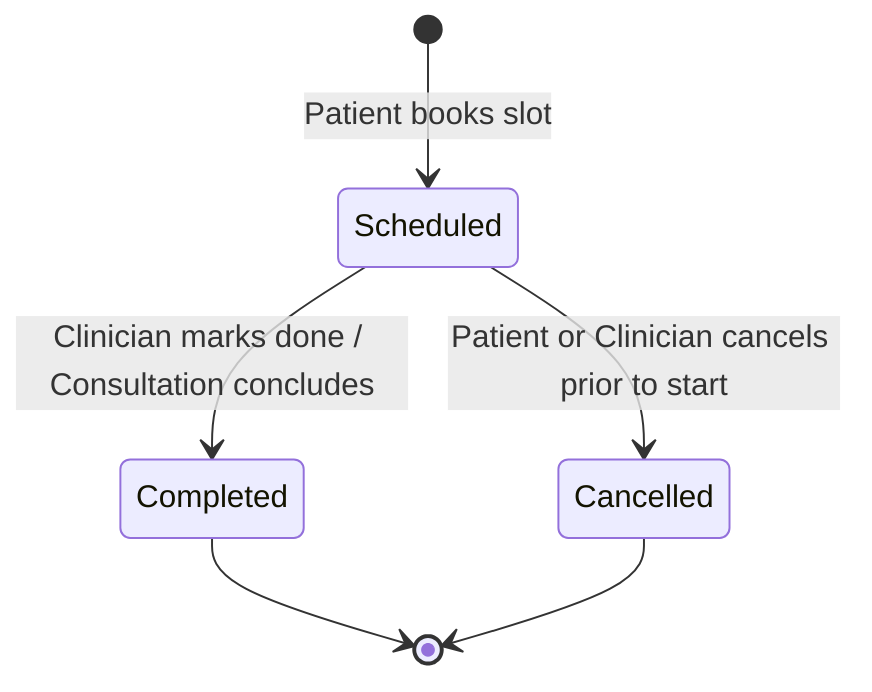

# Database Reference: Rural Healthcare Platform

This document describes the schema, structure, relationships, indexes, and Row Level Security (RLS) policies powering the Rural Healthcare Platform via **Supabase (PostgreSQL 15+ with PostGIS extensions)**.

---

## 1. Entity-Relationship (ER) Diagram

```mermaid
erDiagram
    users ||--o| patients : "has one"
    users ||--o| healthcare_providers : "has one"
    
    patients ||--o{ health_data : "records"
    patients ||--o{ medical_records : "owns"
    patients ||--o{ appointments : "books"
    patients ||--o{ notifications : "receives"
    patients ||--o{ processed_client_ops : "tracks"
    patients ||--o{ doctor_requests : "requests"
    
    healthcare_providers ||--o{ appointments : "conducts"
    healthcare_providers ||--o{ medical_records : "prescribes"
    
    %% Base Supabase Auth Table (System)
    users {
        uuid id PK
        text email
    }

    patients {
        uuid id PK
        uuid user_id FK "References auth.users UNIQUE"
        text role "patient, doctor, admin (Protected via RLS)"
        text first_name
        text last_name
        text email
        text phone
        date date_of_birth
        text gender
        text address
        text medical_history
        text allergies
        text current_medications
        text avatar_url
        timestamptz created_at
        timestamptz updated_at
    }

    healthcare_providers {
        uuid id PK
        uuid user_id FK "References auth.users UNIQUE"
        text name
        text email
        text phone
        text location
        text specialization
        text bio
        text avatar_url
        boolean is_verified
        timestamptz created_at
        timestamptz updated_at
    }

    appointments {
        uuid id PK
        uuid patient_id FK "References patients(id)"
        uuid provider_id FK "References healthcare_providers(id)"
        timestamptz appointment_date
        integer duration_minutes "Default: 30"
        text status "scheduled, completed, cancelled"
        text notes
        text consultation_type "video, audio, chat, in_person"
        text teleconsult_room_id "Cryptographically random room string"
        timestamptz created_at
        timestamptz updated_at
    }

    medical_records {
        uuid id PK
        uuid patient_id FK "References patients(id)"
        uuid provider_id FK "Optional references healthcare_providers(id)"
        uuid appointment_id FK "Optional references appointments(id)"
        text record_type "diagnosis, prescription, lab_result, vaccination, other"
        text content
        text file_url "Supabase Storage URL"
        jsonb metadata "Structured prescriptions, observations, vitals"
        timestamptz created_at
        timestamptz updated_at
    }

    health_data {
        uuid id PK
        uuid patient_id FK "References patients(id)"
        text data_type "vitals type indicator"
        numeric value "scalar reading"
        text unit "unit of measure"
        text notes
        text blood_pressure "e.g. 120/80"
        numeric temperature
        numeric pulse_rate
        numeric blood_sugar
        numeric spo2
        numeric weight
        timestamptz recorded_at
        timestamptz created_at
    }

    processed_client_ops {
        uuid user_id PK "Composite PK (user_id, client_op_id)"
        uuid client_op_id PK "UUID generated by client IndexedDB outbox"
        text table_name "appointments, health_data, notifications"
        timestamptz processed_at "Default: NOW()"
    }

    healthcare_facilities {
        uuid id PK
        bigint osm_id "OpenStreetMap dedup key"
        text name
        text type "hospital, clinic, pharmacy, doctors, health_post, lab"
        text address
        text phone
        text district "LGD District Name"
        text state "LGD State Name"
        double_precision lat
        double_precision lon
        geography geom "PostGIS 4326 Point"
        jsonb tags "Speciality, emergency, operator metadata"
        timestamptz created_at
        timestamptz updated_at
    }

    camps {
        uuid id PK
        text title
        text description
        text location
        text address
        date start_date
        date end_date
        text start_time
        text status "upcoming, active, ended"
        text category "checkup, eye, dental, blood, etc."
        integer participants
        text phone
        text map_url
        boolean is_annual
        timestamptz created_at
        timestamptz updated_at
    }

    chat_cache {
        uuid id PK
        text question
        text normalized_question
        varchar lang "Language code (en, hi, etc.)"
        text answer
        varchar source "gemini, curated"
        varchar status "pending, approved, rejected"
        integer up_votes
        integer down_votes
        uuid reviewed_by FK "References auth.users(id)"
        timestamptz reviewed_at
        timestamptz created_at
    }

    notifications {
        uuid id PK
        text title
        text message
        text type "info, warning, success, emergency"
        text recipient_type "all, role, individual"
        text recipient_role
        uuid recipient_id FK "References patients(id)"
        boolean is_read
        timestamptz created_at
    }

    doctor_requests {
        uuid id PK
        uuid user_id FK "References auth.users(id)"
        text full_name
        text email
        text phone
        text specialization
        text license_number
        text qualification
        integer experience_years
        text hospital_affiliation
        text status "pending, approved, rejected"
        text notes
        timestamptz created_at
        timestamptz updated_at
    }

    access_audit_log {
        uuid id PK
        uuid user_id FK "References auth.users(id)"
        text user_role
        text action
        text resource_type
        uuid resource_id
        uuid patient_id
        text ip_address
        text user_agent
        jsonb details
        timestamptz created_at
    }

    offline_sync_log {
        uuid id PK
        uuid user_id FK "References auth.users(id)"
        text table_name
        text operation
        uuid client_op_id
        text status
        text error
        timestamptz created_at
    }

    payments {
        uuid id PK
        uuid user_id FK "References auth.users(id)"
        uuid appointment_id FK "References appointments(id)"
        numeric amount
        text currency "Default INR"
        text status "pending, completed, failed, refunded"
        text payment_method
        text transaction_id
        timestamptz created_at
        timestamptz updated_at
    }
```



---

## 2. Table Definitions & Constraints

### 2.1 `patients`
Single authoritative patient and user identity ledger.
- `id` (UUID, Primary Key, `default gen_random_uuid()`)
- `user_id` (UUID, Foreign Key `auth.users(id) ON DELETE CASCADE`, `UNIQUE`)
- `role` (TEXT, `CHECK (role IN ('patient', 'doctor', 'admin'))`, `DEFAULT 'patient'`)
- `first_name`, `last_name`, `email`, `phone`, `date_of_birth`, `gender`, `address`
- `medical_history`, `allergies`, `current_medications`, `avatar_url` (TEXT)
- `created_at`, `updated_at` (TIMESTAMPTZ)

**Security Hardening (Migration `20261011000000_scale_and_security.sql`):**
Users are strictly prevented from escalating their own privileges. The RLS update policy allows users to update only profile information, and an SQL trigger `guard_patient_privileges` cancels any attempt by non-admins to change `role` or `user_id`.

### 2.2 `appointments`
Teleconsultation and clinic booking registry.
- `id` (UUID, Primary Key, `default gen_random_uuid()`)
- `patient_id` (UUID, References `patients(id) ON DELETE CASCADE`)
- `provider_id` (UUID, References `healthcare_providers(id) ON DELETE RESTRICT`)
- `appointment_date` (TIMESTAMPTZ, NOT NULL)
- `duration_minutes` (INTEGER, DEFAULT 30)
- `status` (TEXT, `CHECK (status IN ('scheduled', 'completed', 'cancelled'))`, DEFAULT `'scheduled'`)
- `notes` (TEXT)
- `consultation_type` (TEXT, `CHECK (consultation_type IN ('video', 'audio', 'chat', 'in_person'))`, DEFAULT `'video'`)
- `teleconsult_room_id` (TEXT, Cryptographic UUID for Jitsi rooms)

**Double-Booking Prevention Constraint:**
A unique partial index guarantees that two scheduled appointments cannot exist for the same provider at the exact same time slot:
```sql
CREATE UNIQUE INDEX uq_provider_slot_scheduled
ON appointments (provider_id, appointment_date)
WHERE status = 'scheduled';
```
When violated, Postgres throws error code `23505`, which API route `/api/appointments` maps directly to HTTP `409 Conflict` (`code: "SLOT_TAKEN"`).

### 2.3 `medical_records`
Patient electronic health records, prescriptions, and diagnostic reports.
- `id` (UUID, Primary Key, `default gen_random_uuid()`)
- `patient_id` (UUID, References `patients(id) ON DELETE CASCADE`, NOT NULL)
- `provider_id` (UUID, References `healthcare_providers(id) ON DELETE SET NULL`)
- `appointment_id` (UUID, References `appointments(id) ON DELETE SET NULL`)
- `record_type` (TEXT)
- `content` (TEXT, NOT NULL)
- `file_url` (TEXT)
- `metadata` (JSONB, DEFAULT `'{}'::jsonb`)
- `created_at` (TIMESTAMPTZ, DEFAULT NOW())
- `updated_at` (TIMESTAMPTZ, DEFAULT NOW())

### 2.4 `health_data`
Temporal biometric indicators and vitals log.
- `id` (UUID, Primary Key, `default gen_random_uuid()`)
- `patient_id` (UUID, References `patients(id) ON DELETE CASCADE`, NOT NULL)
- `data_type` (TEXT)
- `value` (NUMERIC)
- `unit` (TEXT)
- `notes` (TEXT)
- `blood_pressure` (TEXT) — e.g. `'120/80'`
- `temperature` (NUMERIC)
- `pulse_rate` (NUMERIC)
- `blood_sugar` (NUMERIC)
- `spo2` (NUMERIC)
- `weight` (NUMERIC)
- `recorded_at` (TIMESTAMPTZ, DEFAULT NOW())
- `created_at` (TIMESTAMPTZ, DEFAULT NOW())

### 2.5 `processed_client_ops`
Idempotency table for offline sync queue replay.
- `user_id` (UUID, NOT NULL)
- `client_op_id` (UUID, NOT NULL)
- `table_name` (TEXT, NOT NULL)
- `processed_at` (TIMESTAMPTZ, DEFAULT NOW())
- **Primary Key:** `(user_id, client_op_id)`

When the client flushes its IndexedDB offline outbox, each operation sends its client-generated UUID. If the server already contains that `(user_id, client_op_id)` tuple, the operation is skipped without error, guaranteeing atomic at-most-once execution across network retries.

### 2.6 `healthcare_facilities`
National geospatial directory of healthcare facilities, hospitals, clinics, and individual registered doctors across India.
- `id` (UUID, Primary Key, `default gen_random_uuid()`)
- `osm_id` (BIGINT, UNIQUE) — Natural deduplication key from OpenStreetMap nodes/ways/relations.
- `name` (TEXT, NOT NULL) — Facility or practitioner name.
- `type` (TEXT, NOT NULL) — One of `'hospital'`, `'clinic'`, `'doctors'`, `'pharmacy'`, `'lab'`, `'health_post'`.
- `address` (TEXT) — Human-readable road, street, or locality address.
- `phone` (TEXT) — Public contact or emergency phone number.
- `district` (TEXT) — Local Government Directory (LGD) district name.
- `state` (TEXT, DEFAULT `'Madhya Pradesh'`) — LGD state name.
- `lat` / `lon` (DOUBLE PRECISION, NOT NULL) — WGS84 decimal coordinates.
- `geom` (GEOGRAPHY(Point, 4326)) — Automatically calculated PostGIS geography point generated via trigger `trg_set_facility_geom`.
- `tags` (JSONB, DEFAULT `'{}'`) — Unstructured metadata attributes including `speciality`, `emergency`, `opening_hours`, and `operator`.

---

## 3. Indexes & Performance Optimization

All queries executed by API routes utilize dedicated indexes to ensure sub-millisecond execution times and zero sequential table scans:

| Table | Index Name | Index Definition | Purpose |
|---|---|---|---|
| `healthcare_facilities` | `idx_facilities_geom` | `USING GIST (geom)` | PostGIS bounding-box & spherical distance queries |
| `appointments` | `uq_provider_slot_scheduled` | `UNIQUE (provider_id, appointment_date) WHERE status = 'scheduled'` | Double-booking prevention |
| `appointments` | `idx_appointments_patient_id` | `(patient_id)` | Foreign key join covering index |
| `appointments` | `idx_appointments_provider_id` | `(provider_id)` | Foreign key join covering index |
| `appointments` | `idx_appointments_patient_date` | `(patient_id, appointment_date DESC)` | Patient appointment list & pagination |
| `appointments` | `idx_appointments_provider_date` | `(provider_id, appointment_date)` | Doctor appointment queue & pagination |
| `medical_records` | `idx_medical_records_patient_id` | `(patient_id)` | Foreign key join covering index |
| `medical_records` | `idx_medical_records_provider_id` | `(provider_id)` | Foreign key join covering index |
| `medical_records` | `idx_medical_records_patient_created` | `(patient_id, created_at DESC)` | Patient records timeline & pagination |
| `notifications` | `idx_notifications_recipient_id` | `(recipient_id)` | Foreign key join covering index |
| `notifications` | `idx_notifications_recipient_created` | `(recipient_id, created_at DESC)` | Notification history |
| `health_data` | `idx_health_data_patient` | `(patient_id)` | Patient vitals lookup |
| `health_data` | `idx_health_data_recorded` | `(patient_id, recorded_at DESC)` | Vitals historical charts |
| `processed_client_ops` | `idx_processed_client_ops_age` | `(processed_at)` | Fast batch idempotency check & pruning |
| `chat_cache` | `idx_chat_cache_normalized_question` | `(normalized_question)` | AI semantic cache question lookup |

---

## 4. Row Level Security (RLS) Policy Matrix

| Table | Patient Access | Doctor Access | Admin Access | Demo Admin Mode |
|---|---|---|---|---|
| `patients` | Own row (`SELECT`, `UPDATE` non-role) | Care relationship patients only (`SELECT` via `has_care_relationship`) | Directory oversight (`SELECT`, `DELETE`) | `SELECT` only; role edits & deletes prohibited |
| `healthcare_providers` | Public verified (`SELECT`) | Public verified (`SELECT`) | All rows (`SELECT`, `INSERT`, `UPDATE`, `DELETE`) | Read only |
| `appointments` | Own appointments (`SELECT`, `INSERT`, cancel) | Assigned appointments (`SELECT`, update) | Directory oversight (`SELECT`, `UPDATE`, `DELETE`) | `SELECT` only; mutations blocked |
| `medical_records` | Own records (`SELECT`, `INSERT`) | Assigned patients under care (`SELECT`, `INSERT`) | Zero direct access: `SELECT`/`UPDATE`/`DELETE` denied under RLS; Audited erasure via `admin_erase_medical_record` RPC | Read denied; mutations blocked |
| `access_audit_log` | Own rows (`INSERT`) | Own rows (`INSERT`) | Audit review (`SELECT`); updates/deletes revoked | Read only |
| `health_data` | Own vitals (`SELECT`, `INSERT`, `UPDATE`, `DELETE`) | Care relationship patients (`SELECT` via `has_care_relationship`) | Aggregate metadata | Read only |
| `processed_client_ops` | Own ops (`SELECT`, `INSERT`) | Own ops (`SELECT`, `INSERT`) | Own ops (`SELECT`, `INSERT`) | Read only |
| `notifications` | Own notifications (`SELECT`, `UPDATE is_read`) | Own notifications (`SELECT`, `UPDATE is_read`) | All notifications (`SELECT`, `INSERT`) | Read only |
| `healthcare_facilities`| Public (`SELECT`) | Public (`SELECT`) | All facilities (`ALL`) | Read only |
| `clinical_encounters` | Own encounters (`SELECT`, `INSERT`) | Care relationship patients only (`ALL` via `has_care_relationship`) | Full oversight (`ALL`) | Read only |
| `clinical_observations` | Own observations (`SELECT`, `INSERT`) | Care relationship patients only (`ALL` via `has_care_relationship`) | Full oversight (`ALL`) | Read only |
| `chat_cache` | None | Moderation (`SELECT`, `UPDATE`) if verified doctor | Full moderation (`SELECT`, `UPDATE`) | Read only |

---

## 5. Security Functions & Triggers

### 5.1 `get_user_role()`
Derived **strictly and exclusively** from `public.patients.role` for `auth.uid()`, eliminating JWT spoofing:
```sql
CREATE OR REPLACE FUNCTION public.get_user_role()
RETURNS text
LANGUAGE sql
STABLE
SECURITY DEFINER
SET search_path = public
AS $$
  SELECT COALESCE(
    (SELECT role FROM public.patients WHERE user_id = auth.uid() LIMIT 1),
    'patient'
  );
$$;
```

### 5.2 `has_care_relationship(p_patient_id)`
Restricts clinician visibility exclusively to patients with whom an active or scheduled appointment exists via `healthcare_providers.user_id = auth.uid()`:
```sql
CREATE OR REPLACE FUNCTION public.has_care_relationship(p_patient_id uuid)
RETURNS boolean
LANGUAGE plpgsql
SECURITY DEFINER
SET search_path = public, auth
STABLE
AS $$
BEGIN
  RETURN EXISTS (
    SELECT 1 FROM public.appointments a
    JOIN public.healthcare_providers hp ON a.provider_id = hp.id
    WHERE a.patient_id = p_patient_id
      AND hp.user_id = auth.uid()
      AND a.status IN ('scheduled', 'completed')
  );
END;
$$;
```

### 5.3 `guard_demo_admin_safety()`
Prevents preview demo accounts (`admin@ruralhealth.demo`) from mutating live records or dropping data:
```sql
CREATE OR REPLACE FUNCTION public.guard_demo_admin_safety()
RETURNS trigger
LANGUAGE plpgsql
SECURITY DEFINER
SET search_path = public, auth
AS $$
BEGIN
  IF EXISTS (
    SELECT 1 FROM auth.users
    WHERE id = auth.uid()
      AND lower(trim(email)) = 'admin@ruralhealth.demo'
  ) THEN
    RAISE EXCEPTION 'Demo admin mode restricted: Modifying or destructive operations are prohibited for preview accounts.';
  END IF;
  RETURN COALESCE(NEW, OLD);
END;
$$;
```

### 5.4 `admin_erase_medical_record(p_record_id, p_reason)`
Enforces right-to-erasure under clinical data standards (DPDP Act 2023). Administrators have **zero direct RLS access** (`SELECT`, `INSERT`, `UPDATE`, `DELETE`) on `public.medical_records`. Right-to-erasure is strictly executed through this audited `SECURITY DEFINER` function:
1. **Role Authorization:** Caller role must be `admin`.
2. **Reason Verification:** Requires at least 10 characters of justification.
3. **Immutable Audit Record:** Writes an atomic entry into `public.access_audit_log` before deletion.

---

## 6. PostGIS Spatial Proximity Search (`nearby_facilities`)

Calculates spherical distance using PostGIS geography types:
```sql
CREATE OR REPLACE FUNCTION nearby_facilities(
    p_lat double precision,
    p_lon double precision,
    p_radius_km double precision DEFAULT 50,
    p_type text DEFAULT 'all',
    p_limit integer DEFAULT 50
)
RETURNS TABLE (
    id uuid,
    name text,
    type text,
    address text,
    phone text,
    lat double precision,
    lon double precision,
    distance_km double precision
)
LANGUAGE sql STABLE
SET search_path = public, pg_catalog
AS $$
    SELECT
        f.id,
        f.name,
        f.type,
        f.address,
        f.phone,
        f.lat,
        f.lon,
        round((ST_Distance(f.geom, ST_SetSRID(ST_MakePoint(p_lon, p_lat), 4326)::geography) / 1000)::numeric, 1)::double precision AS distance_km
    FROM healthcare_facilities f
    WHERE
        ST_DWithin(f.geom, ST_SetSRID(ST_MakePoint(p_lon, p_lat), 4326)::geography, p_radius_km * 1000)
        AND (p_type IS NULL OR p_type = 'all' OR f.type = p_type)
    ORDER BY f.geom <-> ST_SetSRID(ST_MakePoint(p_lon, p_lat), 4326)::geography
    LIMIT LEAST(p_limit, 100);
$$;
```

---

## 7. Operational Health & Appointment State Machine

### Lifecycle States


### Past / Expired Classification
- An appointment is classified as **Past / Incomplete** if:
  $$\text{status} = \text{'scheduled'} \quad \text{AND} \quad \text{appointment\_date} + (\text{duration\_minutes} \times \text{60s}) < \text{NOW}()$$
- Teleconsult room join links and cancellation triggers are automatically disabled for consultations outside their active window.
