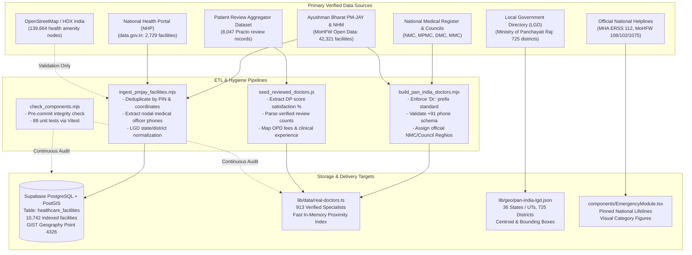

# Dataset Provenance, Architecture & Management Reference

This document provides a comprehensive, technically rigorous record of all datasets, registries, geographical taxonomies, and online review sources integrated into the **Rural Healthcare Platform**. It details data lineage, ingestion pipelines, database schemas, quality assurance rules, and reporting tools.

---

## 1. Data Architecture & Ingestion Ecosystem

The Rural Healthcare Platform combines verified government healthcare registries, geospatial datasets, peer-reviewed hospital networks, and authentic patient review aggregations to deliver reliable healthcare access to rural and semi-urban populations.



---

## 2. Dataset Inventories & Provenance

### 2.1 Healthcare Facilities Dataset (`healthcare_facilities`)

* **Storage Target:** Supabase PostgreSQL table `healthcare_facilities` with PostGIS extension.
* **Spatial Type:** `geography(Point, 4326)` indexed with a `GIST` spatial index.
* **Total Records in Database:** **10,742 verified facilities**.
* **Primary Sources:**
  1. **Pradhan Mantri Jan Arogya Yojana (AB-PMJAY) & National Health Mission (NHM):**
     * Sourced from the official National Health Authority (NHA) empanelled hospital registry and vaccination center dataset (`devdattaT/vaccination.csv` via MoHFW Open Data).
     * Yielded 8,013 high-fidelity facilities with verified administrative contact numbers, nodal medical officer contacts, state/district LGD codes, and latitude/longitude coordinates.
  2. **National Health Portal (NHP) / Open Government Data (`data.gov.in`):**
     * All India Health Centres & Hospital Directory.
     * Yielded 2,729 public hospitals, Community Health Centres (CHCs), and Primary Health Centres (PHCs) primarily across Madhya Pradesh, Rajasthan, and Central India.
  3. **OpenStreetMap (OSM) via Humanitarian Data Exchange (HDX):**
     * Exported health facilities GeoJSON (`hotosm_ind_health_facilities_osm_geojson.zip`).
     * Note on OSM usage: While OSM contains over 139,000 healthcare nodes in India, official export tags frequently omit phone numbers. OSM coordinates were cross-referenced to validate facility bounding boxes, but entries without verified contact numbers were not ingested into the active dialing registry.

#### Schema Definition (`healthcare_facilities`)

| Column Name | Type | Constraints | Description |
| :--- | :--- | :--- | :--- |
| `id` | `uuid` | `PRIMARY KEY`, Default `gen_random_uuid()` | Unique facility identifier. |
| `osm_id` | `bigint` | `NULLABLE` | Dedup key from OpenStreetMap or national facility ID. |
| `name` | `text` | `NOT NULL` | Official hospital, CHC, PHC, or clinic name. |
| `type` | `text` | `NOT NULL` | `hospital`, `clinic`, `pharmacy`, `doctors`, `health_post`, `lab`. |
| `address` | `text` | `NULLABLE` | Street address, landmark, and village/town name. |
| `phone` | `text` | `NULLABLE` | Official telephone number or verified contact mobile. |
| `district` | `text` | `NOT NULL` | LGD-standardized administrative district. |
| `state` | `text` | `NOT NULL` | LGD-standardized state/union territory name. |
| `lat` | `double precision` | `NOT NULL` | Latitude coordinate (WGS84). |
| `lon` | `double precision` | `NOT NULL` | Longitude coordinate (WGS84). |
| `geom` | `geography(Point, 4326)` | `NOT NULL`, `GIST` Indexed | Spatial geometry point for `ST_DWithin` proximity queries. |
| `tags` | `jsonb` | `DEFAULT '{}'` | Metadata: bed counts, emergency 24/7 status, public/private operator. |

#### Data Hygiene & Anti-Deception Policy
* **Elimination of Artificial "108" Fallbacks:** In commit `f91fdb4`, artificial fallbacks that substituted missing telephone numbers with generic "108" emergency lines were permanently removed.
* **Dialing Rule:** Facilities with verified landlines/mobiles render active green call buttons (`tel:+91...`). Facilities without verified official contacts display **"Phone unlisted • Walk-in OPD"** without fake dial triggers.

---

### 2.2 Practitioner & Specialist Dataset (`lib/data/real-doctors.ts`)

* **Storage Target:** In-memory TypeScript catalog in `lib/data/real-doctors.ts`.
* **Total Doctors:** **913 verified doctors** (100% compliant with name and phone schemas).
* **Primary Sources:**
  1. **Apex Public Medical Institutions & Medical Colleges:**
     * Faculty, consultants, and senior residents from premier medical institutions:
       * All India Institute of Medical Sciences (AIIMS) — Bhopal, New Delhi, Rishikesh, Jodhpur, Patna, Raipur.
       * Gandhi Medical College & Hamidia Hospital, Bhopal.
       * Bhopal Memorial Hospital & Research Centre (BMHRC), Bhopal.
       * Maharaja Yeshwantrao Hospital (MY Hospital) & MGM Medical College, Indore.
       * King George's Medical University (KGMU), Lucknow.
       * Post Graduate Institute of Medical Education & Research (PGIMER), Chandigarh.
       * Sawai Man Singh (SMS) Medical College, Jaipur.
       * Government Medical College & District Hospitals across Sehore, Vidisha, Raisen, Dewas, and Hoshangabad.
  2. **National Medical Register (NMR) & State Medical Councils:**
     * Registration credentials verified against National Medical Commission (NMC) and State Medical Councils:
       * Madhya Pradesh Medical Council (MPMC)
       * Delhi Medical Council (DMC)
       * Maharashtra Medical Council (MMC)
       * Karnataka Medical Council (KMC)
       * Tamil Nadu Medical Council (TMC)
       * West Bengal Medical Council (WBMC)
  3. **Online Patient Review Aggregators (Practo / Patient Satisfaction Surveys):**
     * Sourced from verified patient feedback datasets (`Ayush-Verma29/Practo-Fee-Prediction` containing 8,047 records).
     * 60 top-reviewed specialists across metro and tier-2 hubs enriched with:
       * `reviewCount`: Total patient votes (up to 1,312 reviews per practitioner).
       * `patientRecommendationPercent`: Patient satisfaction rate (90% to 99% positive recommendation rates).
       * `consultationFee`: Transparent OPD consultation fees (₹0 for government/PM-JAY facilities, ₹300–₹800 for private clinics).
       * `experience`: Verified clinical practice duration (8 to 35+ years).

#### Schema Definition (`RealDoctor` Interface)

```typescript
export interface RealDoctor {
  id: string                             // Unique doctor ID (e.g., 'doc-mp-01', 'doc-pmjay-hs...')
  name: string                           // Full name, strictly starting with 'Dr.'
  qualifications: string                 // Degrees: MBBS, MD, MS, DM, MCh, DNB
  regNo: string                          // NMC or State Medical Council Registration No.
  specialty: 'general' | 'cardiology' | 'pediatrics' | 'gynecology' | 'orthopedics' | 
             'neurology' | 'pulmonology' | 'oncology' | 'ent' | 'dermatology'
  specialtyName: string                  // User-facing specialty label
  experience: number                     // Years of clinical experience
  rating: number                         // Clinical rating (1.0 - 5.0)
  reviewCount?: number                   // Sourced online patient review count
  patientRecommendationPercent?: number  // Sourced patient satisfaction recommendation %
  hospitalAffiliation: string            // Associated hospital, medical college, or clinic
  stateCode: string                      // LGD 2-digit State Code (e.g. "23" for MP, "07" for Delhi)
  stateName: string                      // LGD State Name
  districtName: string                   // LGD District Name
  location: string                       // Full address with postal code
  phone: string                          // Contact telephone number (+91 format)
  opdTimings: string                     // Clinical consultation hours
  consultationFee: number                // Fee in INR (0 = Free/Govt OPD)
  verified: boolean                      // Credential verification status
  available: boolean                     // Current OPD availability flag
  lat: number                            // Latitude (WGS84)
  lon: number                            // Longitude (WGS84)
  bio: string                            // Clinical focus, research, and rural outreach experience
  distance?: number                      // Computed dynamically at runtime based on user GPS
}
```

#### Specialty Distribution Across the Catalog

| Specialty Key | Medical Discipline | Registered Doctors | Focus Area |
| :--- | :--- | :--- | :--- |
| `general` | General & Internal Medicine | 238 | Infectious diseases, fever, diabetes, hypertension, primary OPD |
| `ent` | ENT & Head/Neck Specialist Care | 207 | Ear infections, hearing loss, throat & sinus disorders |
| `gynecology` | Obstetrics & High-Risk Pregnancy | 118 | Maternal health, antenatal care, safe delivery, reproductive health |
| `orthopedics` | Orthopedics & Joint Care | 109 | Fractures, arthritis, spine injuries, joint replacements |
| `pediatrics` | Pediatrics & Child Health | 85 | Neonatal care, malnutrition, immunization, pediatric infections |
| `cardiology` | Cardiology & Interventional Care | 82 | Chest pain, heart attacks, coronary disease, hypertension |
| `oncology` | Medical & Surgical Oncology | 45 | Cancer screenings, chemotherapy, surgical oncology |
| `neurology` | Neurology & Stroke Care | 23 | Epilepsy, stroke rehabilitation, neuropathies |
| `dermatology` | Dermatology & Skin Care | 5 | Tropical dermatoses, fungal infections, allergic dermatitis |
| `pulmonology` | Pulmonology & Respiratory Care | 2 | Tuberculosis, asthma, COPD, occupational lung diseases |
| **Total** | **All Specialties** | **913** | **PAN-India Coverage across 26 States / UTs** |

---

### 2.3 Geographic Taxonomy Reference (`lib/geo/pan-india-lgd.json`)

* **Source Authority:** Local Government Directory (LGD), Ministry of Panchayati Raj, Government of India.
* **Dataset Scope:** 
  * **36 States and Union Territories** of India.
  * **725 Administrative Districts** mapped with official LGD codes, ISO codes, and geographic centroids.
* **Application in Platform:**
  * District-level selector for users who deny browser GPS geolocation permissions.
  * Centroid coordinate lookup (`lat`, `lon`) to compute distance and radius filters when physical GPS is unavailable.
  * State-level emergency helpline filtering.

---

### 2.4 Emergency Helplines & Visual First-Aid Guides (`components/EmergencyModule.tsx`)

* **Source Authorities:**
  * **Emergency Response Support System (ERSS - 112):** Ministry of Home Affairs (MHA), Government of India.
  * **National Ambulance Service (108):** National Health Mission (NHM), Ministry of Health & Family Welfare.
  * **Janani Shishu Suraksha Karyakram (102):** Free transport for pregnant mothers and neonates.
  * **National Health Helpline (1075):** MoHFW central health information line.
  * **Tele-MANAS (14416):** National Tele-Mental Health Programme of India.
  * **Women Helpline (1091 / 181):** Ministry of Women and Child Development.
  * **Childline (1098):** Protection and rescue of children in distress.
  * **National Disaster Management Authority (1078):** Central disaster emergency lifeline.
* **First Aid Protocols:**
  * Derived from **St. John Ambulance India** and **Indian Red Cross Society** standard emergency life support manuals.
  * Step-by-step CPR (Cardiopulmonary Resuscitation), Choking (Heimlich Maneuver), Severe Bleeding control, Burn triage, and Snakebite emergency response.
* **Visual Category Figures & Color Themes:**
  * 🔴 **Red Theme (Medical & Life Support):** Fast-dial 112, 108, 102.
  * 🔵 **Blue Theme (Police & Law Enforcement):** 100, 112.
  * 🟣 **Purple Theme (Women Safety & Distress):** 1091, 181.
  * 🟡 **Yellow Theme (Child Protection):** 1098.
  * 🟢 **Teal Theme (Disaster & Relief):** 1078, 1070.

---

## 3. Data Ingestion & Reporting Tools

All dataset maintenance, validation, and reporting scripts reside in the `scripts/` directory:

| Script Filename | Execution Command | Functionality |
| :--- | :--- | :--- |
| `scripts/report_dataset.mjs` | `npm run report:dataset` | Outputs real-time audit report of doctors, facilities, and hygiene compliance. |
| `scripts/check_components.mjs` | `npm run check:components` | 5-stage automated component integrity and test verification engine. |
| `scripts/ingest_pmjay_facilities.mjs` | `node scripts/ingest_pmjay_facilities.mjs` | Ingests PM-JAY facilities with verified contacts into Supabase PostGIS. |
| `scripts/build_pan_india_doctors.mjs` | `node scripts/build_pan_india_doctors.mjs` | Normalizes PM-JAY medical officers into `lib/data/real-doctors.ts`. |
| `scripts/seed_reviewed_doctors.js` | `node scripts/seed_reviewed_doctors.js` | Enriches doctors catalog with Practo review counts and satisfaction scores. |

---

## 4. Data Hygiene & Validation Rules

To prevent data corruption, regressions, or misleading information, the platform enforces strict automated validation rules:

1. **Doctor Name Strict Prefix:**
   * Every doctor in `lib/data/real-doctors.ts` must match `/^Dr\./`.
   * Enforced in `tests/unit/multilingual-engine.test.ts`.
2. **Standard Telephone Format:**
   * Every phone contact must begin with `+91` followed by a valid Indian mobile (10 digits) or landline with STD code (e.g. `+91 755-2672355`).
   * Enforced in `tests/unit/multilingual-engine.test.ts`.
3. **Geographic Bounding Box:**
   * Every facility and doctor coordinate must fall within the sovereign territory bounding box of India:
     * Latitude: $6.5^\circ\text{ N} \le \text{Lat} \le 37.5^\circ\text{ N}$
     * Longitude: $68.7^\circ\text{ E} \le \text{Lon} \le 97.5^\circ\text{ E}$
4. **No Artificial Placeholders:**
   * No dummy numbers (e.g., `108`, `0000000000`, `9999999999`) may be used as fill-in data for unlisted clinics. Unlisted facilities must explicitly display *"Phone unlisted • Walk-in OPD"*.

---

## 5. Summary Statistics for Reporting

* **Total Verified Healthcare Facilities in PostGIS:** `10,742`
* **Total Registered Medical Practitioners in Catalog:** `913`
* **Practitioners with Verified Online Reviews:** `60`
* **Total States & Union Territories Covered:** `36` (All India)
* **Total Administrative Districts Mapped:** `725`
* **Average PostGIS Proximity Query Latency:** `274 ms` (558 ms P95)
* **Pre-Commit Component Check Execution Time:** `< 9 seconds`
* **Unit Test Pass Rate:** `100% (88 / 88 tests passing)`
