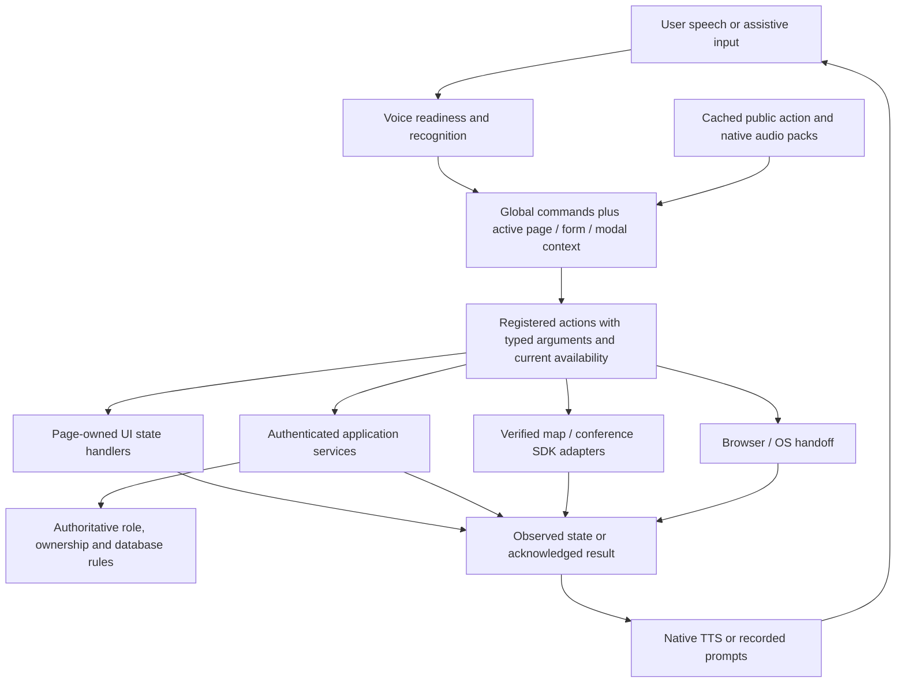

# Plan for complete voice control of the healthcare website

Date: 22 November 2026. Status: **website controller implemented; real-device/native-language and legacy-write release audits remain open**. Source baseline: `c45aa0cf2953300c4f02f3861bb7ff1502d3b735`.

## Intended result

The avatar becomes the user's controller for the active website: it explains available options, accepts a spoken selection, fills and corrects fields, operates registered controls, and announces verified outcomes. It works for users with limited literacy, visual impairment or difficulty using touch/keyboard. Public/patient tasks come first; verified professional roles get their own permitted menus.

Target **100% of eligible first-party interactive controls** after voice activation, with every browser/OS limitation explicitly accounted for. A PWA cannot grant its own permissions, remain an uninterrupted microphone after suspension/closure, or operate another application's private UI. End-to-end touch-free setup/system handoffs may require Android Voice Access, iOS Voice Control or another supported assistive input. Their language/device coverage must also be checked. A native companion is a separate project only if system-wide/background operation is essential.

See [implemented behavior and limits](HANDS_FREE_IMPLEMENTATION.md). The [option map](HANDS_FREE_ACTION_MAP.md) groups all 28 page entries. The [497-candidate source inventory](HANDS_FREE_CONTROL_INVENTORY.md) and [JSON references](HANDS_FREE_CONTROL_INVENTORY.json) cover first-party JSX controls, not live runtime multiplicity or proven voice coverage.

## What the screenshots reveal

1. **Assamese output is unavailable on that device.** Native text does not install a speaker. Repeating a text-only error cannot help a user who cannot read. Add native recorded setup/error/menu prompts and validate an ASR/TTS path for each language. Finite recordings do not cover arbitrary record text or names; those require a working dynamic TTS engine.
2. **“Nearest” is trapped in a numbered facility dialogue.** `useAssistantWorkflow.ts` accepts numeric location choices and performs a separate small GPS lookup. It has no shared binding to `MapView`'s actual search/filter/radius/results state. Add page-aware facility actions, contextual aliases and stable selected-entity IDs.
3. **The visible website has many actions beyond the assistant's current task cards.** Page registration, form control, list selection, dialogs, notifications, map/meeting controls and professional workflows are still missing.
4. **Speech failure recovery needs a deliberate state.** Deduplicate the same capability error per language/session, offer a working audio fallback, stop attempts with the unavailable engine, and let the user request a readiness retry. Do not repeatedly attempt to speak the “voice unavailable” message through that same missing voice.

## Design target and implementation

The sections below retain the full design/release target. The implementation uses source-stamped native-control adapters plus explicit Leaflet/Jitsi adapters. Its current status, confirmation semantics, interruption rules and remaining gates are authoritative in [HANDS_FREE_IMPLEMENTATION.md](HANDS_FREE_IMPLEMENTATION.md); statements below about future native recordings or fully audited professional writes are requirements, not completion claims.

## Architecture

### One shared action registry

Each page/modal registers semantic actions, parameters, field bindings, enabled-state checks and result readers. The corresponding visible buttons use the same handlers. Example: `facilities.radius.set` accepts only the existing 10/25/50/100 km choices and calls `handleRadiusChange`; `facilities.filter.set` calls `handleFilterChange` with the real category enum. It does not simulate a click on translated text.

Each definition includes:

- Stable action ID, native label key and reviewed aliases in all 13 languages.
- Active route/scope, target entity ID and current dataset/form revision.
- Parameter/field schema, validation, actual enabled state and a spoken unavailable reason.
- Role/session requirements; local, queued, online, SDK or OS-handoff execution mode.
- Confirmation requirement, handler, observable result and error/recovery prompts.

Keep modules under the repository's limits: shared registry/router/availability code in `lib/assistant/`, page adapters such as `components/map-view/useVoiceActions.ts`, and separate form/workflow modules. Do not put hundreds of actions into the existing 321-line workflow hook or a large API handler.

A local rule/alias router can operate the full menu without an LLM. An optional model may propose an action ID and arguments from the advertised schema; it cannot execute JavaScript, invent selectors/URLs, grant roles, authorize a write or turn page/record content into instructions.

### Context and conversation

On route/modal changes, update the advertised options and briefly state the useful choices. “What can I do here?” always works, with five options per spoken group and “more options.” Emergency, audio stop, repeat, language and task-navigation commands remain available during normal workflows. Dictation has a separate command prefix/mode so medical note content does not accidentally open a page or submit an action.

Support at least: main menu, back/home, current options, more options, next/previous result, first/last result, open option/name, next/previous field, correct last answer, clear field/filters, yes/no, cancel task, stop speaking/listening, repeat, slower/faster and language selection. “Stop audio,” “cancel this task” and “cancel an appointment” have distinct outcomes.

Represent state explicitly: inactive, listening, dictating, understanding, asking, confirming, executing, speaking, handing off and suspended. Track account generation, page generation, form revision and result-set revision. A delayed response for an old route/account/result set cannot select or execute a new item with the same option number.

### Shared forms and result lists

Register each editable field's label, type, units, allowed values and getter/setter. Use React-owned state and existing validation, rather than changing DOM input values behind the form. Ask one question at a time; read back non-secret quantities and target summaries; permit corrections and backward movement.

Use actual result entities, not visual positions as permanent identities. “Call it” refers to the currently selected facility ID. “Option two” refers to the advertised result revision. If results have changed, reread the choices before acting. A directory entry without a published phone or valid bookable provider must not acquire an invented action.

Passwords, authentication secrets, one-time codes and sensitive token fields bypass normal chat history, model prompts, replay storage and spoken readback. Prefer a supported password-manager/secure-input OS handoff. Optional new authentication methods require a separate, validated design; the existing Supabase integration is not automatically a passkey implementation.

### Voice and audio readiness

Keep the existing canonical languages: English, Hindi, Marathi, Bengali, Telugu, Tamil, Gujarati, Kannada, Punjabi, Odia, Malayalam, Assamese and Urdu. Add all page/action/field/error labels and aliases to native catalogs; do not rely on Google DOM translations for control identity or clinically meaningful wording.

For every language/device, distinguish command recognition, dynamic speech output, recorded fixed prompts and offline capabilities. Install/select one language pack rather than require every phone to download every language. Core native recordings should cover setup, option numbers, common actions, validation/confirmation/error messages and emergency instructions, with proper licenses/voice consent and native review.

Offline preparation contains public instructions/action labels/audio and supported saved data. It is not proof that all speech engines, all districts, private records or map tiles are available offline. Arbitrary dynamic text still needs validated TTS. Recordings alone are not unrestricted speech recognition.

Use one audio coordinator for avatar, page reading, emergency beacon and conference output. Keep Stop effective, cancel stale callbacks and recover from silence with bounded retries. Barge-in needs echo handling and tests preventing the assistant's own output from becoming a command or “yes” confirmation. Do not enable untested simultaneous listening/speaking merely to claim hands-free use. Meetings need a separate media-safe command mode; the current deliberate microphone pause must only be changed after real-device validation.

## First complete slice: nearby facilities

Use the screenshot's page as the first vertical slice:

1. User: “Find the nearest clinic.” Resolve it against the current map/search state. If an origin is missing, offer device location or state/district selection.
2. Apply the real clinic filter, supported radius, and current location basis. Sort/choose from the same list the website displays.
3. Speak the selected facility's name when a working voice exists, published service/category and distance basis. Current distance ranking is straight-line; a driving-distance claim needs actual route data.
4. Offer Call, Directions, More results and Change filters. “Call it” uses the selected published phone; “Directions” uses the page's `showRoute`/navigation adapter.
5. Observe completion. Say that a dialler/navigation app was requested/opened, not that an ambulance was dispatched or a call connected.

Also cover every visible map option: state, district, search/clear, location, All/Hospital/Health Post/Clinic/Pharmacy/Lab/Doctors, 10/25/50/100 km, previous/next result, expand/compact, clear route and valid clinician booking. Add map zoom/pan/recenter through a supported map adapter plus a spoken list alternative.

For “nearest PHC,” inspect reported IPHS tier/name/capability data rather than assume every PHC has the same generic type badge: the screenshot itself shows “PHC Kothri” as Clinic. Report a selected district centre or saved/stale location as the distance origin when applicable. Offline nearest searches only use installed, matching regional packs; do not fabricate nationwide offline coverage.

## Role, action and acknowledgment rules

- Public/patient menus are the default. Doctor/admin menus are filtered using an authoritative authenticated role. “I am a doctor” cannot change permissions; server authorization always derives from `patients.role` or trusted server claims.
- Navigation, filters and ordinary field editing do not need repeated confirmations. Booking, cancellation, clinical/profile saving, deletion and message publication receive an exact final review appropriate to the action.
- Reuse existing signed booking/cancellation drafts, stable operation IDs, receipt validation, authorized rooms, account-owned queues and atomic replay. Queued writes remain pending until acknowledged.
- Extend backend actions through strict schemas and existing services. No generic model-selected table mutation or arbitrary URL/SQL execution endpoint.
- Audit legacy doctor invitation/provisioning, admin role/removal, admin records and reopen/reschedule flows before enabling their writes. Preserve clinical confidentiality. A current button's existence is not proof its backend behavior is correct or appropriate for voice.
- Preserve clinical urgency floors, source/author binding and qualified review. Saving camp information is not organiser enrollment; opening a scheme link is not applying for benefits; opening SMS/WhatsApp is not delivery.

## Browser and OS handoffs

Microphone/location permission, file selection, camera permission, print/share sheets, fullscreen/screen sharing and OAuth/password-manager prompts may require a trusted user gesture or OS control. Give a native spoken explanation, retain pending task context and resume only after observing a real result. Test supported Android/iOS accessibility tools for touch-free handoffs; do not attempt to bypass browser security or call a synthetic event a user gesture.

Jitsi and Leaflet need explicit supported adapters. The bot must not click cross-origin conference DOM, assume moderator permission, or manipulate an unverified room. Conference mute/camera/leave commands should read actual state/events before success speech; screen sharing/device dialogs need a supported handoff.

## Delivery order

| Stage | Deliverable | Exit evidence |
|---|---|---|
| 0 — map | Current source inventory and route/role option map | Completed planning artifacts; runtime hidden/dynamic/widget audit still pending |
| 1 — usable voice | Language readiness, native recorded fallback, deduplicated errors, audio coordinator, accessible activation/Stop | The user can hear/setup the guide in every claimed language on target devices; missing capabilities are explicit |
| 2 — controller | Semantic registry, active page/modal/form context, global menu/back/help/corrections, stale-result guards | No stage traps navigation/help; all registered actions respect availability/ownership |
| 3 — facilities | The complete nearby search/filter/list/call/route slice above | Same entities/results as visible UI; “nearest,” “pharmacy,” radius and follow-up commands work |
| 4 — patient website | Symptoms, consultation, appointments, records/profile, camps/schemes, notifications, account and offline controls | Every eligible first-party patient control is registered or has a reviewed handoff/exclusion |
| 5 — professionals and media | Verified doctor/admin work; audited legacy writes; Leaflet/Jitsi/media/OS adapters | Auth, confidentiality, clinical authorship, terminal states and real media coexistence pass |
| 6 — release | Native/device/disability/offline evaluation and coverage gate | All below checks pass; no “complete hands-free” claim for unsupported system/device paths |

## Verification and continuing coverage

1. **Control coverage:** every first-party interactive control has a registered semantic action or documented exception. Check modal/tab states, dynamic lists, disabled reasons, clickable cards and unlabeled icon buttons. Inputs need stable IDs, connected labels, keyboard/switch access and Urdu direction. Source counts alone do not pass this gate.
2. **Voice journeys:** exercise “nearest clinic/pharmacy,” type/radius/state/district changes, select/call/route, all form fields/corrections, bookings/cancellation, records, camp saving, schemes, notifications, global back/help/Stop, reload/reconnect and private-session transitions.
3. **All 13 languages:** native speakers validate aliases, numbers/dates/units, error/confirmation wording and clinical instructions. Measure real ASR/TTS on representative low-end Android/iOS devices; mocks do not establish language or microphone quality.
4. **Safety/mutation proofs:** remove an auth/availability/stale-result guard in isolated fixtures and demonstrate failure. Test cross-account replay, expired/replayed confirmations, wrong targets, failed receipts, private cleanup and self-speech/false-confirmation prevention. Preserve existing security tests and add real local-database proofs when needed.
5. **Offline/system:** prepare packs, reload without internet, verify readiness/area coverage and truthful queue status, test storage eviction/denied permissions, and record which native handoffs work with OS assistive control.
6. **Clinical/disability review:** qualified clinical reviewers and users with the actual access needs try the flows. Do not infer usability from automated success or icons alone.

Maintain a build/CI action-coverage report so future UI changes identify missing bindings. Updating a page/action catalog should not require changing model names, ports or retraining a conversational model. Keep Next.js at the current port 3000 and the optional owned voice service at 8765 with the existing stable protocol/pinned snapshots.

## Cost and operating boundary

The action registry, contextual menus, deterministic grammar, SVG avatar and cached instructions need no paid AI/automation API. Use validated device engines or the existing optional owned speech service; critical recordings can be served with the app. Models remain pinned and downloaded explicitly. Existing Hugging Face access/license review and language validation still apply.

Owned computation, recordings/review effort, hosting, electricity, bandwidth and device battery have real costs. Free hosted quotas cannot be promised indefinitely. Always present means present in the active website/PWA session; closed/suspended operation needs platform support beyond this web plan.
