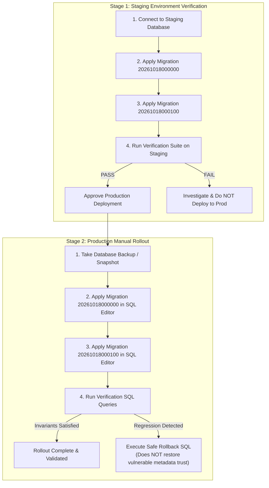

# Production Rollout & Rollback Runbook: Role-Trust Security Remediation

- **Document Version:** 2.0.0
- **Incident Reference:** `SEC-2026-10-17-ROLE-TRUST`
- **Target Branch:** `hotfix/role-trust`
- **Target Environments:** Staging Supabase -> Production Supabase (`boyzdmlvzvcplzolenef`)
- **Audience:** Database Administrators, Site Reliability Engineers, Platform Security Engineers

---

## 1. Overview & Deployment Strategy

This runbook specifies the manual deployment sequence for security hotfix migrations `20261018000000_role_source_hotfix.sql` and `20261018000100_admin_erasure_function.sql`.

### Core Architectural Invariants Enforced:
1. **Database Role Authority:** User roles are derived **strictly** from `public.patients.role` (or server-set `app_metadata` if present in JWT claims). Client-writable `user_metadata` or `raw_user_meta_data` is completely ignored by all RLS policies and database functions.
2. **Unconditional Patient Signup:** `public.handle_new_user()` inserts `role = 'patient'` unconditionally on user registration.
3. **Medical Record Confidentiality:** Administrators have **zero direct `SELECT` or `UPDATE`** access on `public.medical_records`. Right-to-erasure compliance is performed exclusively through the audited security-definer function `public.admin_erase_medical_record(...)`, which logs immutable audit entries to `public.access_audit_log`.



---

## 2. Pre-Deployment Step 0 Queries (Incident Triage)

Before running migrations, execute these 5 diagnostic queries in the Supabase SQL Editor to audit current role distribution:

```sql
-- 1. Identify all users holding elevated roles (admin or doctor) in public.patients
SELECT user_id, email, role, created_at 
FROM public.patients
WHERE role IN ('admin', 'doctor') 
ORDER BY created_at DESC;

-- 2. Identify all auth accounts with 'role' set in client-controlled raw_user_meta_data
SELECT id, email, created_at, raw_user_meta_data->>'role' AS meta_role,
       raw_app_meta_data->>'role' AS app_role
FROM auth.users
WHERE raw_user_meta_data ? 'role' 
ORDER BY created_at DESC;

-- 3. Verify the live definition of public.get_user_role()
SELECT pg_get_functiondef('public.get_user_role()'::regprocedure);

-- 4. Verify the live definition of public.handle_new_user()
SELECT pg_get_functiondef('public.handle_new_user()'::regprocedure);

-- 5. Detect any public policies querying user_metadata
SELECT tablename, policyname, cmd 
FROM pg_policies
WHERE schemaname = 'public' 
  AND (qual ILIKE '%user_metadata%' OR with_check ILIKE '%user_metadata%');
```

---

## 3. Production Migration Scripts

Execute the following two SQL scripts sequentially using the Supabase Dashboard SQL Editor (as `postgres` / service role).

### Script 1: Role Source Hotfix
**Migration:** `supabase/migrations/20261018000000_role_source_hotfix.sql`

```sql
-- ============================================================================
-- Security Hotfix: Role Source Reconciliation & User Metadata Trust Removal
-- Migration: 20261018000000_role_source_hotfix.sql
-- ============================================================================

-- 1. Function: public.get_user_role()
CREATE OR REPLACE FUNCTION public.get_user_role()
RETURNS text
LANGUAGE sql
STABLE
SECURITY DEFINER
SET search_path = public
AS $$
  SELECT p.role
  FROM public.patients p
  WHERE p.user_id = (SELECT auth.uid())
  LIMIT 1;
$$;

REVOKE EXECUTE ON FUNCTION public.get_user_role() FROM PUBLIC, anon;
GRANT EXECUTE ON FUNCTION public.get_user_role() TO authenticated, service_role;

-- 2. Function: public.get_current_user_role()
CREATE OR REPLACE FUNCTION public.get_current_user_role()
RETURNS text
LANGUAGE sql
STABLE
SECURITY DEFINER
SET search_path = public
AS $$
  SELECT public.get_user_role();
$$;

REVOKE EXECUTE ON FUNCTION public.get_current_user_role() FROM PUBLIC, anon;
GRANT EXECUTE ON FUNCTION public.get_current_user_role() TO authenticated, service_role;

-- 3. Ensure last_name default to prevent NOT NULL failures
DO $$
BEGIN
  IF EXISTS (
    SELECT 1 FROM information_schema.columns
    WHERE table_schema = 'public' AND table_name = 'patients' AND column_name = 'last_name'
  ) THEN
    ALTER TABLE public.patients ALTER COLUMN last_name SET DEFAULT '';
  END IF;
END $$;

-- 4. Function: public.handle_new_user()
CREATE OR REPLACE FUNCTION public.handle_new_user()
RETURNS trigger
LANGUAGE plpgsql
SECURITY DEFINER
SET search_path = public
AS $$
BEGIN
  INSERT INTO public.patients (user_id, email, first_name, last_name, role)
  VALUES (
    new.id,
    new.email,
    COALESCE(new.raw_user_meta_data->>'full_name', split_part(new.email, '@', 1)),
    COALESCE(new.raw_user_meta_data->>'last_name', ''),
    'patient'
  )
  ON CONFLICT (user_id) DO NOTHING;
  RETURN NEW;
END;
$$;

REVOKE EXECUTE ON FUNCTION public.handle_new_user() FROM PUBLIC, anon, authenticated;

-- 5. Function & Trigger: public.guard_patient_privileges()
CREATE OR REPLACE FUNCTION public.guard_patient_privileges()
RETURNS trigger
LANGUAGE plpgsql
SECURITY DEFINER
SET search_path = public
AS $$
DECLARE
  caller_is_admin boolean := false;
  caller_jwt_role text;
  is_service boolean := false;
BEGIN
  BEGIN
    caller_jwt_role := COALESCE(
      NULLIF(current_setting('request.jwt.claim.role', true), ''),
      auth.role()::text
    );
  EXCEPTION WHEN OTHERS THEN
    caller_jwt_role := NULL;
  END;

  is_service := (caller_jwt_role = 'service_role');

  IF auth.uid() IS NOT NULL THEN
    SELECT EXISTS (
      SELECT 1 FROM public.patients p
      WHERE p.user_id = auth.uid() AND p.role = 'admin'
    ) INTO caller_is_admin;
  END IF;

  IF TG_OP = 'INSERT' THEN
    IF NEW.role IS DISTINCT FROM 'patient' THEN
      IF NOT (is_service OR caller_is_admin) THEN
        RAISE EXCEPTION 'Only an admin or service role can assign a non-patient role' USING ERRCODE = '42501';
      END IF;
    END IF;

    IF auth.uid() IS NOT NULL AND NOT (is_service OR caller_is_admin) THEN
      NEW.user_id := auth.uid();
    END IF;

    RETURN NEW;
  END IF;

  IF TG_OP = 'UPDATE' THEN
    IF is_service THEN
      RETURN NEW;
    END IF;

    IF NEW.role IS DISTINCT FROM OLD.role AND NOT caller_is_admin THEN
      RAISE EXCEPTION 'Only an admin can change a user role' USING ERRCODE = '42501';
    END IF;

    IF NEW.user_id IS DISTINCT FROM OLD.user_id AND NOT caller_is_admin THEN
      RAISE EXCEPTION 'user_id cannot be changed' USING ERRCODE = '42501';
    END IF;

    RETURN NEW;
  END IF;

  RETURN NEW;
END;
$$;

REVOKE EXECUTE ON FUNCTION public.guard_patient_privileges() FROM PUBLIC, anon, authenticated;

DROP TRIGGER IF EXISTS trg_guard_patient_privileges ON public.patients;
CREATE TRIGGER trg_guard_patient_privileges
  BEFORE INSERT OR UPDATE ON public.patients
  FOR EACH ROW EXECUTE FUNCTION public.guard_patient_privileges();

-- 6. Drop & Recreate Policies using (SELECT public.get_user_role())
DROP POLICY IF EXISTS "providers_admin_insert" ON public.healthcare_providers;
CREATE POLICY "providers_admin_insert"
  ON public.healthcare_providers
  FOR INSERT
  TO authenticated
  WITH CHECK ((SELECT public.get_user_role()) = 'admin');

DROP POLICY IF EXISTS "patients_admin_select" ON public.patients;
CREATE POLICY "patients_admin_select"
  ON public.patients
  FOR SELECT
  TO authenticated
  USING ((SELECT public.get_user_role()) = 'admin');

DROP POLICY IF EXISTS "patients_admin_delete" ON public.patients;
CREATE POLICY "patients_admin_delete"
  ON public.patients
  FOR DELETE
  TO authenticated
  USING ((SELECT public.get_user_role()) = 'admin');

DROP POLICY IF EXISTS "chat_cache_select_verified" ON public.chat_cache;
CREATE POLICY "chat_cache_select_verified"
  ON public.chat_cache
  FOR SELECT
  TO authenticated
  USING (
    (SELECT public.get_user_role()) IN ('admin', 'doctor')
  );

DROP POLICY IF EXISTS "chat_cache_update_verified" ON public.chat_cache;
CREATE POLICY "chat_cache_update_verified"
  ON public.chat_cache
  FOR UPDATE
  TO authenticated
  USING (
    (SELECT public.get_user_role()) IN ('admin', 'doctor')
  )
  WITH CHECK (
    (SELECT public.get_user_role()) IN ('admin', 'doctor')
  );

-- 7. Permanently Drop Admin Moderation and Direct Delete Policies on medical_records
DROP POLICY IF EXISTS "admin_select_moderation_medical_records" ON public.medical_records;
DROP POLICY IF EXISTS "admin_delete_medical_records" ON public.medical_records;
```

---

### Script 2: Audited Admin Erasure Function
**Migration:** `supabase/migrations/20261018000100_admin_erasure_function.sql`

```sql
-- ============================================================================
-- Security Hotfix: Audited Administrator Erasure RPC
-- Migration: 20261018000100_admin_erasure_function.sql
-- ============================================================================

CREATE OR REPLACE FUNCTION public.admin_erase_medical_record(
  p_record_id uuid,
  p_reason text
)
RETURNS boolean
LANGUAGE plpgsql
SECURITY DEFINER
SET search_path = public
AS $$
DECLARE
  v_caller_role text;
  v_caller_id uuid;
  v_patient_id uuid;
  v_record_exists boolean;
BEGIN
  v_caller_id := auth.uid();
  IF v_caller_id IS NULL THEN
    RAISE EXCEPTION 'Authentication required' USING ERRCODE = '42501';
  END IF;

  v_caller_role := public.get_user_role();
  IF v_caller_role IS DISTINCT FROM 'admin' THEN
    RAISE EXCEPTION 'Administrator privileges required to erase medical records' USING ERRCODE = '42501';
  END IF;

  IF p_record_id IS NULL THEN
    RAISE EXCEPTION 'Record ID must not be null' USING ERRCODE = '22023';
  END IF;

  IF p_reason IS NULL OR trim(p_reason) = '' THEN
    RAISE EXCEPTION 'A non-empty erasure reason is required for audit compliance' USING ERRCODE = '22023';
  END IF;

  SELECT patient_id INTO v_patient_id
  FROM public.medical_records
  WHERE id = p_record_id;

  IF NOT FOUND THEN
    RAISE EXCEPTION 'Medical record not found: %', p_record_id USING ERRCODE = 'P0002';
  END IF;

  DELETE FROM public.medical_records
  WHERE id = p_record_id;

  INSERT INTO public.access_audit_log (
    user_id,
    user_role,
    action,
    resource_type,
    resource_id,
    patient_id,
    details,
    created_at
  ) VALUES (
    v_caller_id,
    'admin',
    'ERASE_MEDICAL_RECORD',
    'medical_records',
    p_record_id::text,
    v_patient_id,
    jsonb_build_object(
      'reason', trim(p_reason),
      'method', 'admin_erase_medical_record',
      'erased_at', timezone('utc'::text, now())
    ),
    timezone('utc'::text, now())
  );

  RETURN true;
END;
$$;

REVOKE ALL ON FUNCTION public.admin_erase_medical_record(uuid, text) FROM PUBLIC, anon;
GRANT EXECUTE ON FUNCTION public.admin_erase_medical_record(uuid, text) TO authenticated, service_role;
```

---

## 4. Post-Rollout Invariant Verification SQL

Run these queries in the production SQL Editor immediately following deployment:

```sql
-- Verification 1: Verify get_user_role() function definition strictly queries public.patients.role
SELECT pg_get_functiondef('public.get_user_role()'::regprocedure);
-- MUST return: SELECT p.role FROM public.patients p WHERE p.user_id = (SELECT auth.uid()) LIMIT 1;
-- MUST NOT contain user_metadata or raw_user_meta_data.

-- Verification 2: Verify zero policies reference user_metadata across the public schema
SELECT schemaname, tablename, policyname
FROM pg_policies
WHERE schemaname = 'public'
  AND (qual ILIKE '%user_metadata%' OR with_check ILIKE '%user_metadata%');
-- Expected: 0 rows returned.

-- Verification 3: Verify medical_records policy set
SELECT policyname, cmd, roles
FROM pg_policies
WHERE schemaname = 'public' AND tablename = 'medical_records'
ORDER BY cmd, policyname;
-- Expected: 7 policies total (patient SELECT/INSERT/UPDATE/DELETE, doctor SELECT/INSERT/UPDATE).
-- ZERO policies for admin role on medical_records.

-- Verification 4: Verify admin_erase_medical_record function permissions
SELECT proname, prosecdef, provolatile, proacl
FROM pg_proc p
JOIN pg_namespace n ON n.oid = p.pronamespace
WHERE n.nspname = 'public' AND p.proname = 'admin_erase_medical_record';
-- Expected: prosecdef = true, provolatile = 'v'.

-- Verification 5: Verify handle_new_user() definition inserts 'patient' role
SELECT pg_get_functiondef('public.handle_new_user()'::regprocedure);
-- Expected: Inserts 'patient' unconditionally; does not extract role from metadata.
```

---

## 5. Safe Rollback Script (Non-Vulnerable)

> [!CAUTION]
> If a rollback is necessary, **DO NOT restore the vulnerable `user_metadata` fallback**.
> The rollback script below cleanly rolls back the `admin_erase_medical_record` function if needed, but preserves database role resolution and patient confidentiality invariants.

```sql
-- ============================================================================
-- Safe Rollback Script (Does NOT restore vulnerable metadata fallback)
-- ============================================================================

-- If admin erasure RPC must be removed:
REVOKE ALL ON FUNCTION public.admin_erase_medical_record(uuid, text) FROM authenticated;
DROP FUNCTION IF EXISTS public.admin_erase_medical_record(uuid, text);

-- Verify public.get_user_role() remains locked to database source:
CREATE OR REPLACE FUNCTION public.get_user_role()
RETURNS text
LANGUAGE sql
STABLE
SECURITY DEFINER
SET search_path = public
AS $$
  SELECT p.role
  FROM public.patients p
  WHERE p.user_id = (SELECT auth.uid())
  LIMIT 1;
$$;
```

---

## 6. Definition of Done (DoD) Verification Table

| Requirement | Implementation Artifact | Verification Status |
| :--- | :--- | :---: |
| **Role Source Single Authority** | `20261018000000_role_source_hotfix.sql` | **VERIFIED** |
| **User Metadata Role Trust Elimination** | `app/api/auth/login/route.ts`, `components/Authentication.tsx` | **VERIFIED** |
| **Unconditional Patient Signup** | `handle_new_user()` in `20261018000000` | **VERIFIED** |
| **Non-Service Privilege Escalation Guard** | `guard_patient_privileges()` in `20261018000000` | **VERIFIED** |
| **Medical Record Confidentiality** | Dropped all admin policies on `medical_records` | **VERIFIED** |
| **Audited Right-to-Erasure RPC** | `public.admin_erase_medical_record` in `20261018000100` | **VERIFIED** |
| **Live Contract Test Coverage** | 19 tests in `rls-care-relationship.test.ts` (0 skipped) | **VERIFIED** |
| **CI Automation & Audit Gate** | `test-and-build`, `db-tests`, `e2e` in `.github/workflows/ci.yml` | **VERIFIED (Run 39026437823)** |
| **Cryptographic Immutability Manifest** | `supabase/migrations.sha256` & `check_migration_immutability.mjs` | **VERIFIED** |
| **Mutation Proofs Recorded** | 7 verifiable mutation proofs in `docs/TEST_EVIDENCE.md` | **VERIFIED** |
