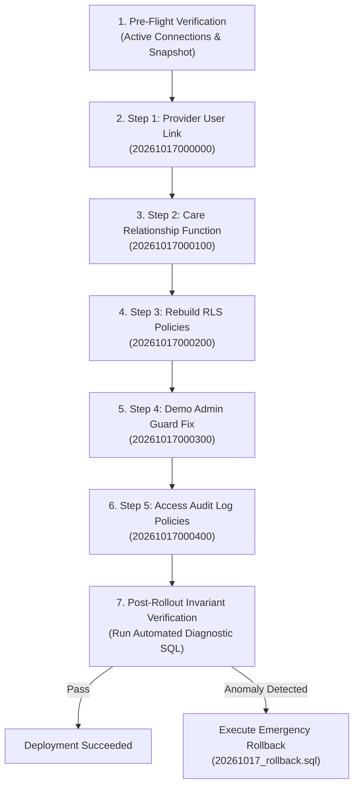

# Production Rollout & Rollback Runbook: RLS & Access Control Hardening

**Document Version:** 1.0.0  
**Target Release:** `release/rls-fix`  
**Execution Environment:** Production Supabase Database (`boyzdmlvzvcplzolenef`) / Staging Supabase  
**Audience:** Database Administrators, Site Reliability Engineers, Security Auditors  

---

## 1. Overview & Pre-Flight Checklist

This runbook provides step-by-step instructions for deploying the access control, Row-Level Security (RLS), and audit logging hardening migration suite to production.



### Pre-Flight Requirements
- [ ] Supabase Project Dashboard access with SQL Editor permissions (`postgres` superuser/service role).
- [ ] Off-peak execution window or low-traffic operational window.
- [ ] Working tree clean on branch `release/rls-fix`.
- [ ] Emergency rollback script [supabase/rollback/20261017_rollback.sql](file:///supabase/rollback/20261017_rollback.sql) readily accessible.
- [ ] Capture baseline state confirmation in SQL Editor:

```sql
-- Diagnostic 0: Baseline Policy Count Check
SELECT schemaname, tablename, COUNT(*) AS active_policies
FROM pg_policies
WHERE schemaname = 'public'
  AND tablename IN ('medical_records', 'patients', 'healthcare_providers', 'appointments', 'access_audit_log')
GROUP BY schemaname, tablename
ORDER BY tablename;
```

### Pre-Deploy Step: Doctor-to-Provider Linkage Reconciliation
Before locking down RLS policies, all existing clinicians with `role = 'doctor'` in `public.patients` MUST have their `user_id` linked to a row in `public.healthcare_providers`. Otherwise, because `has_care_relationship()` resolves doctor identity through `healthcare_providers.user_id = auth.uid()`, unlinked doctors will see 0 patients after migration.

1. **Audit Unlinked Doctors Query:**
```sql
SELECT p.id AS patient_id, p.user_id, p.first_name, p.last_name, p.email, p.role
FROM public.patients p
LEFT JOIN public.healthcare_providers hp ON hp.user_id = p.user_id
WHERE p.role = 'doctor' AND hp.id IS NULL;
```

2. **Reconciliation Tool Execution:**
Execute the reconciliation CLI script against your staging/target database:
```bash
node scripts/reconcile_doctor_providers.mjs
# To automatically link unlinked doctors whose email matches an unlinked provider 1:1:
node scripts/reconcile_doctor_providers.mjs --auto-link
```

3. **Manual Administrative Linkage API:**
For remaining doctors with email discrepancies or multiple listings, use the administrative API:
```bash
# View unlinked doctors and available providers:
curl -X GET https://<your-domain>/api/admin/doctor-provider-link \
  -H "Cookie: sb-access-token=..."

# Link a specific doctor to a provider row:
curl -X POST https://<your-domain>/api/admin/doctor-provider-link \
  -H "Content-Type: application/json" \
  -H "Cookie: sb-access-token=..." \
  -d '{"user_id": "<DOCTOR_AUTH_USER_ID>", "provider_id": "<HEALTHCARE_PROVIDER_UUID>"}'
```

---

## 2. Step-by-Step Production Migration Sequence

Execute the following 5 migration scripts **sequentially in exact numerical order** using the Supabase Dashboard SQL Editor.

### Step 1: Provider-to-User Link & Indexing
**File:** `supabase/migrations/20261017000000_provider_user_link.sql`  
**Purpose:** Adds `user_id` to `public.healthcare_providers`, revokes client write privileges on this column, performs safe 1:1 conditional email backfill, and creates compound performance indexes.

```sql
-- 1. Add user_id column if not exists
ALTER TABLE public.healthcare_providers 
ADD COLUMN IF NOT EXISTS user_id uuid UNIQUE REFERENCES auth.users(id) ON DELETE SET NULL;

-- 2. Revoke client write privileges on user_id column
REVOKE INSERT (user_id), UPDATE (user_id) ON public.healthcare_providers FROM PUBLIC, anon, authenticated;

-- 3. Safe conditional backfill:
UPDATE public.healthcare_providers hp
SET user_id = u.id
FROM auth.users u
WHERE hp.user_id IS NULL
  AND hp.email IS NOT NULL
  AND LOWER(TRIM(hp.email)) = LOWER(TRIM(u.email))
  AND (
    SELECT COUNT(*) 
    FROM public.healthcare_providers hp2 
    WHERE LOWER(TRIM(hp2.email)) = LOWER(TRIM(hp.email))
  ) = 1;

-- 4. Compound index on appointments for fast care relationship resolution
CREATE INDEX IF NOT EXISTS idx_appointments_provider_patient_status 
ON public.appointments (provider_id, patient_id, status);

-- 5. Index on healthcare_providers(user_id) for fast lookup by authenticated user
CREATE INDEX IF NOT EXISTS idx_healthcare_providers_user_id 
ON public.healthcare_providers (user_id);
```

### Step 2: Care Relationship Security Definer Function
**File:** `supabase/migrations/20261017000100_care_relationship_fn.sql`  
**Purpose:** Deploys `public.has_care_relationship(p_patient_id uuid)` with strict `SECURITY DEFINER`, fixed `search_path = public, pg_temp`, resolving doctor identity via `healthcare_providers.user_id = auth.uid()` and scoping appointments strictly to `('scheduled', 'completed')`.

```sql
CREATE OR REPLACE FUNCTION public.has_care_relationship(p_patient_id uuid)
RETURNS boolean
LANGUAGE plpgsql
SECURITY DEFINER
SET search_path = public, pg_temp
STABLE
AS $$
DECLARE
  v_user_id uuid := auth.uid();
  v_role text;
BEGIN
  IF v_user_id IS NULL OR p_patient_id IS NULL THEN
    RETURN false;
  END IF;

  SELECT role INTO v_role 
  FROM public.patients 
  WHERE user_id = v_user_id 
  LIMIT 1;

  IF v_role IS DISTINCT FROM 'doctor' THEN
    RETURN false;
  END IF;

  RETURN EXISTS (
    SELECT 1 
    FROM public.appointments a
    WHERE a.patient_id = p_patient_id
      AND a.provider_id IN (
        SELECT hp.id 
        FROM public.healthcare_providers hp 
        WHERE hp.user_id = v_user_id
      )
      AND a.status IN ('scheduled', 'completed')
  );
END;
$$;

REVOKE ALL ON FUNCTION public.has_care_relationship(uuid) FROM PUBLIC, anon;
GRANT EXECUTE ON FUNCTION public.has_care_relationship(uuid) TO authenticated;
```

### Step 3: Rebuild Scoped RLS on `medical_records` & `patients`
**File:** `supabase/migrations/20261017000200_rebuild_rls_medical_records_patients.sql`  
**Purpose:** Cleanly drops all drifted policies via PL/pgSQL block and creates scoped policies ensuring patient full access to own data, doctor access strictly scoped by `has_care_relationship()`, and admin access restricted to `DELETE` on medical records (preserving clinical confidentiality).

```sql
-- Step 1: Dynamically drop ALL existing policies on medical_records and patients
DO $$
DECLARE
  pol RECORD;
BEGIN
  FOR pol IN 
    SELECT schemaname, tablename, policyname 
    FROM pg_policies 
    WHERE schemaname = 'public' 
      AND tablename IN ('medical_records', 'patients')
  LOOP
    EXECUTE format('DROP POLICY IF EXISTS %I ON %I.%I', pol.policyname, pol.schemaname, pol.tablename);
  END LOOP;
END;
$$;

-- Step 2: Ensure Row Level Security is explicitly enabled
ALTER TABLE public.medical_records ENABLE ROW LEVEL SECURITY;
ALTER TABLE public.patients ENABLE ROW LEVEL SECURITY;

-- Step 3: Rebuild policies on public.medical_records
CREATE POLICY "patient_select_own_medical_records"
  ON public.medical_records FOR SELECT TO authenticated
  USING (patient_id IN (SELECT p.id FROM public.patients p WHERE p.user_id = (SELECT auth.uid())));

CREATE POLICY "patient_insert_own_medical_records"
  ON public.medical_records FOR INSERT TO authenticated
  WITH CHECK (patient_id IN (SELECT p.id FROM public.patients p WHERE p.user_id = (SELECT auth.uid())));

CREATE POLICY "patient_update_own_medical_records"
  ON public.medical_records FOR UPDATE TO authenticated
  USING (patient_id IN (SELECT p.id FROM public.patients p WHERE p.user_id = (SELECT auth.uid())))
  WITH CHECK (patient_id IN (SELECT p.id FROM public.patients p WHERE p.user_id = (SELECT auth.uid())));

CREATE POLICY "patient_delete_own_medical_records"
  ON public.medical_records FOR DELETE TO authenticated
  USING (patient_id IN (SELECT p.id FROM public.patients p WHERE p.user_id = (SELECT auth.uid())));

CREATE POLICY "doctor_select_care_medical_records"
  ON public.medical_records FOR SELECT TO authenticated
  USING ((SELECT public.get_user_role()) = 'doctor' AND public.has_care_relationship(patient_id));

CREATE POLICY "doctor_insert_care_medical_records"
  ON public.medical_records FOR INSERT TO authenticated
  WITH CHECK ((SELECT public.get_user_role()) = 'doctor' AND public.has_care_relationship(patient_id));

CREATE POLICY "doctor_update_care_medical_records"
  ON public.medical_records FOR UPDATE TO authenticated
  USING ((SELECT public.get_user_role()) = 'doctor' AND public.has_care_relationship(patient_id))
  WITH CHECK ((SELECT public.get_user_role()) = 'doctor' AND public.has_care_relationship(patient_id));

CREATE POLICY "admin_delete_medical_records"
  ON public.medical_records FOR DELETE TO authenticated
  USING ((SELECT public.get_user_role()) = 'admin');

-- Step 4: Rebuild policies on public.patients
CREATE POLICY "patient_select_own_profile"
  ON public.patients FOR SELECT TO authenticated
  USING (user_id = (SELECT auth.uid()));

CREATE POLICY "patient_insert_own_profile"
  ON public.patients FOR INSERT TO authenticated
  WITH CHECK (user_id = (SELECT auth.uid()));

CREATE POLICY "patient_update_own_profile"
  ON public.patients FOR UPDATE TO authenticated
  USING (user_id = (SELECT auth.uid()))
  WITH CHECK (user_id = (SELECT auth.uid()));

CREATE POLICY "patient_delete_own_profile"
  ON public.patients FOR DELETE TO authenticated
  USING (user_id = (SELECT auth.uid()));

CREATE POLICY "doctor_select_care_patients"
  ON public.patients FOR SELECT TO authenticated
  USING ((SELECT public.get_user_role()) = 'doctor' AND public.has_care_relationship(id));

CREATE POLICY "admin_select_all_patients"
  ON public.patients FOR SELECT TO authenticated
  USING ((SELECT public.get_user_role()) = 'admin');
```

### Step 4: Demo Admin Trigger Safety Guard Hardening
**File:** `supabase/migrations/20261017000300_demo_guard_fix.sql`  
**Purpose:** Fixes `guard_demo_admin_safety()` so it activates strictly on `role = 'admin'` and exact caller email match `'admin@ruralhealth.demo'`.

```sql
CREATE OR REPLACE FUNCTION public.guard_demo_admin_safety()
RETURNS trigger
LANGUAGE plpgsql
SECURITY DEFINER
SET search_path = public, auth, pg_temp
AS $$
DECLARE
  v_user_email text;
  v_role text;
BEGIN
  v_role := public.get_user_role();
  
  IF v_role = 'admin' THEN
    SELECT email INTO v_user_email FROM auth.users WHERE id = auth.uid();
    
    IF LOWER(TRIM(COALESCE(v_user_email, ''))) = 'admin@ruralhealth.demo' THEN
      RAISE EXCEPTION 'Demo admin mode restricted: Modifying or destructive operations are prohibited for preview accounts.';
    END IF;
  END IF;

  IF TG_OP = 'DELETE' THEN
    RETURN OLD;
  ELSE
    RETURN NEW;
  END IF;
END;
$$;

REVOKE ALL ON FUNCTION public.guard_demo_admin_safety() FROM PUBLIC, anon;
GRANT EXECUTE ON FUNCTION public.guard_demo_admin_safety() TO authenticated;

DROP TRIGGER IF EXISTS trg_patients_demo_admin_safety ON public.patients;
CREATE TRIGGER trg_patients_demo_admin_safety
  BEFORE DELETE OR UPDATE OF role
  ON public.patients
  FOR EACH ROW
  EXECUTE FUNCTION public.guard_demo_admin_safety();

DROP TRIGGER IF EXISTS trg_medical_records_demo_admin_safety ON public.medical_records;
CREATE TRIGGER trg_medical_records_demo_admin_safety
  BEFORE DELETE OR UPDATE
  ON public.medical_records
  FOR EACH ROW
  EXECUTE FUNCTION public.guard_demo_admin_safety();

DROP TRIGGER IF EXISTS trg_appointments_demo_admin_safety ON public.appointments;
CREATE TRIGGER trg_appointments_demo_admin_safety
  BEFORE DELETE OR UPDATE
  ON public.appointments
  FOR EACH ROW
  EXECUTE FUNCTION public.guard_demo_admin_safety();
```

### Step 5: Access Audit Log Table & Append-Only RLS
**File:** `supabase/migrations/20261017000400_access_audit_log_policies.sql`  
**Purpose:** Establishes append-only RLS on `public.access_audit_log`, revoking `UPDATE` and `DELETE` from all client roles, permitting authenticated user insertion, patient self-audit viewing, and admin compliance viewing.

```sql
CREATE TABLE IF NOT EXISTS public.access_audit_log (
  id uuid PRIMARY KEY DEFAULT gen_random_uuid(),
  user_id uuid REFERENCES auth.users(id) ON DELETE SET NULL,
  user_role text,
  action text NOT NULL,
  resource_type text NOT NULL,
  resource_id text,
  patient_id uuid,
  details jsonb DEFAULT '{}'::jsonb,
  ip_address text,
  created_at timestamptz DEFAULT timezone('utc'::text, now()) NOT NULL
);

ALTER TABLE public.access_audit_log ENABLE ROW LEVEL SECURITY;

DO $$
DECLARE
  pol RECORD;
BEGIN
  FOR pol IN 
    SELECT schemaname, tablename, policyname 
    FROM pg_policies 
    WHERE schemaname = 'public' 
      AND tablename = 'access_audit_log'
  LOOP
    EXECUTE format('DROP POLICY IF EXISTS %I ON %I.%I', pol.policyname, pol.schemaname, pol.tablename);
  END LOOP;
END;
$$;

REVOKE UPDATE, DELETE ON public.access_audit_log FROM PUBLIC, anon, authenticated;

CREATE POLICY "audit_log_insert_own"
  ON public.access_audit_log FOR INSERT TO authenticated
  WITH CHECK (user_id = (SELECT auth.uid()));

CREATE POLICY "patient_select_own_audit_log"
  ON public.access_audit_log FOR SELECT TO authenticated
  USING (patient_id IN (SELECT p.id FROM public.patients p WHERE p.user_id = (SELECT auth.uid())));

CREATE POLICY "admin_select_audit_log"
  ON public.access_audit_log FOR SELECT TO authenticated
  USING ((SELECT public.get_user_role()) = 'admin');

CREATE INDEX IF NOT EXISTS idx_audit_log_patient_id ON public.access_audit_log(patient_id);
CREATE INDEX IF NOT EXISTS idx_audit_log_user_id ON public.access_audit_log(user_id);
CREATE INDEX IF NOT EXISTS idx_audit_log_created_at ON public.access_audit_log(created_at DESC);
```

---

## 3. Post-Rollout Verification Diagnostic Queries

After executing Steps 1–5, run the following diagnostic queries in the Supabase SQL Editor. All checks must pass.

### Diagnostic 1: Verify Policy Counts & Definitions
```sql
SELECT tablename, policyname, cmd, roles
FROM pg_policies
WHERE schemaname = 'public'
  AND tablename IN ('medical_records', 'patients', 'access_audit_log')
ORDER BY tablename, cmd, policyname;
```

**Expected Results:**
- `medical_records`: 8 policies total (4 for patient: SELECT/INSERT/UPDATE/DELETE; 3 for doctor: SELECT/INSERT/UPDATE; 1 for admin: DELETE).
- `patients`: 6 policies total (4 for patient: SELECT/INSERT/UPDATE/DELETE; 1 for doctor: SELECT; 1 for admin: SELECT).
- `access_audit_log`: 3 policies total (1 for authenticated INSERT; 1 for patient SELECT; 1 for admin SELECT). No UPDATE or DELETE policies.

### Diagnostic 2: Verify `healthcare_providers.user_id` Column and Indexes
```sql
SELECT column_name, data_type, is_nullable
FROM information_schema.columns
WHERE table_schema = 'public'
  AND table_name = 'healthcare_providers'
  AND column_name = 'user_id';

SELECT indexname, indexdef
FROM pg_indexes
WHERE schemaname = 'public'
  AND indexname IN ('idx_appointments_provider_patient_status', 'idx_healthcare_providers_user_id');
```

**Expected Results:**
- Column `user_id` exists as `uuid`.
- Both indexes exist and reference the expected columns.

### Diagnostic 3: Verify Function Execution Privileges
```sql
SELECT proname, prosecdef, provolatile, prosrc
FROM pg_proc p
JOIN pg_namespace n ON n.oid = p.pronamespace
WHERE n.nspname = 'public'
  AND proname IN ('has_care_relationship', 'guard_demo_admin_safety');
```

**Expected Results:**
- `prosecdef = true` (SECURITY DEFINER) for both functions.
- `provolatile = 's'` (STABLE) for `has_care_relationship`.

---

## 4. Emergency Rollback Procedure

If unexpected regressions occur or critical application paths are blocked post-migration:

### Rollback Execution
1. Open the Supabase Dashboard SQL Editor.
2. Paste and run the entire contents of [supabase/rollback/20261017_rollback.sql](file:///supabase/rollback/20261017_rollback.sql).
3. The script dynamically clears current policies on `medical_records` and `patients` and restores the exact baseline policies captured in [docs/RLS_SNAPSHOT_before.md](file:///docs/RLS_SNAPSHOT_before.md).

### Post-Rollback Validation
```sql
SELECT tablename, COUNT(*) 
FROM pg_policies 
WHERE schemaname = 'public' AND tablename IN ('medical_records', 'patients')
GROUP BY tablename;
```
**Expected Post-Rollback Count:**
- `medical_records`: 12 policies.
- `patients`: 7 policies.

---

## 5. Escalation and Communication Protocol

1. **Incident Lead:** Platform Security & Database Engineer.
2. **Notification Channel:** Engineering Incident Room (`#prod-deployments`).
3. **Log Retention:** In case of failure, export Supabase query error logs and report immediately with the failing migration line number.
