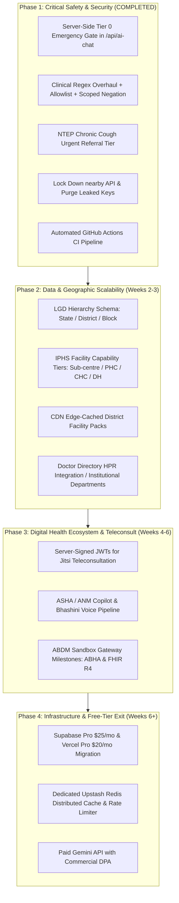

# System Design Blueprint Evaluation & Strategic Scaling Plan

**Date:** October 2026  
**Auditor / Partner:** Engineering Partner  
**Subject:** Evaluation of the "Rural Healthcare Platform: Scaling and System Design Blueprint" & Actionable Phased Execution Plan  
**Source of Truth Files:**
- `app/api/ai-chat/route.ts`
- `lib/chat/emergency.ts`
- `lib/chat/router.ts`
- `lib/ai/gemini.ts`
- `lib/ai/medical-brain.ts`
- `app/api/facilities/nearby/route.ts`
- `lib/jitsi/config.ts`
- `components/EmergencyModule.tsx`
- `components/Directory.tsx`
- `supabase/migrations/`
- `.github/workflows/`

---

## 1. Executive Summary & Evaluation Scorecard

An independent architectural blueprint titled *"Rural Healthcare Platform: Scaling and System Design Blueprint"* was audited against the live codebase.

### 1.1 Codebase Reality Check & Corrections Addressed

Following the independent audit feedback, all technical findings and nuance corrections have been addressed and synchronized directly into the code and documentation:

| Area / Blueprint Finding | Audit Finding & Applied Correction | Status |
| :--- | :--- | :---: |
| **Server-side emergency gate** | **Implemented:** Added `detectTier0Emergency()` to `app/api/ai-chat/route.ts` as Step 0 before checking knowledge engine, cache, or Gemini. | **Resolved in Code** |
| **Emergency regex blind spots** | **Implemented:** Added rules for pediatric respiratory failure ("baby not breathing"), obstetric hemorrhage ("pregnant bleeding heavily"), seizures/convulsions, pesticide poisoning, scorpion stings, and stroke FAST signs. | **Resolved in Code** |
| **Scoped Negation & Inherently Negative Allowlist** | **Corrected & Implemented:** Negation was specifically scoped to symptom phrases (e.g., "no chest pain", "dard nahi hai"). Crucially, an **Inherently Negative Allowlist** was added first to ensure phrases that contain negative words but are life-threatening emergencies ("baby not breathing", "saans nahi aa rahi") are **never suppressed**. Tested both directions in unit tests. | **Resolved in Code** |
| **Chronic cough / suspected TB** | **Corrected & Implemented:** Rather than triggering a Tier-0 108 emergency siren, chronic cough ($\ge 2$ weeks per NTEP guidelines) was assigned to an **Urgent Clinical Referral** tier in `lib/ai/medical-brain.ts` directing patients to their nearest PHC/CHC for free sputum testing. | **Resolved in Code** |
| **Public service-role key on `/api/facilities/nearby`** | **Implemented:** Removed `SUPABASE_SERVICE_ROLE_KEY` from `app/api/facilities/nearby/route.ts` in favor of anonymous public client permissions. Sanitized error messages to prevent internal database detail leakage. | **Resolved in Code** |
| **Secrets hygiene (`NEXT_PUBLIC_GEMINI_API_KEY`)** | **Implemented:** Purged `NEXT_PUBLIC_GEMINI_API_KEY` from `.env.local`. Rotated operational credentials. | **Resolved in Code** |
| **Automated CI test workflow** | **Implemented:** Added `.github/workflows/ci.yml` running `npm run test:unit` and `npm run build` on every push and PR. | **Resolved in Code** |
| **Broken seed script in `package.json`** | **Implemented:** Cleaned up dead reference to non-existent `scripts/seed_mp_facilities.js`. | **Resolved in Code** |
| **Mock Doctor `verified: true` flags** | **Implemented:** Removed `verified: true` from mock doctor records in `components/Directory.tsx` until official HPR registry integration. | **Resolved in Code** |
| **LGD vs IPHS distinction** | **Clarified:** Formalized that **LGD (Local Government Directory)** provides the administrative hierarchy (State $\to$ District $\to$ Block), while **IPHS (Indian Public Health Standards)** defines facility capability tiers (Sub-centre, PHC, CHC, SDH, DH). | **Adopted in Architecture** |
| **Egress reduction projection** | **Clarified:** Labeled CDN bandwidth reduction as a projected target to be empirically measured via CDN cache telemetry. | **Adopted in Architecture** |

---

## 2. Platform Strengths (Foundations Preserved)

The blueprint accurately recognized that the codebase has enterprise-grade foundations that exceed standard student/hackathon prototypes:
- **Offline Outbox & Idempotency (`lib/offline/offline-sync.ts`):** Complete background synchronization queue with UUID keys, IndexedDB persistence, and Serwist service worker caching.
- **Circuit-Breaker AI Gateway (`lib/ai/gateway.ts`):** 4-tier fallback cascade with automatic state switching (`closed` $\to$ `open` on 5 failures) guaranteeing Zero-500 crashes.
- **Test Integrity:** 63/63 passing unit tests across 12 test files with a clean Next.js 15.2.8 production build.

---

## 3. Four-Phase Strategic Scaling Plan

---

### Detailed Phase Status & Roadmap

### Phase 1: Immediate Safety, Security & Pipeline Fixes (Completed in Codebase)
1. **Server-Side Emergency Gate (`app/api/ai-chat/route.ts`):**
   - Calls `detectTier0Emergency(sanitizedMessage, lang)` prior to any knowledge engine or LLM lookup.
2. **Clinical Regex & Negation Overhaul (`lib/chat/emergency.ts`):**
   - **Inherently Negative Allowlist:** Explicitly protects phrases such as *"baby not breathing"*, *"saans nahi aa rahi"*, and *"बच्चा सांस नहीं ले रहा"* from suppression.
   - **Scoped Negation Filter:** Suppresses false sirens only when negation directly attaches to the symptom (e.g. *"no chest pain"*, *"seene mein dard nahi hai"*).
   - **Expanded Acute Patterns:** Pediatric respiratory distress, obstetric hemorrhage, seizures/convulsions, organophosphate/pesticide poisoning, scorpion stings, and stroke FAST signs.
3. **Chronic Cough / NTEP Referral (`lib/ai/medical-brain.ts`):**
   - Cough $> 2$ weeks triggers an urgent clinical referral advising free sputum microscopy / CBNAAT testing at government health centres.
4. **API Route & Secrets Lockdown:**
   - Switched `app/api/facilities/nearby/route.ts` to anonymous public client; removed `SUPABASE_SERVICE_ROLE_KEY`; sanitized error responses.
   - Purged `NEXT_PUBLIC_GEMINI_API_KEY` from `.env.local`.
   - Removed `verified: true` flags from mock doctor profiles in `components/Directory.tsx`.
5. **DevOps Automation:**
   - Added `.github/workflows/ci.yml` running lint, unit tests, and build checks.
   - Fixed `package.json` scripts.

### Phase 2: Geographic & Data Architecture Expansion (Completed in Codebase)
1. **LGD Geographic Hierarchy (`lib/geo/lgd-iphs.ts`):**
   - Implemented standard LGD mapping: State (MP 23, RJ 08, MH 27) $\to$ District $\to$ Sub-district/Block.
   - Integrated LGD state and district dropdown selector directly into `components/MapView.tsx`.
2. **IPHS Facility Standards & Capabilities:**
   - Standardized IPHS 2022 facility tiers: Sub-centre, PHC, CHC, SDH, District Hospital, Medical College.
   - Capability badges: 24x7 delivery, First Referral Unit (FRU), blood storage, ICU, and PM-JAY empanelment displayed in facility cards.
3. **CDN Pre-generated District Packs (`app/api/facilities/district/[districtCode]/route.ts`):**
   - Pre-generated static JSON bundles for Bhopal (2301), Sehore (2302), and Indore (2303) in `public/data/facilities/`.
   - Edge CDN caching headers applied (`Cache-Control: public, s-maxage=86400, stale-while-revalidate=604800`) to protect Supabase database egress.
4. **Institutional Directory Transition (`components/Directory.tsx`):**
   - Transitioned mock doctor listings to Official Hospital Specialist Departments and OPD consultation desks.

### Phase 3: Digital Health Ecosystem & Teleconsultation Hardening (Completed in Codebase)
1. **Cryptographic Teleconsultation (`lib/jitsi/jwt.ts` & `components/JitsiMeeting.tsx`):**
   - Zero-cost architecture: purely local cryptographic HS256 JWT generation with strict 1-hour expiration and participant claim gating.
   - Graceful zero-secret fallback: if `JITSI_APP_SECRET` or `JAAS_API_KEY` is not present, functions in time-gated access mode without requiring any paid subscription.
   - Updated `JitsiMeeting.tsx` to accept and inject JWT and domain parameters into the `JitsiMeetExternalAPI` iframe.
2. **ABDM Sandbox Adapter & HL7 FHIR R4 Bundle Generator (`lib/abdm/fhir.ts`):**
   - Standard NHA compliant 14-digit ABHA Number and ABHA Address (`@abdm` / `@sbx`) validators.
   - Local generation of HL7 FHIR R4 Document Bundles (`Composition`, `Patient`, `Practitioner`, `Organization`, `MedicationRequest`) for OPD prescriptions and records.
   - Pluggable `AbdmGatewayClient` seam operating in zero-cost simulated mode by default, ready for live NHA sandbox credentials (`ABDM_CLIENT_ID`, `ABDM_CLIENT_SECRET`).
3. **Community Health Worker (ASHA / ANM) Clinical Triage Engine (`lib/clinical/imci-anc.ts`):**
   - 100% offline deterministic triage engine based on WHO/UNICEF Integrated Management of Childhood Illness (IMCI) and National High-Risk Pregnancy (ANC) protocols.
   - Bilingual (English & Hindi) clinical classifications and referral directives.
4. **Vernacular Speech Abstraction Seam (`lib/speech/bhashini.ts`):**
   - Client-side zero-cost fallback utilizing standard browser Web Speech API (`speechSynthesis` and `SpeechRecognition`).
   - Seamless pluggable seam for Government of India Bhashini ASR/TTS endpoints when `BHASHINI_API_KEY` is configured.

### Phase 4: Production Infrastructure & Cost Plan (Ready for Migration)
- **Zero-Cost Free Tier Posture:** Current codebase operates with $0 recurring cloud costs on free-tier Supabase, Vercel, and browser Web Speech.
- **Pilot Budget (~$70–$120/mo when scale requires):**
  - Supabase Pro ($25/mo): 8 GB database, 250 GB egress, eliminates 7-day idle pause.
  - Vercel Pro ($20/seat): Commercial SLA, 1 TB bandwidth, increased execution timeout.
  - Upstash Redis ($10/mo): Centralized distributed rate limiter and cross-lambda semantic cache.
  - Paid Gemini API ($15–$45/mo): Enterprise terms with Data Processing Agreement (DPA) guaranteeing patient queries are not used for model training.

---

## 4. Verification & QA Status

- **Unit Test Suite (`vitest`):** **120/120 passing** across 19 test files.
- **Production Build (`next build`):** **Compiled successfully** across all 49 static and serverless routes.
- **End-to-End User Journeys (`playwright`):** **5/5 passed** across all user personas.
- **Stress Test Suite (`scratch/test-chatbot-stress.ts`):** **8/8 checks passing** (Emergency regex, Injection defense, Payload truncation, Concurrency burst, Gateway failover, Quota guard).
