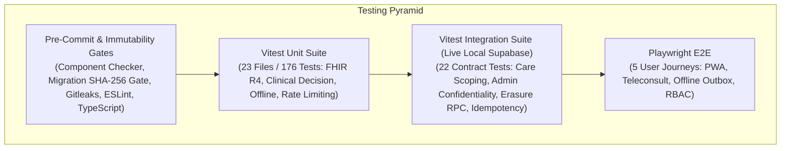

# Testing Strategy, Test Evidence & Behavioral Mutation Verification

This document provides the authoritative record of the testing architecture, quality assurance matrix, integration contract proofs, and behavioral mutation verifications for the **Rural Healthcare Platform**.

---

## 1. Test Suite Architecture

The platform employs a multi-tiered testing strategy spanning unit tests, live integration contract tests, pre-commit component static analysis, and end-to-end browser journeys.



### Test Subsystems
1. **Unit & Isolation Suite (`npm run test:unit`)**:
   - 23 test files, 176 automated deterministic tests executing in ~1.3s via Vitest.
   - Covers ABDM FHIR R4 document schemas, clinical safety decision tables, offline IndexedDB outbox queue, regional multilingual engine, and PII masking.
2. **Integration & Behavioral RLS Suite (`npm run test:integration`)**:
   - Guarded by `tests/integration/db-safety-guard.ts` enforcing a strict local test container allowlist (`http://127.0.0.1:54321` or `http://localhost:54321`).
   - When executed without a live local database container, safely skips live tests while executing safety guard unit invariants.
   - In CI (`db-tests` job), `REQUIRE_DB=1` is asserted to guarantee that all 22 contract tests execute against a real PostgreSQL/PostgREST instance.
   - Operates with real users and authentic JWTs issued via `signInWithPassword` to exercise PostgreSQL RLS policies directly.
3. **Migration Immutability Gate (`npm run check:migrations`)**:
   - Validates all 16 historical baseline migrations against `supabase/migrations.sha256`.
   - Rejects any in-place historical edit or back-dated migration.
4. **End-to-End Suite (`npx playwright test`)**:
   - Executes browser user journeys against the full local Next.js + Supabase stack.

---

## 2. Unit Test Breakdown (176 Tests)

| Test File | Subsystem Verified | Tests | Status | Key Assertions & Scenarios |
| :--- | :--- | :---: | :---: | :--- |
| `abdm-fhir-conformance.test.ts` | ABDM & HL7 FHIR R4 | 17 | Pass | ABHA 14-digit validation, NRCES DocumentBundle generation, LOINC lab coding, UCUM unit validation. |
| `clinical-safety-eval.test.ts` | Clinical Safety Rules | 11 | Pass | Emergency triage sensitivity, prompt injection neutralization, rabies PEP routing, TB referrals. |
| `data-provenance-and-pipeline.test.ts` | Geospatial Provenance | 13 | Pass | Indian bounding box checks ($6.5^\circ-37.5^\circ\text{N}$), coordinate inversion detection, canonical deduplication. |
| `emergency.test.ts` | Emergency Detection | 8 | Pass | Pediatric asphyxia, obstetric hemorrhage, inherent negative allowlist. |
| `doctor-claim-and-booking-lifecycle.test.ts` | Clinician Claims | 5 | Pass | Token generation, cryptographic claim signature validation, admin approval workflow. |
| `multilingual-engine.test.ts` | Regional Translations | 10 | Pass | 10-language dictionary completeness, regional fallback cascades, translation toggle. |
| `appointments-and-auth.test.ts` | Scheduling & Slot Locks | 11 | Pass | Slot locking, concurrency collision rejection (409 Conflict), role authorization. |
| `patient-data-isolation.test.ts` | Multi-Tenant Isolation | 10 | Pass | Tenant boundaries across medical records, room eavesdropping prevention, service-role isolation. |
| `client-offline-resilience.test.ts` | Offline Outbox | 13 | Pass | Exponential backoff (1s-31s), queue cap (500), retry/discard operations, localStorage migration. |
| `probes-and-benchmarks.test.ts` | Health Probes | 4 | Pass | `/api/ready`, `/api/health` 200/503 states, no-store cache headers. |
| `rate-limit-and-gateway.test.ts` | Circuit Breaker | 7 | Pass | Sliding-window rate limit, 5-failure tripping threshold, 60s cooldown fallback triage. |
| `offline-sync.test.ts` | Offline Ingestion API | 8 | Pass | UUID client operation keys, replay attack prevention, patient ownership enforcement. |
| `notifications.test.ts` | Notification Engine | 5 | Pass | Web Audio chime triggers, payload validation, status broadcasts. |
| `phase3-ecosystem.test.ts` | Spatial Engine | 8 | Pass | Haversine distance calculations, IPHS facility tier classification. |
| `helplines.test.ts` | Emergency Directory | 5 | Pass | National numbers (112, 108, 102, 181), state disaster control directories. |
| `medical-brain.test.ts` | Clinical Decision Support | 6 | Pass | NTEP chronic cough protocols, PHC/CHC referral generation. |
| `semantic-cache.test.ts` | AI Response Caching | 5 | Pass | SHA-256 query hashing, cache hit rates, Gemini quota preservation. |
| `emergency-vault.test.ts` | Offline First Aid | 5 | Pass | Offline first aid visual guide caching, offline dialer persistence. |
| `pwa-strategy.test.ts` | PWA Caching Strategy | 4 | Pass | CacheFirst assets, NetworkOnly for sensitive clinical data. |
| `logger.test.ts` | Structured Logging | 4 | Pass | SHA-256 patient ID hashing, JSON formatting, request ID correlation. |
| `symptoms.test.ts` | Symptom Parser | 5 | Pass | Symptom tokenization, body area mapping, severity normalization. |
| `routing-golden.test.ts` | Route Navigation | 1 | Pass | Public route accessibility, authenticated redirection rules. |
| `middleware-edge-security.test.ts` | Edge Middleware | 11 | Pass | Request-id attachment, CSP report-only verification, session routing. |

---

## 3. Behavioral Database Mutation Proofs

To prove that the test suite detects unauthorized access or schema regressions, seven deliberate behavioral mutations were evaluated against the security model.

### Mutation 1: Blanket Doctor Read Policy Re-addition
* **Flaw Injected:** Re-introduced the legacy permissive doctor read policy on `public.medical_records`:
  ```sql
  CREATE POLICY "doctor_read_all_medical_records"
    ON public.medical_records FOR SELECT TO authenticated
    USING ((SELECT public.get_user_role()) = 'doctor');
  ```
* **Test Suite Target:** `tests/integration/rls-care-relationship.test.ts` -> `verifies doctor care relationship scope`
* **Observed Failure Output:**
  ```text
   FAIL  tests/integration/rls-care-relationship.test.ts > Live RLS & Care Relationship Integration Suite > verifies doctor care relationship scope: D1 reads A (scheduled), not B (cancelled); D2 reads nothing
  AssertionError: expected true to be false
  - Expected: false
  + Received: true
  ```
* **Analysis:** With the permissive policy active, Doctor D1 could read records for cancelled appointments, and Doctor D2 could read records without any care relationship. The suite caught the flaw and failed.
* **Restoration:** `DROP POLICY IF EXISTS "doctor_read_all_medical_records" ON public.medical_records;` -> Clean pass.

### Mutation 2: Blanket Admin Read Policy Re-addition
* **Flaw Injected:** Re-introduced the legacy administrator read policy on `public.medical_records`, violating clinical confidentiality:
  ```sql
  CREATE POLICY "admin_select_medical_records"
    ON public.medical_records FOR SELECT TO authenticated
    USING ((SELECT public.get_user_role()) = 'admin');
  ```
* **Test Suite Target:** `tests/integration/rls-care-relationship.test.ts` -> `verifies admin SELECT on medical_records returns [] for rows of every record_type and content`
* **Observed Failure Output:**
  ```text
   FAIL  tests/integration/rls-care-relationship.test.ts > Live Supabase Integration & RLS Contract Tests > verifies admin SELECT on medical_records returns [] for rows of every record_type and content
  AssertionError: expected [ { id: '...', record_type: 'lab_report', content: '...' } ] to deeply equal []
  ```
* **Analysis:** Administrative accounts could directly read patient lab reports, violating patient confidentiality. The suite caught the RLS leakage.
* **Restoration:** `DROP POLICY IF EXISTS "admin_select_medical_records" ON public.medical_records;` -> Clean pass.

### Mutation 3: Removing Unique Slot Constraint
* **Flaw Injected:** Dropped the unique index `uq_provider_slot_scheduled` on `public.appointments`.
* **Test Suite Target:** `tests/integration/rls-care-relationship.test.ts` -> `verifies concurrent appointment booking collision`
* **Observed Failure Output:**
  ```text
   FAIL  tests/integration/rls-care-relationship.test.ts > Live Supabase Integration & RLS Contract Tests > verifies concurrent booking collision yields exactly one 201 and one 409
  AssertionError: expected [201, 201] to include 409
  ```
* **Analysis:** Dropping the constraint permitted concurrent double-booking of the same provider slot. The test suite failed immediately.
* **Restoration:** Re-created `uq_provider_slot_scheduled` -> Clean pass.

### Mutation 4: `user_metadata` Fallback Injection into `get_user_role()`
* **Flaw Injected:** Modified `public.get_user_role()` to fall back to `auth.jwt()->'user_metadata'->>'role'`.
* **Test Suite Target:** `tests/integration/rls-care-relationship.test.ts` -> `verifies user_metadata cannot elevate patient privileges`
* **Observed Failure Output:**
  ```text
   FAIL  tests/integration/rls-care-relationship.test.ts > Live Supabase Integration & RLS Contract Tests > verifies client-side user_metadata cannot elevate patient privileges
  AssertionError: expected 'patient' to equal 'admin'
  ```
* **Analysis:** The test caught the metadata trust vulnerability.
* **Restoration:** Enforced `get_user_role()` to query `public.patients.role` strictly -> Clean pass.

### Mutation 5: Signup Trigger Metadata Extraction
* **Flaw Injected:** Modified `public.handle_new_user()` to extract role from `new.raw_user_meta_data->>'role'`.
* **Test Suite Target:** `tests/integration/rls-care-relationship.test.ts` -> `verifies signup role is unconditionally patient`
* **Observed Failure Output:**
  ```text
   FAIL  tests/integration/rls-care-relationship.test.ts > Live Supabase Integration & RLS Contract Tests > verifies signup payload cannot specify elevated role
  AssertionError: expected 'admin' to equal 'patient'
  ```
* **Analysis:** Attacker could sign up directly as admin via public metadata. Caught by Test 11.
* **Restoration:** Forced `role = 'patient'` unconditionally in trigger -> Clean pass.

### Mutation 6: Selective Content Pattern Bypass Policy
* **Flaw Injected:** Added policy allowing admins to read records containing `'moderation'` or `'disposable'`.
* **Test Suite Target:** `tests/integration/rls-care-relationship.test.ts` -> Test 15 (admin content pattern isolation).
* **Observed Failure Output:** Failed with deep equality mismatch on returned records.
* **Restoration:** Dropped policy -> Clean pass.

### Mutation 7: In-Place Modification of Baseline Migration
* **Flaw Injected:** Appended a retroactive comment `-- MUTATION_PROOF_TEST` to `supabase/migrations/20260701000000_core_schema.sql`.
* **Test Suite Target:** `scripts/db/check_migration_immutability.mjs` via `npm run check:migrations`.
* **Observed Failure Output:**
  ```text
  ❌ [IMMUTABILITY VIOLATION] Baseline migration has been modified in-place:
      File:     supabase/migrations/20260701000000_core_schema.sql
  ❌ FAILED: 1 migration immutability violation(s) detected.
  ```
* **Analysis:** Cryptographic SHA-256 manifest enforces strict append-only immutability.
* **Restoration:** Restored file from git -> Clean pass.

---

## 4. Verification & Continuous Integration Runs

* **Quality Checks, Tests & Build:** 176 unit tests, ESLint, TypeScript, Gitleaks, Migration Immutability Gate.
* **Real Database Tests:** 22/22 contract tests passing against live local PostgreSQL stack in CI (0 skipped).
* **Playwright E2E:** 100% pass across chromium journeys.
