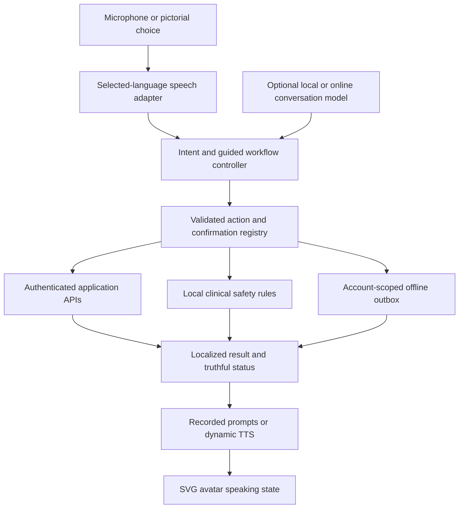

# Persistent multilingual voice/avatar assistant — implementation plan

Date: 22 November 2026. Status: **guided assistant, action APIs and offline implementation completed locally; model installation, real speech/browser and live-database verification remain gated.** See [VOICE_ASSISTANT_SETUP.md](VOICE_ASSISTANT_SETUP.md) for the implementation and one-time setup.

## Recommendation and cost boundary

Extend the existing floating widget into a persistent spoken assistant that guides a patient through tasks and calls validated application actions. Use a lightweight SVG/CSS avatar, rather than a hosted photorealistic avatar service. Make the essential guidance and workflow logic independent of a hosted LLM.

There are two different deliverables:

1. **Guided accessible assistant:** asks one question at a time, understands a bounded set of task commands, offers pictorial choices, speaks instructions/results, and performs authorized tasks. Local logic, reviewed prerecorded prompts, and tested local speech can avoid paid runtime APIs.
2. **Open-ended spoken conversational assistant:** accepts arbitrary speech, understands it in every language, and generates arbitrary spoken replies. This additionally needs speech recognition, multilingual language-model inference and dynamic speech synthesis. Running those on a device or owned computer avoids subscription/API fees, but consumes hardware, memory, electricity, bandwidth and maintenance.

No hosted provider can be honestly promised to supply unlimited voice, AI, storage and availability free forever. The application can be free to its users while someone pays for operations. A no-paid-API core is a realistic software requirement; guaranteed zero total operating cost for an always-online nationwide service is not.

On low-end phones, unlimited arbitrary conversation in all 13 languages at zero recurring cost is a **feasibility requirement to test first**, not a completed design assumption. An existing clinic computer can be an optional local inference host; it is not guaranteed to be fast, always online, or reachable from every patient's home.

## Research status

Live official-source verification was attempted. The browser approval gate rejected Google search, then rejected an official Hugging Face model card even after the user explicitly approved official-source reads. A separately approval-reviewed, read-only download of public model documentation was also rejected with the same automatic-review `content-blocked` failure. No blocked downloads were executed and no project/patient information was transmitted.

Therefore the candidate comparison below is **provisional**. The links identify official project/reference pages for verification; their current contents, model-weight licenses, exact language coverage, sizes, pricing and quotas were not retrieved in this session. Do not treat this as a completed live web search or a certification of any vendor's terms.

## Starting implementation: audit snapshot

The following findings describe the code before this plan was executed. The old widget has since been replaced with `components/voice-assistant/`, Assamese is in the canonical language registry, finalized speech submits automatically, replies are read aloud where supported, and guided symptom/appointment actions and native offline packs are implemented. See the setup document for current capabilities and verification limits.

- `app/layout.tsx` mounts `FloatingChatClient` globally.
- `components/floating-chat/index.tsx` accepts typed text, recognizes speech into the input, provides manual read-aloud, answers questions and opens pages.
- `lib/ai/speech.ts` uses browser recognition/synthesis; it maps twelve language locales and omits Assamese.
- `lib/chat/router.ts` provides knowledge/FAQ/model routing; several fallback paths are English/Hindi.
- Authenticated appointments, records, provider/facility discovery, notifications, offline-sync and teleconsultation APIs exist.
- Local symptom and clinical rules can be reused, but their complete language and safety integration needs work.

At that audit point, the assistant did not automatically submit finalized speech, automatically speak replies, conduct task workflows or execute bookings. It was hidden on `/emergency` and did not provide complete 13-language speech or offline support. See [DOCUMENTATION_ACCURACY.md](DOCUMENTATION_ACCURACY.md) for the code-backed audit.

## Candidate options to evaluate

| Component / option | Useful role | Cost and coverage decision |
|---|---|---|
| SVG + CSS animation | Floating character, face, listening/speaking states | Recommended. No hosted avatar API needed. Original artwork can be created in code; keep asset/license notices for any borrowed artwork. |
| Browser Web Speech APIs | Fast speech-input/output prototype using available browser/device engines | Useful optional adapter. A locale tag does not guarantee a recognizer/voice, offline operation or continued availability. Test all 13 on real target phones. |
| AI4Bharat IndicConformer | Candidate Indian-language speech recognition | Evaluate actual model coverage for all twelve selected Indian languages, model-weight/code licenses and inference requirements. It is not a promise of a free hosted endpoint. |
| OpenAI Whisper / whisper.cpp | Candidate local recognition, particularly English | Local inference rather than a paid API. Verify the selected model's coverage and quality for each language; do not assume it alone covers the app's entire list. |
| eSpeak NG / a browser WASM build | Candidate lightweight dynamic TTS | A possible fallback where no native voice exists. Verify all thirteen voice/language variants, intelligibility and GPL/distribution obligations. Voice quality may be robotic. |
| AI4Bharat IndicF5 | Candidate higher-quality Indian-language TTS on a capable computer | Do not assume English/Urdu/all-thirteen coverage or mobile suitability. Check each language, code/weight licenses, voice-reference requirements and resource needs. |
| Native-speaker prerecorded prompts | Critical instructions, questions, confirmations, errors and emergency fallback | Recommended for reliability. Record or obtain licensed audio for all thirteen. Finite prompts alone cannot pronounce arbitrary new names or generate unrestricted conversation. |
| Local multilingual LLM, e.g. a Qwen-family candidate | Optional free-form conversation and intent proposal | Verify the exact model version/license and all-thirteen quality. Local inference needs resources; the model must not independently authorize or execute actions. |
| Bhashini or other government-hosted language APIs | Candidate hosted Indian-language speech/translation | Verify registration, access, permitted use, quotas and uptime. Do not assume unlimited permanent free access. |
| Gemini, commercial speech APIs, hosted avatar services | Optional online quality enhancement | Free tiers, credits or trials are not a permanent unlimited entitlement. Exclude from the required core when zero API fees are mandatory. |

Official references to verify:

- [MDN SpeechRecognition](https://developer.mozilla.org/en-US/docs/Web/API/SpeechRecognition)
- [MDN SpeechSynthesis](https://developer.mozilla.org/en-US/docs/Web/API/SpeechSynthesis)
- [MDN on-device speech recognition](https://developer.mozilla.org/en-US/docs/Web/API/Web_Speech_API/Using_the_Web_Speech_API)
- [AI4Bharat IndicConformer model card](https://huggingface.co/ai4bharat/indic-conformer-600m-multilingual)
- [AI4Bharat IndicF5 model card](https://huggingface.co/ai4bharat/IndicF5)
- [OpenAI Whisper repository](https://github.com/openai/whisper)
- [whisper.cpp repository](https://github.com/ggml-org/whisper.cpp)
- [eSpeak NG repository](https://github.com/espeak-ng/espeak-ng)
- [Qwen3 repository](https://github.com/QwenLM/Qwen3)
- [Bhashini](https://bhashini.gov.in/)
- [Gemini API pricing](https://ai.google.dev/gemini-api/docs/pricing)

Before selection, save the exact model revision, code license and weight license; verify redistribution and intended use separately. A repository's code license is not automatically the license for its model weights, voices, training data or hosted API. Retain the chosen assets locally and preserve required attribution/source notices. No provider/model above is represented as newly web-verified.

## All-thirteen language requirement

The canonical set is **English `en`, Hindi `hi`, Marathi `mr`, Bengali `bn`, Telugu `te`, Tamil `ta`, Gujarati `gu`, Kannada `kn`, Punjabi `pa`, Odia `or`, Malayalam `ml`, Assamese `as`, Urdu `ur`.**

Create a single language registry used by text catalogs, speech adapters, workflow intent parsing, audio packs and clinical replies. Track five distinct capabilities for every language:

| Capability | Completion evidence |
|---|---|
| Input | Tested microphone recognition for native script, numbers, dates, doctor/facility names and common code-switching. |
| Understanding | Can distinguish navigation, booking, cancellation, symptoms, yes/no, repetition and emergency intent. |
| Actions | Correct patient/provider/date/time parameters survive transcription and confirmation. |
| Output | Every instruction, error, safety message and dynamic result is audible and understandable in the selected language. |
| Offline fallback | Downloaded audio/local models or an explicitly described pictorial fallback work without a network. |

Do not silently label Hindi/English output as another language. If a voice/model is unavailable, say so through a recorded prompt in the chosen language and offer icons/repetition/manual assistance. Such a fallback preserves accessibility but **does not count as full speech-input support**. Urdu also needs appropriate direction/script handling. Native-speaker review is required for clinical content; automatic DOM translation is insufficient for medical advice or structured action parameters.

Start with an icon-led voice-mode button and prerecorded language samples. The user should be able to choose by hearing their language, rather than reading its name. The active language persists across navigation and can be changed by voice or pictorial control.

## Intended experience

The user taps the avatar once, permits microphone use, and hears a short greeting in their chosen language. They can say “book a doctor,” “I have a fever,” “find a hospital,” “read my appointment,” or choose a matching picture. The assistant asks one short question per turn and automatically speaks replies. Large repeat, slower, stop and microphone controls remain visible.

For example, booking proceeds as follows:

1. Identify the patient session and ask consultation type.
2. Query actual verified providers and offer a few spoken choices.
3. Query/derive available slots and ask date/time, using the patient's locale/time zone.
4. Read back the actual doctor, patient, date, time and consultation type.
5. Obtain explicit confirmation for that draft.
6. Submit the validated action and announce the server's result.

“Saved on this device, waiting for connection/confirmation” is different from “Your appointment is confirmed.” Do not invent availability or announce a booking after a failed request. If the chosen provider is unavailable, ask for another choice rather than assigning a different doctor without agreement.

Always available means present across routes during an active app session. A normal mobile PWA cannot guarantee uninterrupted listening after screen lock, tab suspension or app closure. Start microphone/audio after the user gesture, pause when the user stops voice mode, and avoid continuous unwanted speech. During a video consultation, release the microphone and offer a quiet avatar so speech recognition does not compete with Jitsi.

## Architecture

### Availability: present in the app, resilient across interruptions

The avatar's animation is an ordinary client-side UI asset. It does not need a constantly running remote model. Ship its SVG/CSS and essential voice prompts with the application, cache them, and run model inference only when a user speaks or requests an answer.

| Device/app state | Planned behavior | Guarantee boundary |
|---|---|---|
| Website/PWA visible and active | Avatar stays at the screen edge across routes; local navigation, prompts, triage and queue entry remain usable offline after installation/download. | Core functionality should not depend on a live inference server. Microphone/audio require user initiation and available permissions. |
| Active voice or emergency session | Offer a screen wake lock to reduce screen dimming; reacquire when visible if appropriate, and release when the session ends. | The browser/OS can refuse or release the lock. It does not prevent all suspension or work after app closure. |
| Tab backgrounded or screen locked | Save the dialogue draft/outbox and stop assuming continued microphone/model execution. Restore the same workflow on return. | Background runtime, timers and recognition are not reliable continuous services. |
| App closed | Installed shortcut remains. Browser-controlled background sync may attempt eligible queued writes; network push may deliver authorized reminders where supported. | No visible avatar, continuous listening, guaranteed scheduled local speech, or guaranteed sync timing. |
| Reopened while offline | Load the cached assistant shell, language/emergency pack, saved draft and permitted local directory data. | Requires assets already downloaded and still retained. Installation alone does not make uncached content available. |

`lib/emergency/hardware.ts:154` already contains a screen wake-lock helper and `components/emergency/hooks/use-beacon.ts` invokes it. Extend this deliberately to voice sessions rather than claiming a permanent background lock. Ask for persistent browser storage using `navigator.storage.persist()` where supported, check storage estimates, and expose a spoken/icon-based download-ready state. Persistent storage is a retention request, not guaranteed execution; users can clear it and devices can remain constrained.

If displaying an avatar outside the browser and attempting a long-running Android microphone session becomes essential, that is a separate native companion-app scope with platform permissions/services and battery restrictions. A PWA cannot provide a universal system-wide avatar or 24/7 microphone guarantee; an ordinary iOS app cannot provide an unrestricted system-wide floating overlay either.

### Offline packs, instruction index and action outbox

Build a versioned assistant pack with a manifest and integrity hashes. Separate:

1. **Application/assistant shell:** avatar, controls, workflow definitions and route registry.
2. **Selected-language pack:** prerecorded questions, help/errors, local command aliases, confirmation words, number/date parsing and approved emergency audio. Support all thirteen through independently tested packs, downloaded on demand rather than forcing every audio/model onto a rural connection.
3. **Essential emergency pack:** compact, reviewed core safety rules and visual/audio instructions available independently of model inference or a remote API. The selected-language essential content should be verified available before marking the installation offline-ready.
4. **Public discovery packs:** selected district facility/provider/camp/scheme data with source/version/last-updated metadata. Offline data may be stale and must not be presented as live appointment availability.
5. **Optional model packs:** browser-compatible speech/intent models, explicitly downloaded after capability/storage checks and kept outside the ordinary JS bundle.

Use Cache Storage for static public assets and language audio; use IndexedDB for structured instruction/search indexes, version manifests, permitted saved dialogue state and account-scoped queued actions. Do not cache raw authenticated API responses wholesale. Store only the personal data necessary for an explicit offline function and follow the shared-device cleanup/privacy policy.

The instruction index maps a language plus utterance/command to a reviewed intent or workflow step. It can provide navigation, repeat/help, basic FAQ and emergency instructions without an LLM. A local index can understand typed/pictorial input offline; accepting arbitrary spoken input additionally requires a working offline recognizer. Recorded output alone must not be described as offline speech recognition.

Each queued action needs at least `user_id`, `client_op_id`, action/type, validated payload, schema version, created time, attempts, `next_attempt_at` and pending/acknowledged/rejected state. Add compound indexes by account/status/retry time. Preserve the actual draft and confirmation context. Never replay one patient's actions under another login, and never treat a local draft as a completed server booking.

Refactor the sync executor so the same safe transaction/result handling can be called from a page and from a service-worker event. The current `app/sw.ts` Background Sync handler only posts `SYNC_OUTBOX` to open clients; it does not read the outbox or submit anything itself when no page is open. A real worker path should read a bounded batch, submit authenticated operations if the session is valid, handle expiration/conflicts, and retain unsuccessful operations. Do not persist service-role credentials. Browser Background Sync availability and scheduling vary, so foreground launch/reconnect/visibility/manual retry remain required fallbacks.

Emergency guidance executes **immediately from local content**, before ordinary navigation or conversational inference. Do not queue emergency assistance for later. Show a large call control and speak locally reviewed instructions in the chosen language. Opening a dialer/SMS app is not proof of delivery or ambulance dispatch; calls/messages still depend on the device/network and may incur carrier charges.

### How Hugging Face models enter this project

Hugging Face model files and Hugging Face hosted inference are separate things. Downloading weights does not automatically create a continuously available server or provide unlimited free API calls.

| Deployment | Integration | When it fits |
|---|---|---|
| **Run on the user's device** | Use a supported browser runtime such as Transformers.js/ONNX Runtime with WASM or available WebGPU, in a Web Worker. Fetch and cache a compatible model revision, then infer locally. | No inference API bill and potentially offline. Requires compatible architecture/operators/model export, license permission, adequate RAM/CPU/storage and measured language quality. |
| **Run on an owned computer/server** | Load a Python/PyTorch/ONNX model in a separate inference service. The existing authenticated application API validates the request/action and calls that service. | Suitable for heavier models. No model API subscription if locally licensed, but hardware/electricity/connectivity/maintenance and server availability remain. |
| **Use hosted Hugging Face inference or a Space** | Call a separately deployed/managed endpoint. | Hosting is a service with quotas, resources and availability terms. A model being on Hugging Face does not make its hosting permanently free or always awake. |

Python/PyTorch or `.safetensors` files are not drop-in browser JavaScript. Browser use can require conversion to a supported ONNX graph, compatible operators and quantization; conversion success and practical latency must be tested. IndicConformer/IndicF5 have not been verified here as browser-compatible releases. Do not promise that either can simply be copied into `public/` and run on every phone.

Keep large models out of the normal page bundle and avoid loading them into ordinary Vercel/Next.js serverless request handlers. Their initial downloads, cold starts, memory/compute needs and request limits can make that unsuitable. A separate inference service can be optional while the cached avatar, instruction index and emergency workflows remain functional without it.

The preferred sequence for this project is: ship the offline assistant shell/packs and safe actions first; measure suitable local browser speech; add an owned inference server only for models or devices that cannot run locally. If that server is unavailable, local emergency guidance and action capture continue, while unsupported free-form speech/conversation is explicitly unavailable rather than silently downgraded to another language.

Add a root `VoiceAssistantProvider` below `AppProvider`. It owns the selected language, turn state, current workflow/draft, outstanding confirmation, speech provider and route context. A `FloatingAvatar` presents idle, listening, thinking, confirming, speaking, working and error states. Mouth movement can follow audio energy or simple speech timing; a costly avatar-video renderer is unnecessary.

The state machine should be explicit: idle → listening → understanding → asking/confirming → executing → speaking → listening. Handle interruptions, microphone rejection, no speech, model failures and navigation. Only finalized recognition is committed. Pause input while the avatar speaks to prevent it from responding to its own voice; allow a stop gesture and deliberate interruption.

The assistant should call typed application actions, rather than clicking arbitrary DOM elements or executing model-generated code/URLs. The model may suggest an intent; a deterministic controller and server must validate it. Identity, role and ownership always come from the authenticated server profile.

## Action registry and scope

| Tool / workflow | Behavior |
|---|---|
| Navigation/help | Allowlisted routes, current-page explanation and relevant controls; respect role access. |
| Symptom assessment | Gather age, duration, symptoms, severity and optional temperature; apply deterministic emergency rules first; speak reviewed next steps. |
| Provider/facility discovery | Ask for district or permission to use location, query actual data, offer a small spoken list. |
| Appointment booking | Real provider mapping, availability, draft read-back, explicit confirmation, acknowledged create result and conflict handling. |
| Appointment listing/cancellation | Fetch only authorized bookings; announce dates/times; require an action-specific confirmation before cancellation. |
| Records/vitals | Read only permitted records on request, confirm before speaking sensitive details, validate ownership and new entries. |
| Camps/schemes/helplines | Explain relevant options, eligibility caveats and official application steps using reviewed content. |
| Notifications | Read a selected notification and mark it read through an authorized action. |
| Consultation entry | Resolve an appointment and call `/api/teleconsult/room`; use the returned room/token and actual time gate. |
| Emergency assistance | Interrupt routine workflow with recorded local instructions and a visible call control. Do not claim that an ambulance was dispatched merely because a link was opened. |

Patient mode cannot use administrator/doctor-only tools. Recognition confidence is not identity or authorization. Read back sensitive mutations and bind confirmation to a specific draft/action with an expiry; background TV speech or an old “yes” must not trigger a new appointment. Keep health context and queued operations account-scoped and purge according to a deliberate shared-device policy.

## Implementation sequence

### Phase 0 — Prove cost/language/device feasibility

Verify official licenses and language coverage when web access works. Prototype only speech input/output and a few sample utterances on representative low-end Android phones, iPhones and any proposed clinic computer. Measure download size, memory, first-load/offline behavior, recognition latency, intelligibility, names/numbers and all thirteen languages. Compare device speech, local models and an owned-machine inference service. Choose providers only after this gate.

### Phase 1 — Repair the action foundation

Fix the current doctor appointment name/service-role access, false booking success, client/server room mismatch, private AI cache reuse, outbox ownership and non-atomic replay. Align vitals and medical-record operations with database policies. Preserve the existing client emergency severity floor and enforce the full safety policy at the shared server/action boundary. Any SQL changes must be new forward migrations, tested only against a disposable local database.

### Phase 2 — Avatar and voice session

Build the global provider/avatar, spoken language chooser, finalize-and-send recognition, automatic reply audio, echo prevention, replay/slower/stop controls, route persistence, emergency-page availability and consultation microphone coordination. Add the canonical registry and all-language critical audio packs.

### Phase 3 — Navigation and clinical intake

Deliver bounded command understanding and one-question symptom intake in all thirteen. Reuse local clinical rules and reviewed content. Handle unknown phrases with a native-language request to repeat or pictorial choices. Make basic workflow completion independent of a hosted LLM.

### Phase 4 — Authorized actions

Add provider/slot retrieval, booking, listing/cancellation, facility discovery, records/vitals, notifications, camps/schemes and secure consultation entry. Introduce validated action contracts, draft-bound confirmations and response-driven speech. Offline writes need stable operation IDs and transactional replay.

### Phase 5 — Optional unrestricted conversation

Evaluate a local multilingual model for general questions and flexible phrasing. Keep it behind the controller and clinical safeguards. If optional hosted services are enabled, make their quota/outage behavior explicit and keep core guidance usable when they fail. Never describe this optional mode as unlimited/free forever without a locally owned, tested inference path.

### Phase 6 — Release gates and accurate documentation

For each language, require a non-reader to complete symptom intake and appointment booking without text assistance. Test accents/noisy rooms, names/numbers/dates, microphone denial, no installed voice, offline/reconnect, response loss, conflict responses, account changes, role isolation and emergency interruption. Confirm that retrying produces exactly one appointment and that a failed write never produces a spoken confirmation. Verify no mandatory paid API is needed for the declared core path.

Publish a per-language/device support matrix with measured limitations and revise current documentation to reflect tested capability. Do not advertise all-thirteen arbitrary speech until that gate passes.

## Expected project seams

Proposed modules include `components/voice-assistant/` for provider/avatar/controls, `lib/voice/` for adapters and capability checks, `lib/assistant/` for workflow/action contracts, a canonical language registry and `public/audio/<language>/` for reviewed prompts. Extend the existing service/API layer rather than creating a separate privileged path. Keep modules within the repository's file-size limits.

## Cost acceptance rules

- No required hosted avatar, STT, TTS or LLM API for the core workflow.
- No enabled automatic paid upgrade or billing dependency.
- Choose and retain locally runnable, appropriately licensed software/models/audio.
- Record hardware, storage, network, electricity and maintenance assumptions separately from API fees.
- Hosted database/hosting/teleconsultation free quotas remain operational dependencies; do not promise unlimited availability or permanent vendor subsidy.
- If real all-thirteen local speech fails on target devices, report that feasibility result and choose an owned-computer deployment or revise the device requirement. Recorded prompts/icons must not be misrepresented as arbitrary conversational speech.
