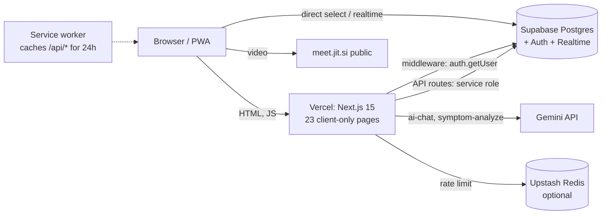

# Rural Healthcare Platform: Audit, PWA Review, Scalability Plan and System Design

*Audited: 10 Oct 2026 · Source: your `rural_health (2).zip` (Next.js 15.2.8, React 18, Supabase, Vercel)*

---

## 0. The short version

**Where you stand:** a feature-rich app that works for a pilot (about 13 patients and 27 providers in production today), but it has **security holes that must be closed before any growth**, a PWA that is **not actually installable** and **leaks private data through its cache**, and an architecture where **every request hits the database**, so it will hit free-tier limits long before it hits a technical ceiling.

**The five things to fix first (in this order):**

1. **Any signed-in user can make themselves admin** (patients table policy, finding C1). Run `supabase/09_scale_and_security.sql` on staging, then production.
2. **Any signed-in user can change any appointment** (service-role PATCH with no ownership check, C2).
3. **The service worker caches medical API responses on the device** for 24 hours, not per user (C3).
4. **Offline sync does not work** (every sync request fails validation) **and would lose data even if it did** (C4).
5. **Teleconsult rooms are guessable** on the public Jitsi server with no lobby (C5).

**Where the real ceiling is (hypothesis, to be confirmed by the load test):** on the free plans the *monthly quotas* (Supabase egress 5 GB, Vercel ~1M invocations / 100 GB) will run out at a few thousand monthly users, long before CPU does. Caching and fewer round trips raise that ceiling more than any server upgrade.

> **What I could and could not verify.** I read all the code, SQL, config and generated service worker, ran the new scripts under Node with stubs, and checked platform limits against the vendors' current docs. I **could not** run your app, a Postgres database or k6 from my sandbox. Findings marked *(code)* come from reading the code; nothing was exploited. Capacity numbers are **estimates and hypotheses until you run the load-test kit**.

---

## 1. Findings

Severity: **C** critical (fix before anything else) · **H** high · **M** medium · **L** low.

### Security and correctness

| ID | Sev | Finding | Evidence | Fix |
|---|---|---|---|---|
| C1 | **C** | **Privilege escalation to admin.** `patients_update_own` lets a user update their own row with no column limits and no `WITH CHECK`, so `UPDATE patients SET role='admin'` works through the public API. Also `patients_insert_own` plus no `UNIQUE(user_id)` lets a user insert a second row for themselves with `role='admin'`. Every role check in the app trusts that column. | `03_rls.sql`, `01_schema.sql` *(code)* | `09_scale_and_security.sql` §1: trigger forcing role/user_id rules for end users + `UNIQUE(user_id)` |
| C2 | **C** | **`PATCH /api/appointments` has no authorization.** It takes `{id, status}` from any logged-in user and updates through the **service-role client**, which bypasses RLS. No role check, no ownership check, no rate limit, status not validated. | `app/api/appointments/route.ts` *(code)* | Role-aware rules: patient can only cancel own; doctor only own provider's; admin any. Validate `status` against the DB enum. |
| C3 | **C** | **Service worker caches every `/api/*` GET** (`NetworkFirst`, cache `apis`, 24 h, 16 entries), including profile, appointments, medical records and notifications. The cache is not per user and nothing clears it on logout, so on a shared phone the next person can see the last user's data offline. | generated `public/sw.js` *(code)* | Never cache private API calls; clear caches on sign-out (§3) |
| C4 | **C** | **Offline sync is broken in two ways.** (a) The client sends each op with an `id` like `op_171…_0.42`, but the route validates `id` as `z.string().uuid()`, so any real sync gets **HTTP 400**. (b) If it did pass, the route swallows every per-row error and returns `synced: operations.length`, and the client then marks everything synced and **deletes it**: silent data loss. Also: no idempotency (a retry duplicates rows), no cap on batch size, and `data` is `z.record(z.any())` so a client can write any column. | `lib/offline/sync.ts`, `app/api/offline-sync/route.ts` *(code)* | Rewrite: per-op results, idempotency keys, column whitelist per table, batch cap (§3.4) |
| C5 | **C** | **Guessable video rooms.** Room id is `ruralhealth-consult-` + `Date.now().toString(16)` on public `meet.jit.si`, with `enableLobbyMode:false`, and recording/livestream buttons enabled. Anyone can guess a room and join a medical consultation. | `appointments/route.ts`, `lib/jitsi/config.ts` *(code)* | Unguessable ids (`crypto.randomUUID()`), lobby on, JWT-protected rooms (JaaS or self-hosted), remove recording/livestream |
| H1 | H | **Schema drift: notifications never get created or marked read.** The appointments route inserts `user_id` and type `'alert'`, but the table has `recipient_id`/`is_read` and a CHECK that excludes `'alert'`. The inserts fail silently. `PATCH /api/notifications` compares `recipient_id` (a *patients* id) with `user.id` (an *auth* id), which never matches. `04_seed_data.sql` uses a `read` column that does not exist. | `01_schema.sql` vs routes *(code)* | Pick one schema, migrate, fix inserts and PATCH |
| H2 | H | **Booking likely violates a foreign key.** `appointments.provider_id` references `healthcare_providers`, but the API picks its default provider from the `providers` table. Same pattern in `teleconsult/room` (`healthcare_providers.user_id` does not exist in `01_schema.sql`). Every booking without a chosen provider goes to one doctor (hot spot). No double-booking constraint (race condition). `consultation_type` is validated but never stored. | `appointments/route.ts`, `01_schema.sql` *(code; verify against live DB)* | Single provider table; slot uniqueness (`09` §4); return 409 on `23505` |
| H3 | H | **Service role used almost everywhere** (appointments, medical-records, notifications, facilities), so RLS is bypassed and one missed `if` becomes a breach (C2 proves it). | route matrix *(code)* | User-scoped client by default; service role only in a small audited server module |
| H4 | H | **Rate limiting is weak.** Keyed by IP only (rural India = CGNAT, so one village can share one IP and lock itself out); one shared bucket across all routes; the `max`/`windowMs` arguments are **ignored** when Upstash is configured; the in-memory fallback is per serverless instance (useless) and never evicts (memory leak); 11 of 14 routes use the raw, spoofable `x-forwarded-for` string; `chat-cache` and `PATCH` appointments have no limit. | `lib/rate-limit.ts` *(code)* | Per-route limiters, key by user id when logged in, first XFF hop, bounded fallback |
| H5 | H | **Admin and doctor pages are not protected server-side.** Middleware guards only `/dashboard`, `/consultation`, `/records`, `/camps`. `/admin/*`, `/doctor/*`, `/appointments` rely on client-side checks. (`/camps` is guarded even though it is public information.) | `middleware.ts` *(code)* | Role-aware middleware or server components that check the role |
| M1 | M | **Content-Security-Policy removed** "temporarily"; XSS has no second line of defence. | `next.config.mjs` | Add CSP in report-only mode, tighten |
| M2 | M | **Migrations are not reproducible.** 11 overlapping SQL files, one saved in UTF-16 (`08_fix_permissions.sql`), conflicting `REVOKE`/`GRANT` of `get_user_role()` across files (final state depends on run order), and live tables (`health_data`, `doctor_requests`, `offline_sync_log`) that are not in the repo. | `supabase/*` | Timestamped `supabase/migrations/`, `supabase db pull` once to capture reality |
| M3 | M | **GitHub Actions keep-alive can silently stop.** Scheduled workflows are disabled after about 60 days without repo activity (public repos), and the free Supabase project then auto-pauses after a week idle. | `.github/workflows/keep-alive.yml` | Move to a real uptime monitor, or use the Pro plan |

### Scalability and performance

| ID | Sev | Finding | Evidence | Fix |
|---|---|---|---|---|
| H6 | H | **No caching anywhere.** No `Cache-Control`, no ISR, no `revalidate`. All 23 pages are `"use client"` components that fetch from the browser, so even public data (camps, providers, health-info, facilities) hits the database on every visit. | grep across `app/`, `lib/` *(code)* | Server components + ISR for public pages; `s-maxage` + `stale-while-revalidate` on public APIs; round coordinates for facility search |
| H7 | H | **Middleware calls `supabase.auth.getUser()` (a network call to Supabase Auth) on every page navigation**, including public pages. | `middleware.ts` *(code)* | Narrow the matcher to routes that need auth; verify the JWT locally where your project supports it |
| H8 | H | **Unbounded queries.** `GET /api/appointments` returns *every* appointment to doctors and admins; 20 `select("*")` calls vs 10 `limit/range`. | route matrix *(code)* | Cursor pagination, explicit column lists, hard caps |
| H9 | H | **Missing indexes.** Only 3 indexes in `01_schema.sql` (plus PostGIS and chat cache). Nothing on `appointments(patient_id/provider_id/date)`, `medical_records(patient_id)`, `notifications(recipient_id)`, `providers(user_id)`, and `patients.user_id` (hit on every API call and inside RLS) is not even unique. | `01_schema.sql` *(code)* | `09_scale_and_security.sql` §3 |
| H10 | H | **Unfiltered realtime subscription.** `NotificationBell` subscribes to *all* INSERTs on `notifications` for every logged-in tab and filters in JavaScript. Supabase Free allows **200 concurrent Realtime connections** (Pro: 500), and Postgres-changes needs a permission check per subscriber per event. | `NotificationBell.tsx`; Realtime limits docs | Per-user filter, poll with backoff, or Broadcast; consider Web Push |
| M4 | M | **Gemini is a single shared key** with no per-user quota, circuit breaker or server-side answer cache in front of it. | `lib/ai/gemini.ts` | Approved `chat_cache` lookup first, per-user daily quota, breaker |
| M5 | M | **Mobile speed:** Lighthouse (30 Jul, mobile) performance 0.88, LCP 3.2 s, Speed Index 5.0 s. Contributors: home page is a client component that waits for auth before rendering, `hero.png` is an 878 KB JPEG named `.png`, `images.unoptimized: true`, Leaflet CSS loaded twice (import **and** an unpkg `<link>`), only 2 `next/dynamic` uses for 28 KB+ components. | `scripts/lighthouse_report.json`, `layout.tsx`, `app/page.tsx` | Server-render the shell, lazy-load chat/map/charts, resize images, drop the unpkg link |
| M6 | M | **No observability.** No error tracking, no structured logs, no health endpoint, no uptime monitor. You will learn about problems from users. | repo-wide | Sentry (or similar), `/api/health`, uptime monitor, Supabase Query Performance |
| M7 | M | **Platform fit:** Vercel Hobby is for **non-commercial** use only; Supabase Free has **no automatic backups** and pauses when idle. Not suitable for real patient data at scale. | vendor docs (§4.2) | Pro plans before a real launch |

### Low

L1 duplicate `use-mobile` hooks · L2 `benchmark_results.json`, `lighthouse_report.json` and `test-results/` committed · L3 `README` states Next 14 but `package.json` has 15.2.8 · L4 `ensure-patient`/`appointments` both auto-create patient rows (race → duplicates, fixed by `UNIQUE(user_id)`).

---

## 2. PWA audit

### 2.1 Scorecard

| Check | Status | Detail |
|---|---|---|
| Manifest linked | ✅ | `metadata.manifest = "/manifest.json"` |
| **Manifest icons exist** | ❌ **broken** | Manifest points to `/icon-192.png` and `/icon-512.png`; the files are `icon-192x192.png` / `icon-512x512.png`. Chrome sees no valid icons, so **the install criteria fail**. |
| **Icons are real PNGs of the declared size** | ❌ | `icon-192x192.png` and `icon-512x512.png` are the **same file** (identical hash): a **1024×1024 JPEG** with a `.png` extension, 218 KB each. `hero.png` is also a 1024² JPEG (878 KB). |
| Maskable icon | ⚠️ | `"purpose": "maskable any"` in one entry is discouraged; use separate entries and a properly padded maskable image |
| Theme colour consistent | ❌ | manifest `#1d4ed8` vs `<meta theme-color>` `#0ea5e9` |
| Shortcuts work | ❌ | They open `/?page=emergency` and `/?page=symptom-checker`, but **nothing in the app reads `?page=`**, so both just open the home page. Real routes are `/emergency` and `/symptom-checker`. |
| Offline fallback page | ❌ | No `fallbacks`, no `/~offline` page: an uncached navigation offline shows the browser's error page. |
| Install prompt UX | ❌ | No `beforeinstallprompt` handling; users must find "Add to Home Screen" themselves. |
| iOS support | ⚠️ | No `appleWebApp` metadata or `apple-touch-icon` link (a 180 px file exists but is not linked; `public/` files are not auto-linked). |
| Service worker generated | ✅ | `@ducanh2912/next-pwa` precaches ~100 build files, with runtime caching for fonts/images/JS/pages |
| **Private data kept out of cache** | ❌ **critical** | See C3: all `/api/*` GETs cached 24 h |
| Update flow | ⚠️ | Default behaviour; no "new version available" prompt. Combined with `aggressiveFrontEndNavCaching`, users can stay on stale pages. |
| `reloadOnOnline: true` | ⚠️ | Reloads the page when the connection returns. A patient typing a symptom description or chat message **loses it**. |
| Navigation timeout | ⚠️ | `pages` use `NetworkFirst` with the 10 s default timeout: on a flaky rural 2G/3G link the user waits **10 seconds** before the cached copy is shown. |
| Generated files in git | ⚠️ | `public/sw.js`, `workbox-*.js`, `swe-worker-*.js` are committed (not in `.gitignore`); they are regenerated each build and cause stale-file confusion. |
| Package health | ⚠️ | `@ducanh2912/next-pwa` is in maintenance mode; its author points to **Serwist**. |

### 2.2 Corrected `manifest.json`

Generate real PNGs from the logo (192, 512, and padded maskable 192/512) into `public/icons/`.

```json
{
  "id": "/",
  "name": "RuralHealth — ग्रामीण स्वास्थ्य",
  "short_name": "RuralHealth",
  "description": "Healthcare access for rural India: hospitals, doctors, AI symptom checker",
  "start_url": "/?source=pwa",
  "scope": "/",
  "display": "standalone",
  "orientation": "portrait",
  "background_color": "#ffffff",
  "theme_color": "#0ea5e9",
  "lang": "en-IN",
  "categories": ["health", "medical"],
  "icons": [
    { "src": "/icons/icon-192.png",     "sizes": "192x192", "type": "image/png", "purpose": "any" },
    { "src": "/icons/icon-512.png",     "sizes": "512x512", "type": "image/png", "purpose": "any" },
    { "src": "/icons/maskable-192.png", "sizes": "192x192", "type": "image/png", "purpose": "maskable" },
    { "src": "/icons/maskable-512.png", "sizes": "512x512", "type": "image/png", "purpose": "maskable" }
  ],
  "shortcuts": [
    { "name": "Emergency", "short_name": "SOS", "url": "/emergency",
      "icons": [{ "src": "/icons/icon-192.png", "sizes": "192x192" }] },
    { "name": "Symptom Checker", "short_name": "Symptoms", "url": "/symptom-checker",
      "icons": [{ "src": "/icons/icon-192.png", "sizes": "192x192" }] }
  ]
}
```

Also: set the same `theme-color` in `viewport`, add `appleWebApp: { capable: true, title: "RuralHealth" }` and `icons.apple` in `metadata`, and make the `<html lang>` follow the user's language.

### 2.3 Caching strategy (replace the plugin defaults)

| Resource | Strategy | Why |
|---|---|---|
| Hashed build assets (`/_next/static/*`) | **Precache / CacheFirst** | Immutable |
| App shell + `/offline` fallback page | **Precache** | Always available |
| Public pages (`/`, `/camps`, `/health-info`, `/directory`, `/emergency`, `/symptom-checker`) | **StaleWhileRevalidate** | Instant on slow links; refresh in background |
| Public JSON (`/api/providers`, `/api/facilities/nearby`, camps) | **StaleWhileRevalidate**, short expiry (1–6 h), 50 entries | Useful offline; not sensitive |
| Emergency numbers, symptom catalog, offline FAQ | **Bundled in the build** (already largely done) | Must work with zero network |
| **Every authenticated or private `/api/*`** (profile, appointments, medical records, notifications, health data, chat-cache, offline-sync) | **NetworkOnly** | Never store personal medical data in Cache Storage |
| Auth routes | **NetworkOnly** | |
| Images | **CacheFirst**, 30 days, 60 entries | |

Required behaviours:
- **On sign-out:** post a message to the service worker to `caches.delete()` every runtime cache and clear the IndexedDB outbox.
- **No `reloadOnOnline`** and **no `aggressiveFrontEndNavCaching`**.
- **Navigation `networkTimeoutSeconds: 3`** so rural users get the cached copy quickly.
- **"Update available" toast** with a reload button instead of silently swapping.
- Add `public/sw.js`, `public/workbox-*.js`, `public/swe-worker-*.js` to `.gitignore`.
- Plan the move to **Serwist** (`@serwist/next`) with a hand-written `sw.ts`.

### 2.4 Offline data design (replacement for `localStorage` queue)

Problems today: `localStorage` is synchronous, about 5 MB, and `markOperationAsSynced` rewrites the entire array once per op (O(n²)); ops have no UUID; no versioning; no conflict handling; operations that fail are still marked synced.

Design:
1. **IndexedDB outbox** (via the small `idb` library) with `{ client_op_id (uuid v4), table, type, payload, created_at, attempts, status: pending|sent|failed, last_error }`.
2. **Background Sync** (`sync` event, where supported, mainly Chrome/Android) plus the existing `online` event and a visibility-change retry for iOS/Safari.
3. **API contract:** `POST /api/offline-sync` receives at most **50 ops**, each with `client_op_id`. The server processes them in order and returns `{ results: [{ client_op_id, status: "ok"|"duplicate"|"rejected", error? }] }`. The client only deletes ops marked `ok` or `duplicate`. Rejections stay visible with a retry/discard button.
4. **Server rules:** column **whitelist per table** (no arbitrary `data`); user scope forced from the session; `processed_client_ops` (migration `09` §5) makes retries idempotent; batch inserts per table; user-scoped client so RLS applies.
5. **Conflict policy:** appointments and records are append-mostly, so last-write-wins with `updated_at` plus a server-side "already cancelled/completed" guard is enough; surface conflicts to the user, never overwrite silently.
6. **Capacity limits:** warn at 80% of storage quota (`navigator.storage.estimate()`), cap queue length, show "N changes waiting to upload" in the header.

---

## 3. Request-path analysis (why it scales the way it does)

What one visit costs today:

```
Browser ──GET /page──▶ Vercel edge ──▶ Middleware: supabase.auth.getUser() ─▶ Supabase Auth     (1 network call)
   │                                      └▶ serves a static client-component shell
   ├─ JS loads, AppProvider: getSession + POST /api/ensure-patient + select patients   (2–3 calls)
   ├─ Page components: supabase.from(...).select("*") direct from the browser           (1–N calls)
   ├─ NotificationBell: select notifications + open a Realtime websocket                (1 call + 1 connection)
   └─ every API route: rateLimit (Redis) + auth.getUser + patients lookup + query       (3–4 hops per call)
```

Nothing is cached, and each call fans out to several hops. That is why a *tiny* amount of traffic uses a lot of quota and why the first walls are quotas and per-request hops, not raw CPU.

### 3.1 Predicted bottleneck order (hypotheses for the load test to confirm)

1. **Monthly quotas** (Supabase egress, Vercel invocations/bandwidth). Check with `tools/capacity_model.mjs`.
2. **Doctor/admin appointments query**: unbounded, grows with data.
3. **Auth round trips** (middleware + API routes + AppProvider): adds latency to every navigation.
4. **Database CPU** once tables hold tens of thousands of rows without indexes (the seed makes this visible).
5. **Rate limiter**: a village sharing one IP, plus a single bucket for all routes.
6. **Realtime: 200 connections** on the free plan.
7. **Gemini quota/latency** under chat load (tier 3 only).

### 3.2 Platform limits (checked 10 Oct 2026 against vendor docs: confirm before relying)

| Platform | Limit | Plan | Note |
|---|---|---|---|
| Supabase | Realtime concurrent connections **200**, messages/s **100** | Free | Pro: 500 conns, 500 msg/s |
| Supabase | DB connections: direct **60**, pooler **200** | Free tier row of the pricing page | larger compute = more |
| Supabase | 500 MB DB, **5 GB egress**, 50,000 MAU, **auto-pause after 1 week idle**, 2 active projects | Free | no automatic backups on Free |
| Vercel | Function **concurrency auto-scales to 30,000** (Hobby and Pro); max duration 300 s | Hobby | concurrency is *not* your limit; quotas are |
| Vercel | ~**1M function invocations/month, ~100 GB bandwidth**, limited Active CPU hours | Hobby | confirm at vercel.com/pricing |
| Vercel | **Commercial use not allowed** on Hobby | Hobby | Pro is $20/user/month |
| Upstash, Gemini | free-tier request/rate limits | — | check your own dashboards (not verified here) |

### 3.3 Planning formula

For real users who pause to read: **concurrent users = throughput × (response time + think time)** (interactive response-time law). A breakpoint of 35 interactions/s with 1.8 s response and 30 s think time supports roughly 35 × 31.8 ≈ 1,100 concurrent users **at the breakpoint**; plan for **50%** of it. `tools/capacity_model.mjs` does this and checks every monthly quota. (Those figures are an example of the maths, **not** a measurement of your app.)

---

## 4. System design

### 4.1 Where you are now (as-is)



### 4.2 Target architecture

```mermaid
flowchart TB
  subgraph Client["Client: installable PWA (low-bandwidth first)"]
    UI[Next.js UI<br/>server-rendered shell + client islands]
    SW2[Service worker (Serwist)<br/>precache shell, SWR public data,<br/>NetworkOnly for private APIs]
    IDB[(IndexedDB<br/>outbox + approved FAQ + symptom catalog)]
    T0[Tier 0 emergency gate<br/>Tier 1 composed symptom answers<br/>Tier 2 local FAQ match<br/>all offline, all in-bundle]
    UI --- SW2
    UI --- IDB
    UI --- T0
  end

  subgraph Edge["Edge: Vercel CDN + Firewall"]
    CDN[Static assets, ISR pages,<br/>s-maxage public JSON]
  end

  subgraph App["Application tier: Next.js route handlers (stateless)"]
    MW[Middleware<br/>narrow matcher + role gate]
    AUTHZ[requireUser / requireRole]
    PUB[Public APIs<br/>providers, camps, facilities<br/>cached + rounded coords]
    PRIV[Private APIs<br/>appointments, records, notifications<br/>user-scoped client = RLS enforced<br/>cursor pagination, Zod, idempotency]
    SYNC[Offline-sync API<br/>batch, per-op result, idempotent]
    CHATAPI[AI gateway<br/>approved cache first, per-user quota,<br/>circuit breaker, timeout]
    RL[Per-route rate limiter<br/>key = user id, else IP]
  end

  subgraph Data["Data tier"]
    POOL[Supavisor pooler (transaction mode)]
    PG[(Supabase Postgres<br/>indexed, RLS, PostGIS,<br/>pg_cron retention)]
    ST[(Storage<br/>records via signed URLs)]
    CACHE[(Upstash Redis<br/>limits, hot reads)]
  end

  subgraph External["External services"]
    GEM[Gemini]
    JAAS[Jitsi JaaS / self-hosted<br/>JWT rooms, lobby on]
    PUSH[Web Push + SMS fallback<br/>appointment reminders]
  end

  subgraph Ops["Operations"]
    OBS[Sentry · Vercel Analytics · Supabase logs<br/>uptime monitor · /api/health]
    K6[k6 load tests vs STAGING<br/>nightly smoke, release stress]
  end

  Client --> Edge --> App
  MW --> AUTHZ
  AUTHZ --> PRIV
  AUTHZ --> SYNC
  RL --- PUB
  RL --- PRIV
  RL --- CHATAPI
  PUB --> CACHE
  PRIV --> POOL --> PG
  SYNC --> POOL
  PRIV --> ST
  CHATAPI --> GEM
  CHATAPI --> PG
  PRIV --> JAAS
  PG --> PUSH
  App --> OBS
  K6 -.-> Edge
```

### 4.3 Component decisions

**Edge and rendering**
- Public pages (`/`, camps, health-info, directory, emergency, locations, symptom-checker) become **server components with ISR** (`revalidate` 1–6 h) so the CDN, not the database, serves them. Client components only for interactive islands (chat, symptom stepper, map, charts) loaded with `next/dynamic`.
- Public JSON: `Cache-Control: public, s-maxage=3600, stale-while-revalidate=86400`. Facility search rounds coordinates (for example to 0.05°, about 5 km) so many users share one cache key.
- Authenticated pages stay dynamic but render a fast skeleton immediately; never block the whole shell on auth.

**Application tier**
- **One authorization module** (`requireUser`, `requireRole`, `requireOwnership`) used by every route; no route writes its own checks.
- **User-scoped Supabase client by default**, so RLS is the safety net. The service role lives in one small `server-only` module for the few operations that truly need it (creating notifications for others, admin tasks), and each use is reviewed.
- **Validation:** Zod on every body/query; strict enums matching DB constraints; max sizes.
- **Pagination:** cursor-based (`created_at, id`), default 20, max 100, explicit column lists.
- **Idempotency:** `Idempotency-Key` header or `client_op_id` on every mutating call that can be retried.
- **Errors:** consistent `{ error: { code, message } }`; never return raw database error text to the client.
- **Rate limiting:** a limiter factory per route class (auth, read, write, AI), key `user:<id>` when logged in else first `x-forwarded-for` hop; Upstash sliding window; bounded in-memory fallback with eviction for local dev only.

**Chat pipeline (your four tiers, hardened)**

| Tier | Where | Cost | Scale property |
|---|---|---|---|
| 0 Emergency gate | in the browser bundle (and again on the server) | free | no server load, works offline |
| 1 Symptom check (composed responses) | browser | free | offline |
| 2 Curated FAQ + approved `chat_cache` (BM25, optional pgvector later) | browser + one cached public fetch | free | grows with admin approvals |
| 3 Gemini | server only | quota/money | per-user daily cap, circuit breaker after N failures, 8–12 s timeout, answers saved as `pending` for admin review |

Every approved answer moves load from tier 3 to tier 2: this is your cheapest scaling lever.

**Data tier**
- Run `09_scale_and_security.sql`; then rewrite hot RLS policies with `(select auth.uid())` / `(select get_user_role())`.
- **Use the pooler** (transaction mode) for anything that opens direct Postgres connections (scripts, any future `pg` usage); `supabase-js` goes through PostgREST, which pools for you.
- Retention: `pg_cron` prune of `offline_sync_log` and `processed_client_ops` after 30 days; archive old `medical_records` files to Storage.
- Files (reports, prescriptions): Supabase Storage with **private buckets and signed URLs**, never public links.
- **Backups:** Point-in-time recovery requires a paid plan: mandatory before real patient data.
- **Read scaling later:** read replica for dashboards/reports; materialized views for admin analytics instead of live aggregation.

**Realtime and notifications**
- Replace the unfiltered subscription with a per-user filter (`recipient_id=eq.<patientId>`) or, better, poll `GET /api/notifications?since=…` every 60 s while the tab is visible (cheap, no 200-connection cap).
- Broadcast notices ("health camp tomorrow") become one cached public JSON, not 10,000 realtime events.
- Add **Web Push** (VAPID) for appointment reminders so users hear about things when the app is closed, with **SMS fallback** for feature-phone and low-data users.

**Telehealth**
- Unguessable room ids (`crypto.randomUUID()`), lobby enabled, JWT-authenticated rooms (Jitsi as a Service, or a self-hosted Jitsi), recording/livestream buttons removed, rooms bound to `appointment_id` and a time window.
- Audio-only default and a "call me on phone" fallback for poor networks.

**Observability and delivery**
- Sentry (client + server), Vercel Analytics/Speed Insights, Supabase Reports and **Query Performance** (enable `pg_stat_statements`), `/api/health` that checks DB and cache, an external uptime monitor.
- **Three environments:** dev, **staging** (separate Supabase project, Vercel preview with `LOADTEST_ENABLED`), production. All schema changes through `supabase/migrations/`.
- CI: unit tests + type-check + lint on every PR; **k6 smoke** nightly against staging; **k6 stress/breakpoint** before each major release.

### 4.4 Scaling stages

| Stage | Trigger (measure it!) | What you run | What changes | Rough monthly cost level |
|---|---|---|---|---|
| **0 Pilot** (now) | < ~1,000 MAU, internal/demo | Vercel Hobby, Supabase Free | Fix C1–C5 and H-findings; caching; indexes; PWA fixes | free (but non-commercial, no backups) |
| **1 Launch** | real patients, first district | **Vercel Pro**, **Supabase Pro** (Micro/Small), Upstash | Backups/PITR, quotas lifted, staging env, Sentry, Web Push | tens of USD |
| **2 District/State** | p95 API > 800 ms at peak, or DB CPU > 70% sustained | Supabase Medium+ compute, **read replica**, Redis hot reads, queue for notifications/SMS | Materialized views, pagination everywhere, CDN-cached reads, background workers (Vercel Cron / queues) | low hundreds USD |
| **3 Multi-state** | tens of thousands of concurrent sessions, SLAs | Multi-region or edge reads, dedicated telehealth, data residency review (India), compliance work | Event-driven pipeline, partitioned big tables (`medical_records`, logs), formal on-call | custom |

Move up a stage when a **measured** trigger fires, not before.

### 4.5 Targets (service-level objectives)

| Metric | Target at expected peak |
|---|---|
| API p95 latency | < 800 ms (AI routes < 5 s) |
| Page LCP on mobile 4G | < 2.5 s (today 3.2 s) |
| Error rate (5xx + timeouts) | < 1% |
| Availability | ≥ 99.5% monthly |
| Emergency page + numbers offline | 100% (zero network) |
| Offline-queued changes lost | 0 |

### 4.6 Security checklist for health data

Least privilege everywhere (RLS first, service role rarely); audit log for reads/writes of `medical_records`; private storage with signed URLs; CSP + HSTS (HSTS exists); input validation and rate limits on every route; session/PWA cache clearing on logout; secrets only in environment variables; dependency updates; data-retention and consent text. India's DPDP Act and health-data rules are relevant once you serve real patients: take proper legal advice rather than relying on this document.

---

## 5. Load test: what to do and what "max" means

The kit in `loadtest/` seeds 10,000 synthetic users and 170,000+ rows on a **staging** project and runs smoke, load, stress, spike, soak and **breakpoint** tests. The breakpoint run ramps traffic until latency or errors cross thresholds, then reports the **rate reached**, and `capacity_model.mjs` converts it into concurrent users and the monthly-quota ceiling. See `loadtest/README.md` for the step-by-step runbook.

Remember: your *practical* maximum is `min(compute breakpoint, quota ceilings)`. On free plans the quota ceiling usually wins.

---

## 6. Prioritised roadmap

**Do this week (blocks everything else)**
- [ ] Run `09_scale_and_security.sql` on staging, test sign-up/login/booking, then production (C1, H9, plus the slot and idempotency tables)
- [ ] Fix appointments PATCH authorization (C2) and add rate limit + status enum
- [ ] Stop caching private APIs in the service worker; clear caches on sign-out (C3)
- [ ] Fix `manifest.json` + generate real icons (PWA install works)
- [ ] Unguessable Jitsi rooms + lobby on (C5)

**Next two weeks**
- [ ] Rewrite offline sync (C4): outbox, idempotency, per-op results, column whitelist
- [ ] Align the notifications schema and routes (H1); one provider table (H2)
- [ ] Per-route rate limiter, first-XFF key, user-id key (H4)
- [ ] Middleware: narrow matcher + role gate for `/admin` and `/doctor` (H5, H7)
- [ ] Cursor pagination on appointments, records, notifications (H8)
- [ ] Create staging, apply the load-test patch, seed, run smoke → load → breakpoint

**Next month**
- [ ] Server components + ISR for public pages; `Cache-Control` on public APIs; rounded facility coordinates (H6)
- [ ] Notifications without unfiltered realtime (H10); Web Push for reminders
- [ ] Gemini quota/circuit breaker; approve FAQ answers weekly (M4)
- [ ] Sentry, `/api/health`, uptime monitor; consolidate migrations (M2, M6)
- [ ] Image optimisation, lazy-load chat/map/charts, drop the unpkg CSS link (M5)
- [ ] Move to Serwist; offline page; install prompt; update toast

**Before real patients**
- [ ] Vercel Pro and Supabase Pro (backups/PITR) (M7)
- [ ] Re-add CSP (M1); security review of every service-role call
- [ ] Doctor sign-off of medical content (`docs/MEDICAL_REVIEW_TODO.md`)
- [ ] Legal/consent review for health data

---

## 7. Sources and what was not verified

- Supabase Realtime limits (200 / 500 concurrent connections, message rates): supabase.com/docs/guides/realtime/limits
- Supabase Free/Pro connection limits, egress, MAU, pause behaviour: supabase.com/pricing and 2026 pricing guides
- Vercel function limits (concurrency auto-scaling to 30,000 on Hobby/Pro; Hobby max duration 300 s): vercel.com/docs/functions/limitations (updated 2026-07-01); Hobby is non-commercial per Vercel's fair-use guidelines
- Hobby monthly quotas (~1M invocations, ~100 GB bandwidth): secondary sources; **confirm on vercel.com/pricing**
- **Not verified:** Upstash and Gemini free-tier limits; behaviour of your *live* database (policies/columns may differ from the repo, which is why the staging copy should come from `supabase db dump`); the exact `@supabase/ssr` cookie format on your installed version (smoke test checks it).
